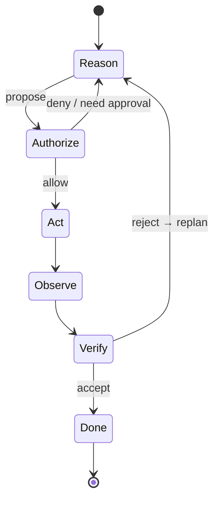
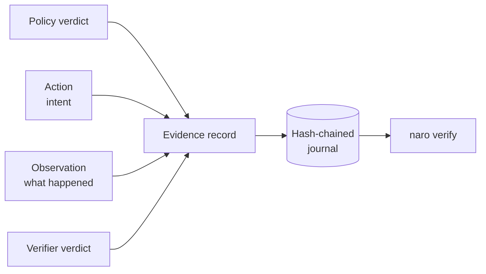
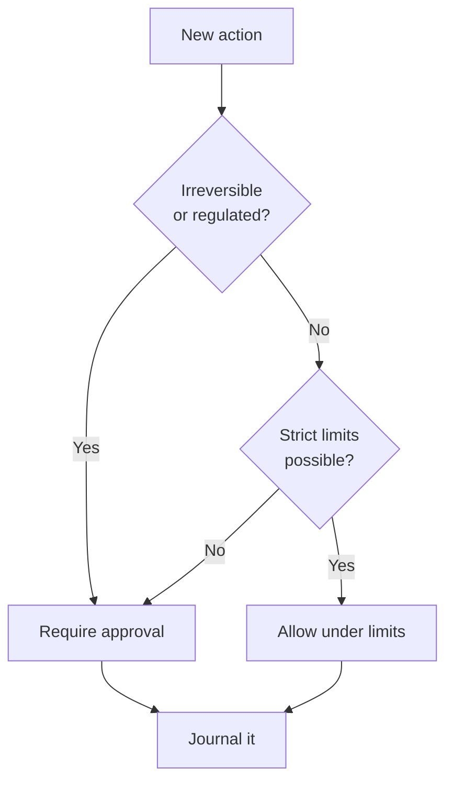

<div align="center">

# Naro

### The agent runtime that refuses to trust the model

**Authorize. Execute. Verify. Audit.**  
Every action is gated. Every outcome is proven. Every run is immutable.

[](LICENSE)
[](package.json)
[](https://github.com/balureddy003/Naro/stargazers)

[Get started in 2 minutes](#quickstart) · [Why this exists](#why-naro) · [AI System Engineering Guide](docs/guide/README.md) · [Roadmap](ROADMAP.md)

</div>

---

Most agent projects die between the demo and production.  
Not because the model is bad — because nothing forces authorization, verification, or audit.

**Naro makes those things structural.**

### The loop



### Evidence flow



The model proposes.  
The runtime authorizes, executes, observes, and only then accepts the result.

## Why Naro

| You keep hitting this | Naro does this instead |
|-----------------------|------------------------|
| Agents that can self-authorize | Required policy gate on every action |
| “It worked in the demo” | Verification is a runtime state + evidence record |
| No way to prove what happened | Hash-chained journal + `naro verify` |
| Prompt injection triggers side effects | Provenance-aware denials |
| Silent regressions | `naro bench --baseline` fails the build |

> **New:** [AI System Engineering Guide](docs/guide/README.md)  
> Patterns, architecture decisions, production-gap mapping, and a full AI SDLC. Naro is the reference implementation.

## Autonomy in one diagram



## Quickstart

```bash
git clone https://github.com/balureddy003/Naro.git
cd Naro
npm install
npm run example      # watch a full safe loop
```

```ts
const runner = new AgentRunner({
  spec: createAgentSpec({ name: 'my-agent', goal }),
  reasoner,
  executor,
  policy: createToolPolicy(registry),  // required
  verifier,                            // completion is a claim until this passes
});
await runner.run();
```

## How it’s different

| | Orchestration frameworks | Security kernels | Harness SDKs | **Naro** |
|---|---|---|---|---|
| Loop | yes | middleware | fixed | **17-state machine** |
| Policy | opt-in | yes | vendor | **required** |
| Verification | you build it | no | no | **runtime state** |
| Intent vs evidence | mixed | audit log | mixed | **separated** |
| CI regression gate | external | no | no | **built-in** |

## Start here

- [AI System Engineering Guide](docs/guide/README.md) — patterns + production gaps + SDLC
- [Build your first safe agent](docs/getting-started.md) — 15 minutes
- [Architecture](docs/architecture.md) · [Use cases](docs/use-cases.md)
- [Roadmap](ROADMAP.md) — closing the execution gaps
- [Analyst briefings](docs/analyst/) — Forrester & Gartner-style mappings

## Star it. Clone it. Ship safer agents.

If this solves a problem you’ve hit:

**→ [Star the repo](https://github.com/balureddy003/Naro)**  
**→ [Contribute](CONTRIBUTING.md)** (docs, examples, profiles, and adapters welcome)

---

Apache-2.0 · Node 24+ · Actively developed
