# Naro Architecture

This document moves from the system boundary to the code that enforces it. Read
as far as your role requires:

1. **System view** — what Naro is, who interacts with it, and where trust ends.
2. **Package view** — how the repository is divided and which dependencies are
   allowed.
3. **Runtime view** — how one agent run makes progress.
4. **Mechanism views** — policy, tools, context, memory, verification,
   observability, recovery, and delegation.
5. **Code view** — the contracts and invariants contributors must preserve.

The diagrams describe the implementation in this repository. Future deployment
options are labeled as such.

---

## 1. Architectural thesis

Naro is a domain-neutral execution kernel for autonomous agents. It does not
put model prompts, vendor SDKs, tools, storage engines, or domain behavior in
the kernel. Instead, it coordinates a small vocabulary:

```text
Goal → Reason → Decide → Authorize → Act → Observe → Verify → Replan
```

Three choices shape the architecture:

- **The runtime owns control.** A model may propose a decision; it never changes
  runtime state or executes a capability directly.
- **Intent and evidence stay separate.** An `Action` records what was attempted.
  An `Observation` records what happened.
- **External technology sits behind contracts.** Models, tools, environments,
  context sources, memory stores, policies, checkpoints, event exporters, and
  agent transports are replaceable at package boundaries.

The result is a single-agent kernel that can support a coding agent, research
agent, browser operator, data workflow, or robot controller without learning
those domains itself.

---

## 2. Level 1 — system context

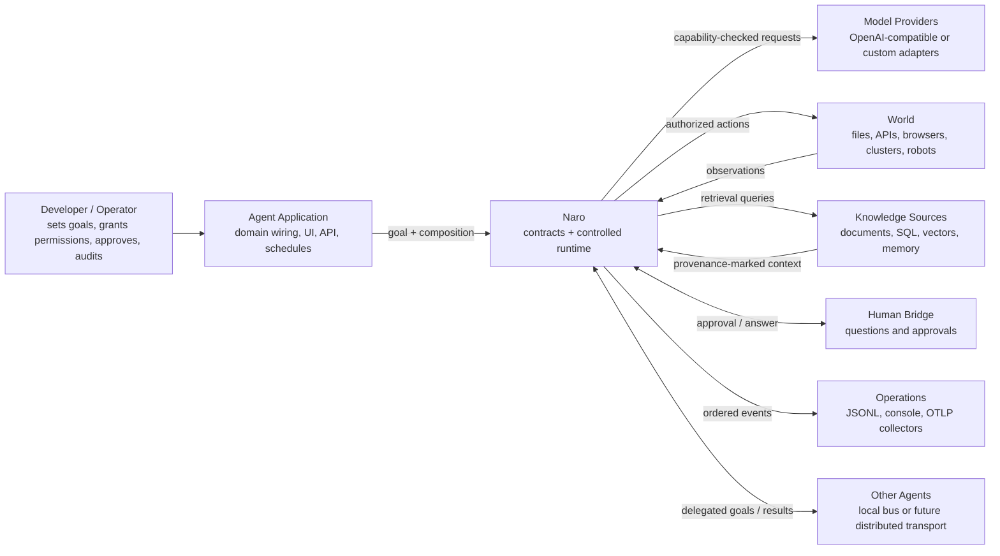

### System boundary

Naro owns the execution protocol: state transitions, policy placement, action
routing, observations, verification, checkpoints, and events. The application
owns the domain composition: which model, tools, grants, policies, stores,
humans, and success criteria are appropriate.

### Trust boundaries

| Boundary | Treat as untrusted | Enforcement point |
|---|---|---|
| user → application | goals, text, uploaded content | application validation and policy |
| model → runtime | decisions, tool names, arguments, completion claims | closed `Decision` union, schemas, policy, verifier |
| source → context | retrieved text and metadata | provenance, source filtering, context budget |
| tool/environment → runtime | outputs, errors, external state | output schema, `Observation`, verifier |
| agent → agent | delegated goals and returned results | delegation tool, grants, policy, result verification |
| runtime → telemetry | potentially sensitive events | exporter configuration, redaction, retention |

A prompt role, model refusal, or tool description is not an authorization
boundary. Permission comes from runtime configuration and `PolicyEngine`.

---

## 3. Level 2 — package architecture

Packages are grouped by responsibility rather than deployment process. `core`
is the stable center; orchestration and integrations depend inward on its
contracts.

```mermaid
flowchart TB
    subgraph kernel["Kernel contracts"]
        core["@naro/core\ndomain types, ports, events, state machine"]
    end

    subgraph execution["Execution"]
        runtime["@naro/runtime\nrunner, event bus, checkpoints, retry, timeout"]
        tools["@naro/tools\nregistry, schemas, tool executor, baseline policy"]
        environment["@naro/environment\nenvironment contract and in-memory world"]
    end

    subgraph intelligence["Intelligence and knowledge"]
        model["@naro/model\nprovider-neutral model contract"]
        reasoning["@naro/reasoning\nReAct, Plan-Execute, Reflection"]
        context["@naro/context\nretrieve, rank, select, budget"]
        memory["@naro/memory\ntiered stores and recall"]
    end

    subgraph assurance["Assurance and operations"]
        policy["@naro/policy\nordered rules, audit, local limits"]
        verification["@naro/verification\nschema, predicate, command, human, judge"]
        observability["@naro/observability\nmetrics and event exporters"]
        evaluation["@naro/evaluation\nbenchmark runner"]
    end

    subgraph coordination["Coordination"]
        multiagent["@naro/multiagent\ndirectory, bus, delegation tool"]
    end

    subgraph profiles["Domain profiles"]
        coding["@naro/profile-coding\nworkspace env + coding tools"]
        research["@naro/profile-research\nfetch + citations"]
        browser["@naro/profile-browser\nBrowserDriver port + Playwright"]
    end

    subgraph adapters["Edge adapters"]
        openai["@naro/adapter-openai"]
        mcp["@naro/adapter-mcp"]
        otel["@naro/adapter-otel"]
        opa["@naro/adapter-opa"]
    end

    runtime --> core
    model --> core
    tools --> core
    environment --> core
    context --> core
    memory --> core
    policy --> core
    observability --> core

    reasoning --> core
    reasoning --> model
    verification --> core
    verification --> model
    verification --> tools
    evaluation --> core
    evaluation --> runtime
    evaluation --> observability
    multiagent --> core
    multiagent --> tools

    openai --> model
    openai --> core
    mcp --> tools
    mcp --> core
    otel --> observability
    otel --> core
    opa --> core

    coding --> environment
    coding --> tools
    coding --> core
    research --> environment
    research --> tools
    research --> core
    browser --> environment
    browser --> tools
    browser --> core
    otel --> core
```

### Package responsibilities

| Package | Owns | Must not own |
|---|---|---|
| `@naro/core` | universal types, ports, state topology, event vocabulary | providers, storage, prompts, domain logic |
| `@naro/runtime` | one run's mutable state and legal progression | model or tool implementation details |
| `@naro/model` | canonical messages and capability-gated model API | provider wire types |
| `@naro/tools` | tool contracts, discovery, schema validation, execution | runtime state transitions |
| `@naro/environment` | a world-facing `ActionExecutor` contract | reasoning or policy decisions |
| `@naro/context` | retrieval orchestration and hard context budgets | source-specific storage technology |
| `@naro/memory` | memory entries, tiers, recall, included stores | deciding what deserves to be remembered |
| `@naro/reasoning` | translating reasoning context and model output into decisions | executing actions directly |
| `@naro/policy` | ordered policy predicates, local limits, policy audit | tool execution |
| `@naro/verification` | concrete evidence checks | declaring its own completion |
| `@naro/observability` | event-derived metrics and export contracts | a second execution state |
| `@naro/evaluation` | repeatable cases over the real runtime | an evaluation-only runtime fork |
| `@naro/multiagent` | addressing and delegation at the edge | multi-agent types in the kernel |
| adapters | translation to external protocols | provider-specific types in public core contracts |

---

## 4. Level 3 — runtime composition

`AgentRunner` is the composition root for one run. Dependencies are injected;
the runner does not construct models, registries, databases, or policies.

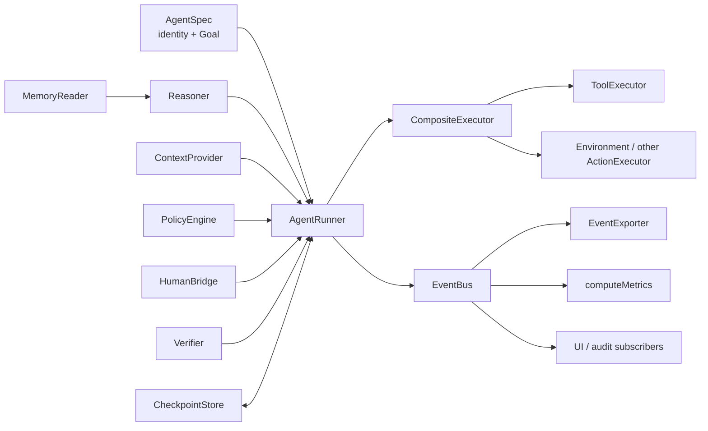

### Runtime-owned state

A runner owns these values for one agent run:

- current `AgentState`;
- task map and task status;
- ordered observations;
- retrieved context items;
- reasoning iteration count;
- pause request;
- ordered event history.

The reasoner receives a read-only `ReasoningContext`. It returns a `Decision`;
it does not mutate runner state.

---

## 5. Core domain model

| Concept | Meaning | Architectural role |
|---|---|---|
| `Goal` | desired outcome and success criteria | stable purpose of a run |
| `Task` | decomposed work with owner and dependencies | visible plan and progress |
| `Decision` | one request from a reasoner to the runtime | closed control protocol |
| `Action` | intent to inspect or change a target | policy and execution unit |
| `Observation` | evidence returned by action, human, verifier, or runtime | input to future reasoning |
| `ContextItem` | retrieved evidence with source and optional score | bounded, attributable context |
| `MemoryHit` | recalled information from longer-lived storage | optional reasoning input |
| `Verification` | `ok`, evidence, and reason | separates claims from proof |
| `NaroEvent` | immutable typed fact ordered within a run | audit and observability vocabulary |

### The closed decision protocol

```ts
Decision =
  | plan(tasks)
  | act(action)
  | need-context(query)
  | wait-for-human(question)
  | complete(result)
  | fail(reason)
```

Keeping this union closed is the main plug-in boundary. ReAct, Plan-Execute,
Reflection, deterministic rules, or a human-controlled reasoner all speak the
same protocol. A new reasoning strategy should not require a new runtime branch
unless it introduces a genuinely universal operation.

---

## 6. Runtime state machine

Naro uses 17 explicit states. `assertTransition` checks every normal state
change against the transition table in `@naro/core`.

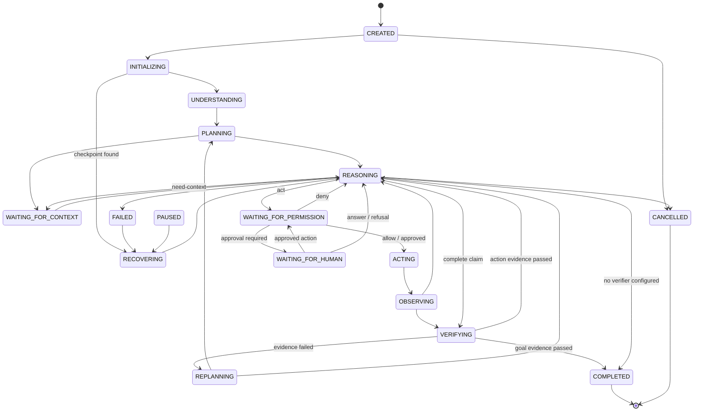

The diagram highlights the normal paths; the source transition table also
allows failure, cancellation, and pause from safe runtime boundaries.

### State invariants

1. `REASONING → ACTING` is illegal. Every action crosses
   `WAITING_FOR_PERMISSION`.
2. `COMPLETED` and `CANCELLED` are terminal.
3. `FAILED` and `PAUSED` resume only through `RECOVERING`.
4. `maxIterations` bounds the reasoning loop; the default is 64.
5. Tool and environment failures normally become observations instead of
   escaping the action boundary.

---

## 7. Dynamic view — one action cycle

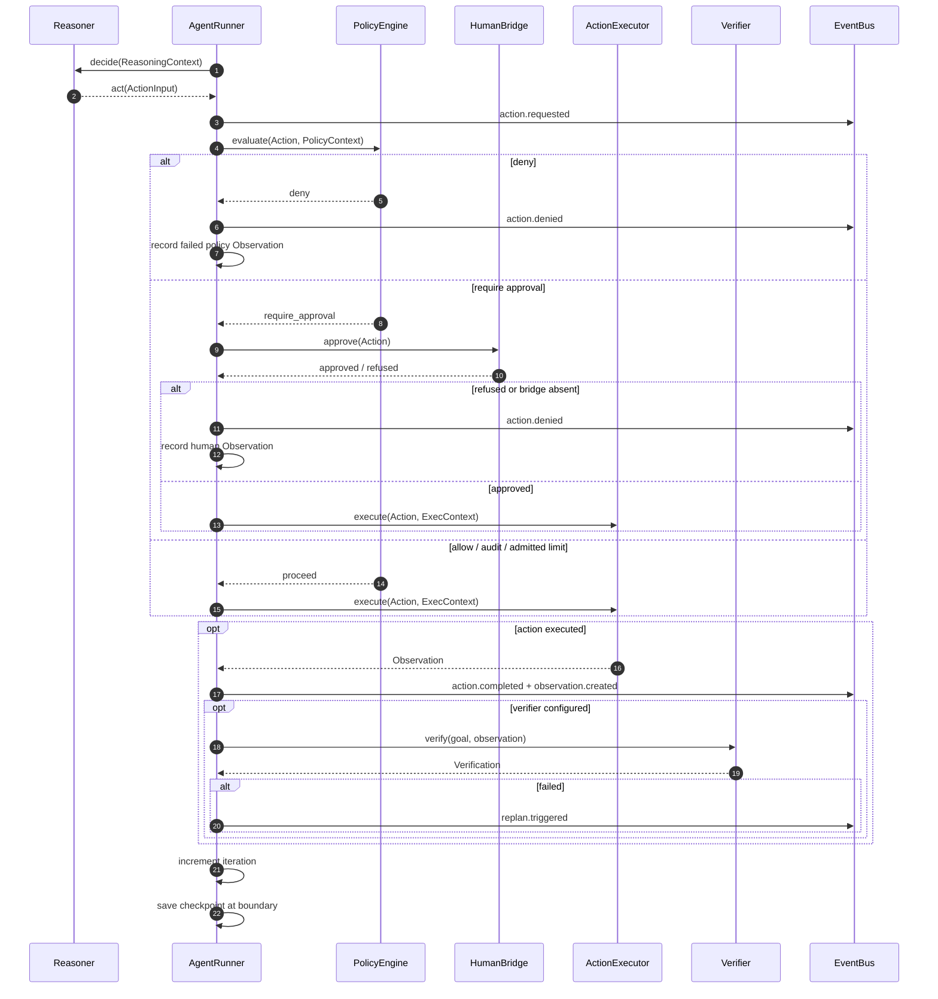

`limit` and `audit` are policy-engine concerns. A limit rule returns `deny` once
its quota is exhausted; an audit rule records its own audit entry and lets the
runtime proceed.

---

## 8. Action routing and tool execution

The runtime sees only `ActionExecutor`. `CompositeExecutor` routes by target URI
prefix, which keeps domains out of the runner.

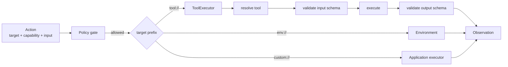

Tool metadata carries schemas, required permissions, and a side-effect class.
`createToolPolicy()` can derive a baseline decision from that metadata. Remote
MCP tools enter through `ToolSource` and then use the same registry, policy, and
executor path as local tools.

---

## 9. Context and memory

Context and memory are related but not interchangeable.

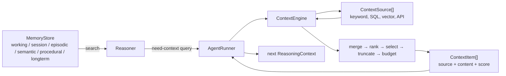

`ContextEngine` enforces item and character budgets before content reaches the
reasoner. `MemoryReader` is deliberately read-only from the reasoner's point of
view; deciding what to write is a strategy or application concern, not a side
effect of recall.

Provenance must travel with context and memory. It supports citation, tenant
filtering, injection analysis, and debugging.

---

## 10. Completion and verification

A model's `complete` decision is a claim. When a verifier is configured, the
runtime checks that claim before entering `COMPLETED`.

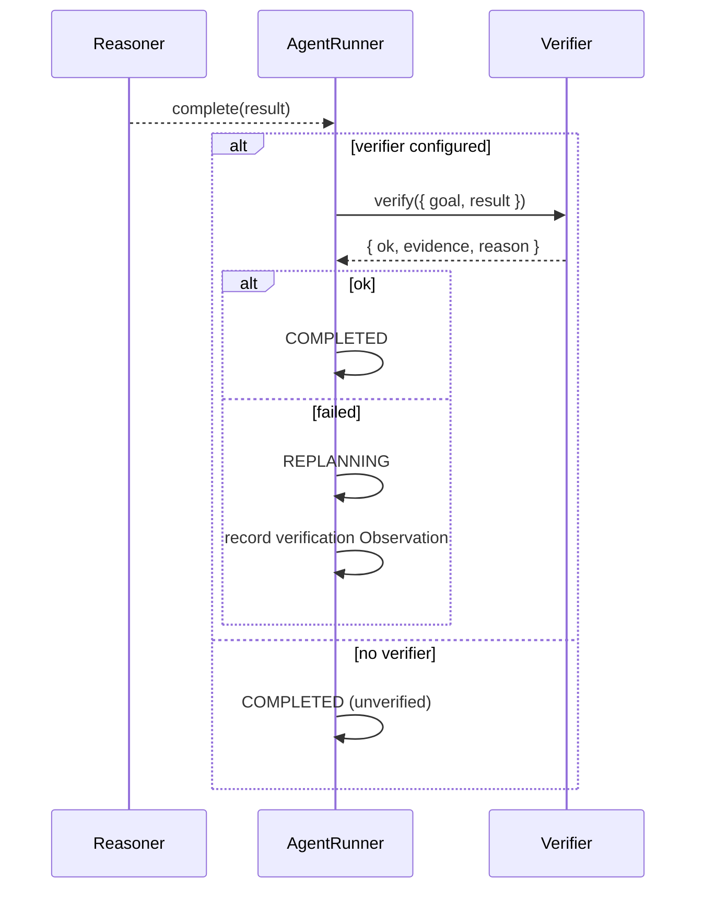

`@naro/verification` provides schema, predicate, command, human, composite, and
LLM-judge implementations. Deterministic evidence should be preferred over an
LLM judge. `CommandVerifier` is a code-execution boundary and must receive only
trusted commands.

---

## 11. Events, observability, and evaluation

Every event has an ID, type, per-run sequence number, timestamp, agent ID, goal
ID, and typed payload.

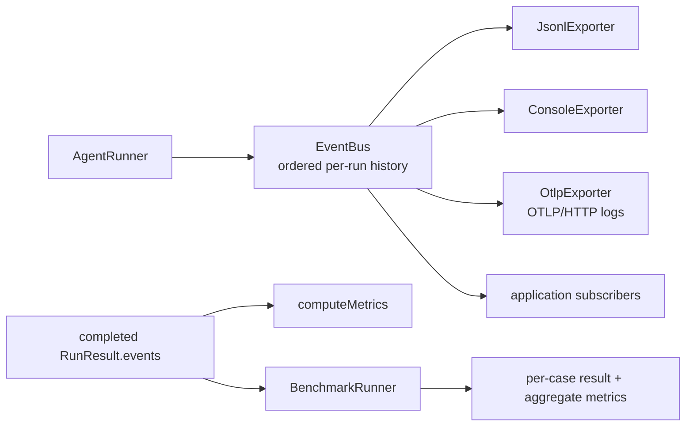

Observability derives interpretation from the event stream rather than keeping
a second hidden state. JSONL and OTLP exporters serialize writes and expose
`flush()` so callers can wait for delivery before process exit.

The current OTLP adapter maps events to log records, not spans. The event model
contains ordered facts but does not yet carry honest parent/child span timing.

`BenchmarkRunner` executes real `AgentRunner` instances. Evaluation therefore
uses the same state machine, policies, tools, and events as production code.

---

## 12. Checkpoint and recovery model

A checkpoint stores iteration, tasks, observations, and retrieved context. It
is written after a continued reasoning cycle, never during executor work.

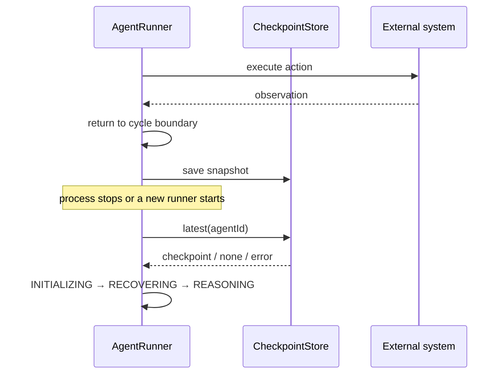

Recovery restores Naro's recorded state; it cannot roll back or infer an
external side effect that completed before its observation was checkpointed.
Production tools therefore need idempotency keys, reconciliation, or durable
external operation IDs.

Included stores are in-memory and append-only JSONL files. A production store
can implement `CheckpointStore` with transactional persistence. Missing files
mean no checkpoint; corrupt checkpoint data fails rather than silently starting
a fresh run.

---

## 13. Multi-agent coordination

The kernel remains single-agent. Coordination is implemented at the edge by
turning delegation into a normal tool.

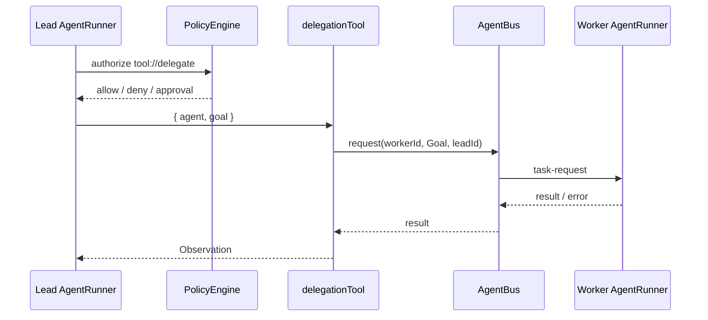

`AgentDirectory` advertises agent capabilities. `AgentBus` defines request and
serve operations. `InMemoryAgentBus` is process-local and non-durable; a timed
out handler may continue running. A persistent queue, HTTP, gRPC, or A2A adapter
can implement the same contract.

Delegation requires the `agent.delegate` permission and remains visible to
policy and audit. Returned agent output is still untrusted and should be
verified by the caller.

---

## 14. Deployment views

Naro packages are libraries, so deployment topology belongs to the application.
Two common shapes are shown below.

### Single-process development

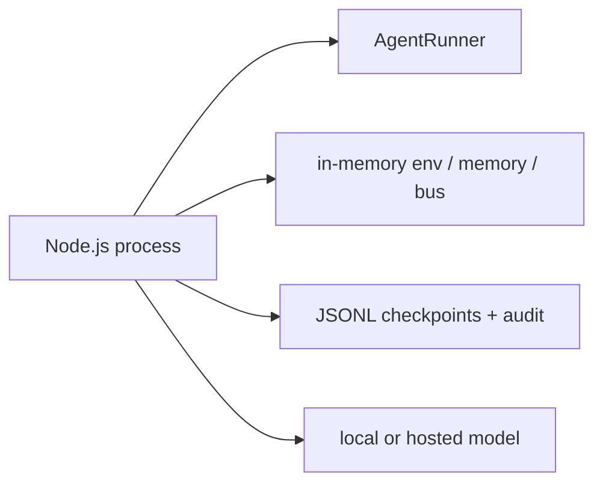

This shape is appropriate for examples, tests, local automation, and controlled
single-user workflows.

### Supervised production service

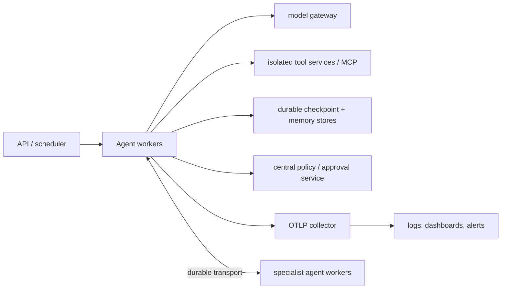

Naro currently supplies contracts and local reference implementations for many
of these edges. Durable queues, distributed locks, centralized secrets,
tenant isolation, and service authentication remain deployment responsibilities.

---

## 15. Code-level extension rules

Use this table before adding a type or package.

| Change | Correct home |
|---|---|
| universal agent noun or port | `core` |
| state progression or run lifecycle | `runtime` |
| provider-neutral model vocabulary | `model` |
| reasoning strategy or prompt assembly | `reasoning` |
| local/remote capability contract | `tools` or an adapter |
| domain world implementation | `environment` or application package |
| retrieval orchestration | `context` |
| persistence and recall | `memory` |
| authorization rule implementation | `policy` or policy adapter |
| evidence check | `verification` |
| metrics or event sink | `observability` or exporter adapter |
| benchmark orchestration | `evaluation` |
| cross-agent transport | `multiagent` adapter |
| vendor protocol translation | `adapters/*` |

### Review invariants

A change is architecturally acceptable only if these remain true:

1. **Core stays domain- and vendor-neutral.**
2. **The runtime is the only owner of agent state transitions.**
3. **Every action passes policy before execution.**
4. **Reasoners return decisions; they do not execute capabilities.**
5. **Actions and observations remain separate.**
6. **Failures stay visible as observations, events, or terminal results.**
7. **Optional capabilities are declared and checked, never guessed.**
8. **Context and memory retain provenance and scope.**
9. **Completion is verified when evidence matters.**
10. **Adapters translate protocols without leaking vendor types inward.**
11. **Loops, retries, context, and external calls are bounded.**
12. **Documentation distinguishes included implementations from deployment
    responsibilities.**

---

## 16. Current architectural limits

These are deliberate implementation boundaries, not hidden guarantees:

- `AgentRunner` falls back to `allowAllPolicy` when no policy is supplied.
  Production composition should provide an explicit deny-by-default policy.
- `withTimeout()` stops waiting but does not cancel underlying work unless the
  executor also honors an `AbortSignal`.
- file checkpoints and memory stores are reference implementations, not
  transactional multi-process stores.
- in-process policy limits and the agent bus are not distributed.
- event history supports audit and derived metrics; deterministic replay of
  external side effects requires application-level fixtures or adapters.
- OTLP export currently emits logs rather than a parented span graph.
- `BenchmarkRunner` runs cases sequentially once; repeated sampling and
  statistical comparison belong to a higher-level evaluation workflow.

Naming these limits is part of the architecture. It tells application teams
where they can rely on Naro and where production infrastructure must take over.

---

## Related reading

- [Design principles](principles.md)
- [How LLMs work](learn/00-how-llms-work.md)
- [Agent loops and state machines](learn/08-agent-loops.md)
- [Evaluation](learn/10-evaluation.md)
- [Security and policy](learn/11-security-and-policy.md)
- [Scale and reliability](learn/12-scale-and-reliability.md)
