# Naro Architecture

This document moves from the system boundary to the code that enforces it. Read
as far as your role requires:

1. **System view** — what Naro is, who interacts with it, and where trust ends.
2. **Package view** — how the repository is divided and which dependencies are
   allowed.
3. **Runtime view** — how one agent run makes progress.
4. **Mechanism views** — policy, tools, context, memory, verification,
   observability, recovery, and delegation.
5. **Code view** — the contracts and invariants contributors must preserve.

The diagrams describe the implementation in this repository, not a planned
future state — where a capability is a deployment responsibility rather than
something Naro supplies, the text says so explicitly (§14, §16).

---

## 1. Architectural thesis

Naro is a domain-neutral execution kernel for autonomous agents. It does not
put model prompts, vendor SDKs, tools, storage engines, or domain behavior in
the kernel. Instead, it coordinates a small vocabulary:

```text
Goal → Reason → Decide → Authorize → Act → Observe → Verify → Replan
```

Three choices shape the architecture:

- **The runtime owns control.** A model may propose a decision; it never changes
  runtime state or executes a capability directly.
- **Intent and evidence stay separate.** An `Action` records what was attempted.
  An `Observation` records what happened.
- **External technology sits behind contracts.** Models, tools, environments,
  context sources, memory stores, policies, checkpoints, event exporters, and
  agent transports are replaceable at package boundaries.

The result is a single-agent kernel that can support a coding agent, research
agent, browser operator, data workflow, or robot controller without learning
those domains itself.

This decomposition matches the brain / hands / session separation described in
Anthropic's [Scaling Managed Agents](https://www.anthropic.com/engineering/managed-agents):
the runner and reasoner are the brain, `Environment.execute` and
`ActionExecutor` are the hands, and the event journal is the session. The
boundaries are real, not just conceptual: `serveEnvironment`/`HttpEnvironment`
put the hands in another process or host behind the same contract
([ADR 0008](adr/0008-environments-are-reachable-over-http.md)), and
`AgentRunner.wake()` rebuilds the session from the journal alone — checkpoints
are an optimization, not a requirement
([ADR 0007](adr/0007-journal-is-the-source-of-truth-for-session-state.md)).

---

## 2. Level 1 — system context

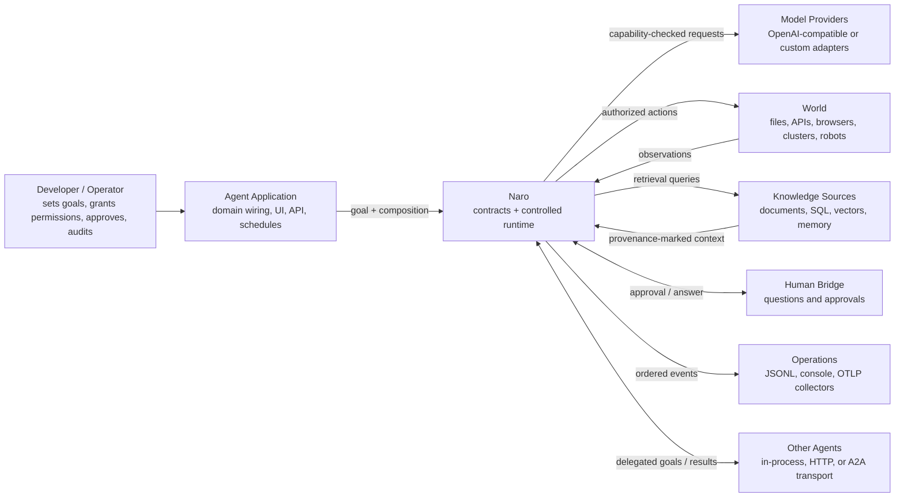

### System boundary

Naro owns the execution protocol: state transitions, policy placement, action
routing, observations, verification, checkpoints, and events. The application
owns the domain composition: which model, tools, grants, policies, stores,
humans, and success criteria are appropriate.

### Trust boundaries

| Boundary | Treat as untrusted | Enforcement point |
|---|---|---|
| user → application | goals, text, uploaded content | application validation and policy |
| model → runtime | decisions, tool names, arguments, completion claims | closed `Decision` union, schemas, policy, verifier |
| source → context | retrieved text and metadata | provenance, source filtering, context budget |
| tool/environment → runtime | outputs, errors, external state | output schema, `Observation`, verifier |
| agent → agent | delegated goals and returned results | delegation tool, grants, policy, result verification |
| runtime → telemetry | potentially sensitive events | exporter configuration, redaction, retention |

A prompt role, model refusal, or tool description is not an authorization
boundary. Permission comes from runtime configuration and `PolicyEngine`.

### Provenance is a policy input, not just a transcript label

The "source → context" row above is more than a delimiter convention.
`Observation.trust` (`system | tool | external`) is stamped at the point an
observation is created, and `ctx.provenance` — the lowest trust level the
reasoner has read since its last decision — is passed to `PolicyEngine` at
the gate. `createToolPolicy({ denyExternalTriggered })` uses it to deny a
side effect whose triggering evidence came from outside the system, even
when the model itself decided to take that action. This turns prompt
injection into a kernel-enforced control instead of a prompt-engineering
suggestion: the policy engine sees where the evidence came from, not only
what the model asked to do. `npm run example:research` demonstrates it.
See [ADR 0010](adr/0010-provenance-is-a-policy-input.md).

---

## 3. Level 2 — package architecture

Packages are grouped by responsibility rather than deployment process. `core`
is the stable center; orchestration and integrations depend inward on its
contracts. Domain profiles are reusable applications of the contracts, while
adapters translate external wire protocols. See [End-to-end use cases](use-cases.md)
for complete compositions.

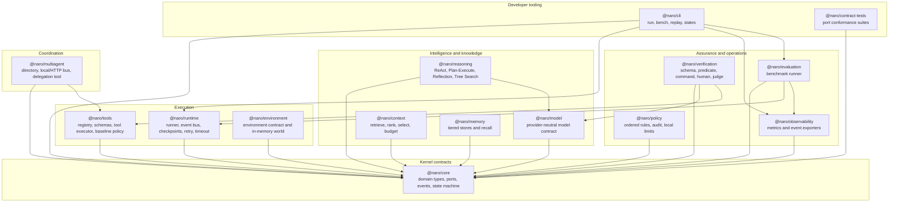

Domain profiles and edge adapters are lower-variance than the diagram above
— every profile depends on the same three packages, and most adapters
translate one protocol into `core`/`model`/`tools` — so they're tables, not
more flowchart, below.

### Domain profiles

Every profile has the identical shape: a domain `Environment`, domain
`Tool`s built on it, and nothing else.

| Profile | Distinctive capability | Depends on |
|---|---|---|
| `@naro/profile-coding` | workspace env + coding tools | `environment`, `tools`, `core` |
| `@naro/profile-research` | fetch + citations | `environment`, `tools`, `core` |
| `@naro/profile-browser` | `BrowserDriver` port + Playwright | `environment`, `tools`, `core` |
| `@naro/profile-data` | SQL env + `node:sqlite` | `environment`, `tools`, `core` |
| `@naro/profile-devops` | runbook registry + probes | `environment`, `tools`, `core` |
| `@naro/profile-workflow` | DAG runner | `environment`, `tools`, `core` |
| `@naro/profile-robotics` | `RobotDriver` port + estop latch | `environment`, `tools`, `core` |

### Edge adapters

Most adapters translate one external protocol into one Naro contract. Two
don't fit that shape — see the note after the table.

| Adapter | Translates | Depends on |
|---|---|---|
| `@naro/adapter-openai` | OpenAI-compatible model API | `model`, `core` |
| `@naro/adapter-anthropic` | Anthropic Messages API | `model`, `core` |
| `@naro/adapter-gemini` | Gemini `generateContent` | `model`, `core` |
| `@naro/adapter-mcp` | MCP tool discovery | `tools`, `core` |
| `@naro/adapter-opa` | OPA/Rego policy decisions | `core` |
| `@naro/adapter-otel` | OTLP/HTTP log export | `observability`, `core` |
| `@naro/adapter-a2a` | A2A agent cards + JSON-RPC task send | `multiagent`, `core` |
| `@naro/adapter-pg` | Postgres — six ports at once (below) | `runtime`, `multiagent`, `memory`, `policy`, `observability`, `core` |
| `@naro/adapter-harness` | *nothing* — governs a foreign harness's own hooks | `runtime`, `core` |

`@naro/adapter-pg` implements `CheckpointStore`, `EventStore`/
`EventExporter`, `MemoryStore`, `LeaseStore`, `LimitStore`, and `AgentBus` on
Postgres — one package, six ports, because multi-host durability is one
deployment concern even though the kernel models it as several contracts.
`@naro/adapter-harness` translates no protocol at all: it runs the policy
gate and journal *beneath* a foreign agent loop (Claude Agent SDK, OpenCode)
via that harness's own tool-call hooks, rather than owning a loop itself.
See §14 and [ADR 0009](adr/0009-governance-beneath-foreign-harnesses.md).

### Package responsibilities

| Package | Owns | Must not own |
|---|---|---|
| `@naro/core` | universal types, ports, state topology, event vocabulary | providers, storage, prompts, domain logic |
| `@naro/runtime` | one run's mutable state and legal progression | model or tool implementation details |
| `@naro/model` | canonical messages and capability-gated model API | provider wire types |
| `@naro/tools` | tool contracts, discovery, schema validation, execution | runtime state transitions |
| `@naro/environment` | a world-facing `ActionExecutor` contract | reasoning or policy decisions |
| `@naro/context` | retrieval orchestration and hard context budgets | source-specific storage technology |
| `@naro/memory` | memory entries, tiers, recall, included stores | deciding what deserves to be remembered |
| `@naro/reasoning` | translating reasoning context and model output into decisions | executing actions directly |
| `@naro/policy` | ordered policy predicates, local limits, policy audit | tool execution |
| `@naro/verification` | concrete evidence checks | declaring its own completion |
| `@naro/observability` | event-derived metrics and export contracts | a second execution state |
| `@naro/evaluation` | repeatable cases over the real runtime | an evaluation-only runtime fork |
| `@naro/multiagent` | agent directory, local/HTTP transport, policy-gated delegation | multi-agent types in the kernel |
| `@naro/contract-tests` | reusable behavioral suites for replaceable ports | production runtime behavior |
| `@naro/cli` | run, benchmark, baseline diff, replay, and state inspection commands | hidden agent composition |
| `@naro/profile-*` | domain environments, tools, drivers, and safety constraints | domain concepts in core |
| adapters | translation to model, tool, policy, telemetry, storage, and agent protocols | vendor-specific types in public core contracts |

---

## 4. Level 3 — runtime composition

`AgentRunner` is the composition root for one run. Dependencies are injected;
the runner does not construct models, registries, databases, or policies.

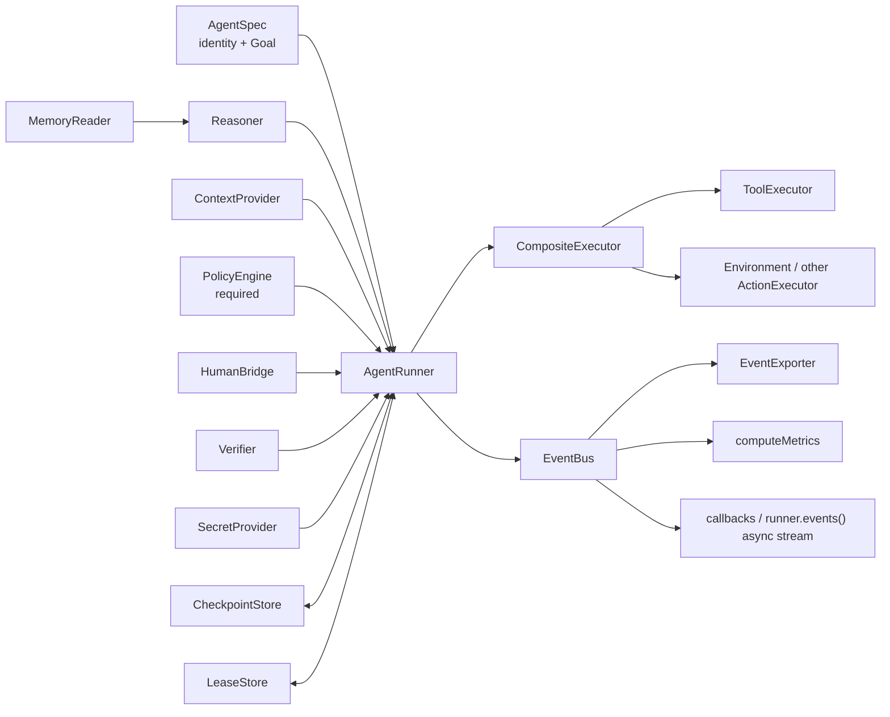

### Runtime-owned state

A runner owns these values for one agent run:

- current `AgentState`;
- task map and task status;
- ordered actions and observations;
- retrieved context items;
- reasoning iteration and accumulated model usage;
- stable run ID and event sequence;
- pause request;
- immutable ordered event history.

The reasoner receives a read-only `ReasoningContext`. It returns a `Decision`;
it does not mutate runner state. Consumers may subscribe with `runner.on()` or
iterate `runner.events()`. The async iterable starts with existing history,
continues live, and closes after completion, failure, cancellation, or pause.

---

## 5. Core domain model

| Concept | Meaning | Architectural role |
|---|---|---|
| `Goal` | desired outcome and success criteria | stable purpose of a run |
| `Task` | decomposed work with owner and dependencies | visible plan and progress |
| `Decision` | one request from a reasoner to the runtime | closed control protocol |
| `Action` | intent to inspect or change a target | policy and execution unit |
| `Observation` | evidence returned by action, human, verifier, or runtime | input to future reasoning |
| `ContextItem` | retrieved evidence with source and optional score | bounded, attributable context |
| `MemoryHit` | recalled information from longer-lived storage | optional reasoning input |
| `Verification` | `ok`, evidence, and reason | separates claims from proof |
| `NaroEvent` | immutable typed fact ordered within a run | audit and observability vocabulary |

### The closed decision protocol

```ts
Decision =
  | plan(tasks)
  | act(action)
  | act-batch(actions)
  | need-context(query)
  | wait-for-human(question)
  | complete(result)
  | fail(reason)
```

Each decision may carry model usage. `act-batch` expresses independent actions
from one reasoning cycle: policy and approval stay serial, then authorized
actions execute concurrently. Keeping this union closed is the main plug-in
boundary. ReAct, Plan-Execute, Reflection, tree search, deterministic rules, or
a human-controlled reasoner all speak the same protocol. A new reasoning strategy should not require a new runtime branch
unless it introduces a genuinely universal operation.

---

## 6. Runtime state machine

Naro uses 17 explicit states. `assertTransition` checks every normal state
change against the transition table in `@naro/core`.

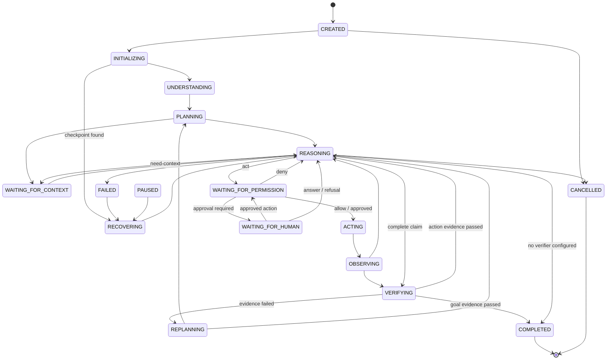

The diagram highlights the normal paths; the source transition table also
allows failure, cancellation, and pause from safe runtime boundaries.

### State invariants

1. `REASONING → ACTING` is illegal. Every action crosses
   `WAITING_FOR_PERMISSION`, and `AgentRunner` requires a policy dependency.
2. When configured, a runner lease is acquired during initialization so a
   second process cannot execute the same agent concurrently.
3. `COMPLETED` and `CANCELLED` are terminal.
4. `FAILED` and `PAUSED` resume only through `RECOVERING`.
5. `maxIterations` bounds the reasoning loop; the default is 64.
6. Tool and environment failures normally become observations instead of
   escaping the action boundary.

---

## 7. Dynamic view — one action cycle

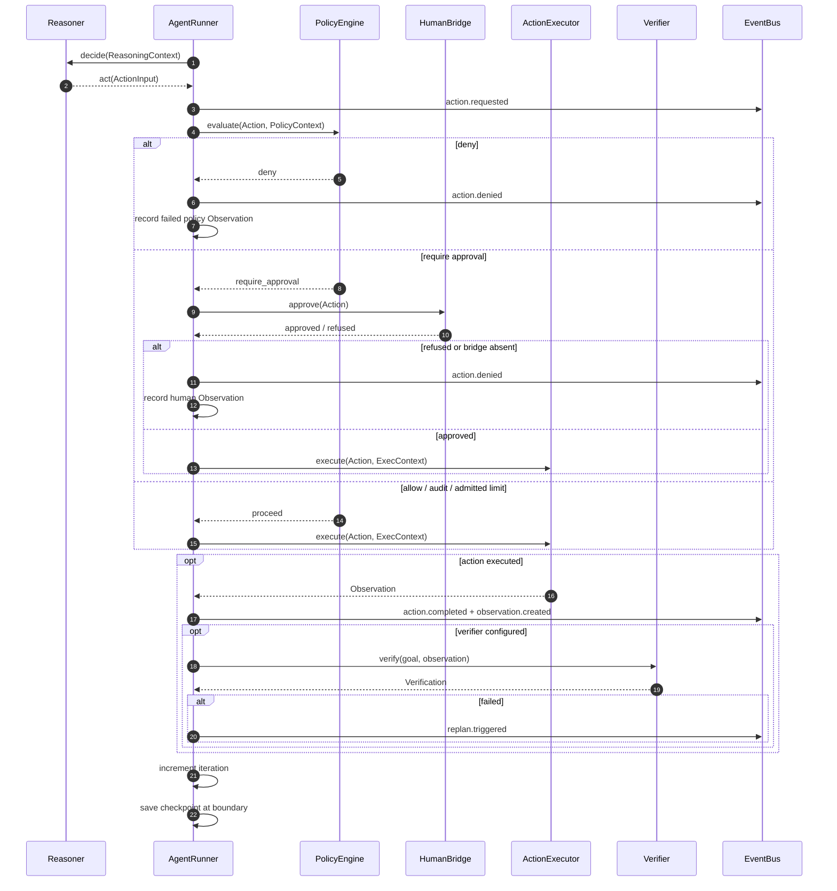

`limit` and `audit` are policy-engine concerns. A limit rule returns `deny` once
its quota is exhausted; an audit rule records its own audit entry and lets the
runtime proceed.

---

## 8. Action routing and tool execution

The runtime sees only `ActionExecutor`. `CompositeExecutor` routes by target URI
prefix, which keeps domains out of the runner.

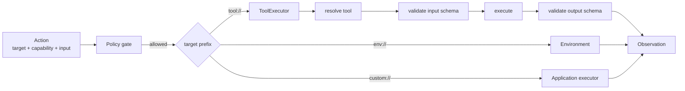

Tool metadata carries schemas, required permissions, and a side-effect class.
`createToolPolicy()` can derive a baseline decision from that metadata. Remote
MCP tools enter through `ToolSource` and then use the same registry, policy, and
executor path as local tools.

Each action receives an idempotency key. The default is deterministic for its
run and iteration, but the target system must store or enforce that key for a
retry to be safe.

`ExecContext` carries an abort signal, goal, grants, and an optional secret
resolver. Actions carry secret references such as `env:API_KEY`; executors
resolve values at the last responsible moment and must not return them in
observations.

`SandboxedExecutor` can run an executor module in a fresh worker thread with V8
heap limits and kill-on-timeout. This isolates crashes and resource exhaustion,
not operating-system syscalls. Hostile code still requires a container or
stronger process sandbox.

---

## 9. Context and memory

Context and memory are related but not interchangeable.

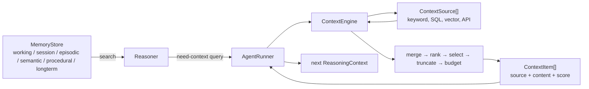

`ContextEngine` enforces item and character budgets before content reaches the
reasoner. `MemoryReader` is deliberately read-only from the reasoner's point of
view; deciding what to write is a strategy or application concern, not a side
effect of recall.

Provenance must travel with context and memory. It supports citation, tenant
filtering, injection analysis, and debugging.

---

## 10. Completion and verification

A model's `complete` decision is a claim. When a verifier is configured, the
runtime checks that claim before entering `COMPLETED`.

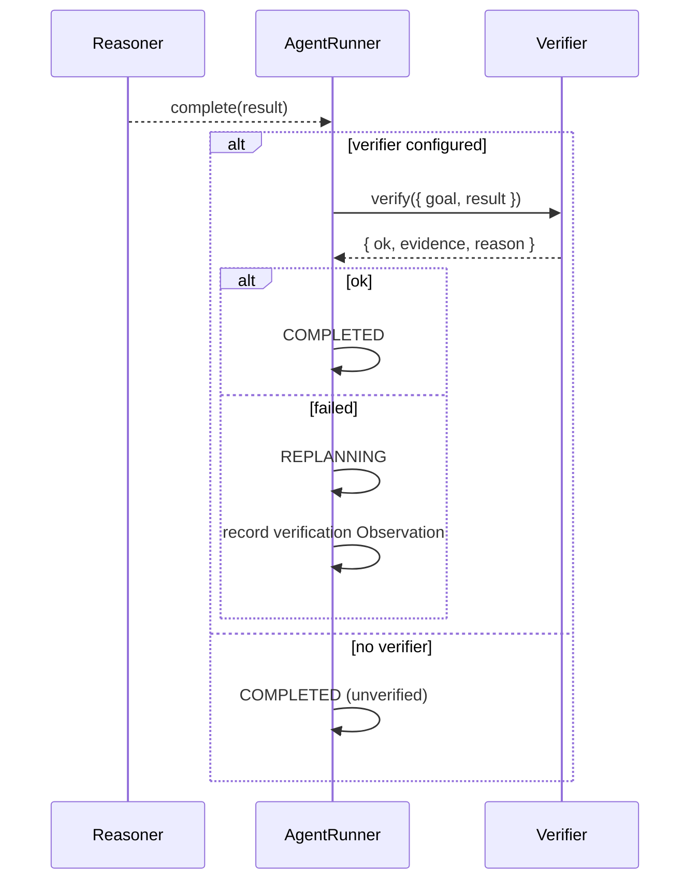

`@naro/verification` provides schema, predicate, command, human, composite, and
LLM-judge implementations. Deterministic evidence should be preferred over an
LLM judge. `CommandVerifier` is a code-execution boundary and must receive only
trusted commands.

---

## 11. Events, observability, and evaluation

Every event has an ID, type, per-run sequence number, timestamp, agent ID, goal
ID, and typed payload.

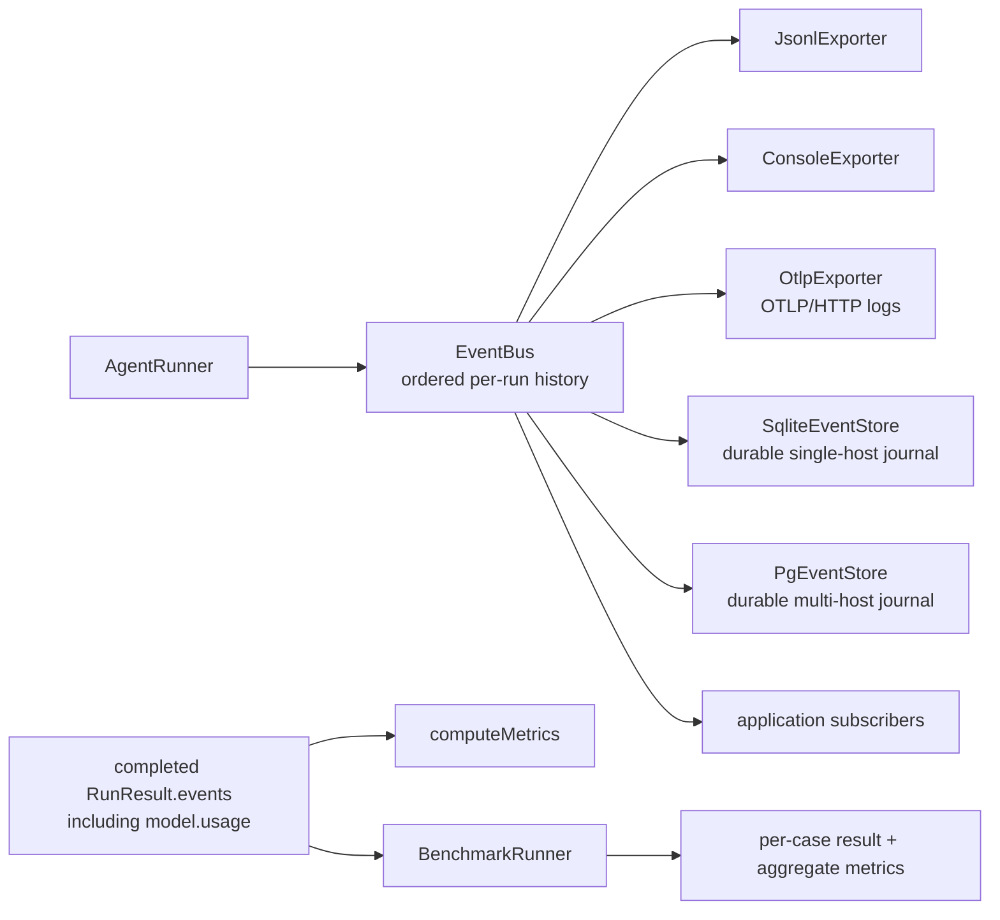

Observability derives interpretation from the event stream rather than keeping
a second hidden state. Event payloads are structured-cloned snapshots; every
event carries `runId` and monotonic `seq`. `SqliteEventStore` provides a
durable, queryable single-host journal; `PgEventStore` (`@naro/adapter-pg`) is
the same journal readable from any replica. JSONL and OTLP exporters
serialize writes and expose `flush()` so callers can wait for delivery before
process exit.

Each event also carries `prev` and `hash` — a SHA-256 chain computed in
`EventBus.emit()` over the event's canonical form (see
[ADR 0005](adr/0005-hash-chain-in-the-event-bus.md)). Checkpoints store the
chain head so a resumed run extends the same chain rather than starting a new
one. `verifyChain()` (`@naro/core`) recomputes a stored journal and reports
the first break; `buildEvidence()` (`@naro/observability`) joins the chain
verdict with per-action evidence (policy verdict → action → observation →
verifier verdict), and `naro verify <run.jsonl>` prints that record and exits
non-zero on a broken or unchained journal.

The current OTLP adapter maps events to log records, not spans. The event model
contains ordered facts but does not yet carry honest parent/child span timing.

`BenchmarkRunner` executes real `AgentRunner` instances. Evaluation therefore
uses the same state machine, policies, tools, and events as production code.
`JsonlReportStore` persists reports and `diffReports()` identifies case-level
regressions and improvements. `naro bench --baseline` turns that comparison
into a CI exit code.

---

## 12. Checkpoint and recovery model

A checkpoint stores iteration, tasks, actions, observations, retrieved context,
optional `StatefulReasoner` state, run ID, the next event sequence, and the
journal's hash-chain head. It is written after a continued reasoning cycle,
never during executor work.

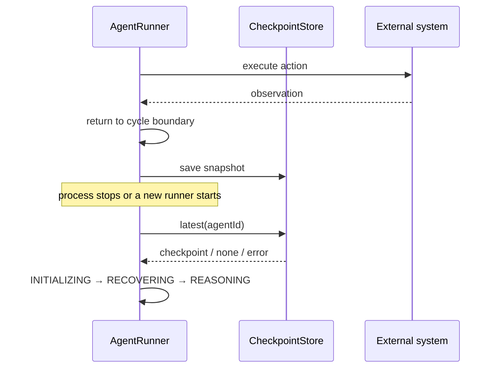

Recovery restores actions and reasoner state, then continues the original
`runId` and event sequence. It cannot roll back an external side effect that
completed before its observation was checkpointed. At-least-once recovery
therefore requires idempotency keys, reconciliation, or durable external
operation IDs.

Included stores are in-memory, append-only JSONL, transactional SQLite, and
Postgres. `SqliteCheckpointStore` is the durable single-host option;
`PgCheckpointStore` (`@naro/adapter-pg`) is the durable multi-host option — a
checkpoint written by one replica is readable by any other. Missing files
mean no checkpoint; corrupt data fails rather than silently starting a fresh
run.

---

## 13. Multi-agent coordination

The kernel remains single-agent. Coordination is implemented at the edge by
turning delegation into a normal tool.

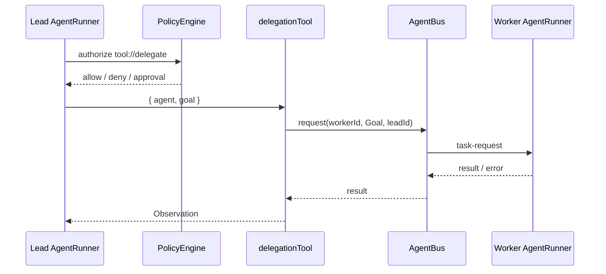

`AgentDirectory` advertises agent capabilities. `AgentBus` defines request and
serve operations. `InMemoryAgentBus` stays within one process.
`HttpAgentBus` sends authenticated tasks to resolved endpoints; token verification
supports shared secrets, HS256 JWTs, JWKS-backed RS256/ES256 validation, and
application-provided verifiers.
`@naro/adapter-a2a` adds agent cards, task send/get/cancel, and SSE lifecycle
streaming through `requestStream()`. The stream reports task state rather than
incremental model tokens or artifacts. `DurableAgentBus` stores tasks in SQLite,
atomically claims work, and reclaims stale claims for at-least-once
single-host delivery. `PgAgentBus` (`@naro/adapter-pg`) is the same contract
on Postgres — `SKIP LOCKED` claims give at-least-once delivery across
replicas on any host that can reach the database, not just one machine.
Handlers must be idempotent either way; a reclaimed stale claim means a
handler ran and never marked completion, not that it never ran.

Delegation requires the `agent.delegate` permission and remains visible to
policy and audit. Returned agent output is still untrusted and should be
verified by the caller.

---

## 14. Deployment views

Naro packages are libraries, so deployment topology belongs to the
application. Two shapes are shown below — [deploy.md](deploy.md) covers two
more (environments as a separate remote process, and governance running
beneath a foreign harness) with the Dockerfile/compose/k8s manifests that
implement them.

### Single-process development

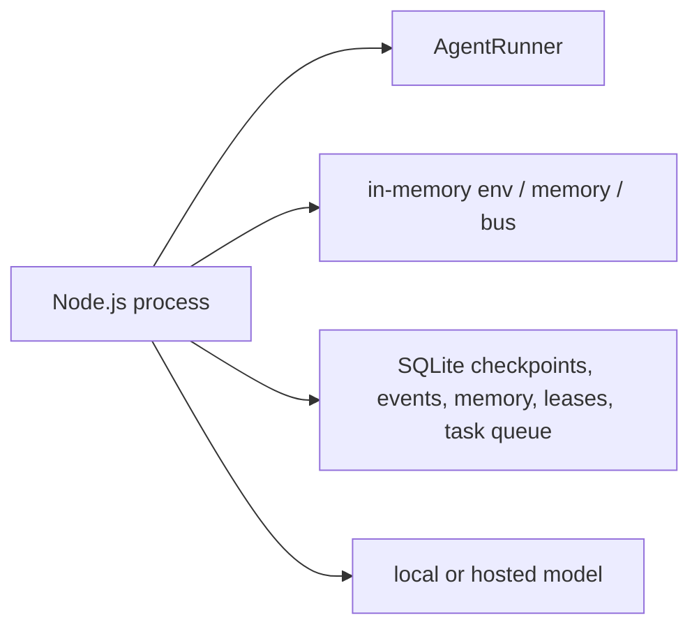

Zero infrastructure — SQLite is a file, not a server. Appropriate for
examples, tests, local automation, and controlled single-user workflows.
The limit is the file: one host, no failover.

### Multi-host control plane

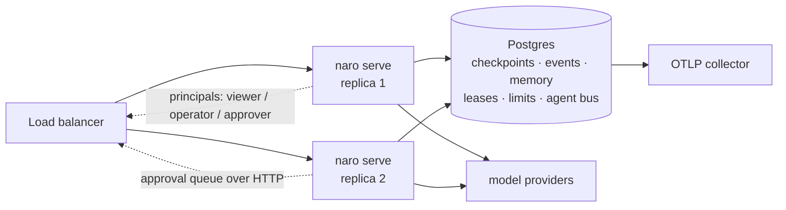

Every durable port — checkpoints, events, memory, leases, limits, and the
agent bus — has a Postgres implementation in `@naro/adapter-pg`, so this
topology needs no bespoke infrastructure code, only a Postgres connection
string. A run started on one replica can be read, resumed (`wake(runId)`),
or approved from any other, because the journal and the lease are both in
the shared database, not in process memory. `naro serve --principals` maps
bearer tokens to `{id, roles}` for this shared control plane — the approver
identity lands in the journal (`human.approval.received.by`), and gate
events carry the policy engine's own id (`PolicyEngine.id`, alongside the
verdict's `reason` — [ADR 0011](adr/0011-policy-verdicts-carry-reasons.md)),
so "who approved this, and under which policy, and why" is answered by the
journal alone ([ADR 0012](adr/0012-control-plane-identity.md)). See
[deploy.md](deploy.md)'s "Topology 2" for the full networking matrix and the
k8s/compose manifests that implement this diagram.

### What's still a deployment responsibility

Naro supplies the stores, leases, queues, secret-provider ports, JWT hooks,
and OTLP export — both the zero-infrastructure SQLite tier and the
multi-host Postgres tier above. What it does not supply: centralized secret
management (KMS/HSM), tenant authorization (the control-plane roles above
are viewer/operator/approver, not per-tenant isolation), TLS/mTLS, container
or VM sandboxing for hostile code, and hosted operations (dashboards,
on-call, capacity planning). §16 names the remaining implementation limits
inside the ports themselves.

---

## 15. Code-level extension rules

Use this table before adding a type or package.

| Change | Correct home |
|---|---|
| universal agent noun or port | `core` |
| state progression or run lifecycle | `runtime` |
| provider-neutral model vocabulary | `model` |
| reasoning strategy or prompt assembly | `reasoning` |
| local/remote capability contract | `tools` or an adapter |
| reusable domain world, tools, and drivers | `profiles/<domain>` |
| application-specific domain behavior | application package |
| retrieval orchestration | `context` |
| persistence and recall | `memory` |
| authorization rule implementation | `policy` or policy adapter |
| evidence check | `verification` |
| metrics or event sink | `observability` or exporter adapter |
| benchmark orchestration | `evaluation` |
| protocol-neutral cross-agent transport | `multiagent` |
| vendor or wire-protocol translation | `adapters/*` |
| reusable port conformance suite | `contract-tests` |
| developer command | `cli` |

### Review invariants

A change is architecturally acceptable only if these remain true:

1. **Core stays domain- and vendor-neutral.**
2. **The runtime is the only owner of agent state transitions.**
3. **Every action passes policy before execution.**
4. **Reasoners return decisions; they do not execute capabilities.**
5. **Actions and observations remain separate.**
6. **Failures stay visible as observations, events, or terminal results.**
7. **Optional capabilities are declared and checked, never guessed.**
8. **Context and memory retain provenance and scope.**
9. **Completion is verified when evidence matters.**
10. **Adapters translate protocols without leaking vendor types inward.**
11. **Loops, retries, context, and external calls are bounded.**
12. **Documentation distinguishes included implementations from deployment
    responsibilities.**

---

## 16. Current architectural limits

These are deliberate implementation boundaries, not hidden guarantees:

- `AgentRunner` requires a policy, but explicit `allowAllPolicy` remains suitable
  only for tests and controlled development.
- action deadlines abort the executor signal; an external system may still have
  committed work before observing cancellation.
- durability has two included tiers, not one: SQLite (checkpoints, events,
  memory, leases, limits, delegation — durable across processes sharing one
  host) and Postgres via `@naro/adapter-pg` (the same six ports, durable
  across hosts). There is no third, larger tier — sharding a single Postgres
  further, or a non-relational store, is still an application concern.
- `naro serve`'s approval queue (`/approvals`) is SQLite-only today —
  `SqliteApprovalBridge` has no Postgres counterpart, so a Postgres-backed
  multi-host deployment's approval queue is still per-replica even though its
  run registry and journal are shared. HTTP and A2A transports are
  synchronous either way — no async/streaming task protocol is included.
- event history supports audit and derived metrics; deterministic replay of
  external side effects requires application-level fixtures or adapters.
- OTLP export currently emits logs rather than a parented span graph.
- `BenchmarkRunner` runs cases sequentially once; repeated sampling and
  statistical comparison belong to a higher-level evaluation workflow.

Naming these limits is part of the architecture. It tells application teams
where they can rely on Naro and where production infrastructure must take over.

---

## Related reading

- [Documentation map](README.md)
- [End-to-end use cases](use-cases.md)
- [Production readiness](production-readiness.md)
- [Deploying Naro](deploy.md) — the topologies this doc's §14 summarizes,
  in full, with networking and the deployment manifests.
- [Design principles](principles.md)
- [Architecture decision records](adr/README.md) — every ADR this doc
  cites (0005, 0007, 0008, 0009, 0010, 0011, 0012), and the ones it doesn't.
- [Market quadrant](market-quadrant.md) — where this architecture sits
  relative to the field, and what's still missing for adoption rather
  than for correctness.
- [How LLMs work](learn/00-how-llms-work.md)
- [Agent loops and state machines](learn/08-agent-loops.md)
- [Evaluation](learn/10-evaluation.md)
- [Security and policy](learn/11-security-and-policy.md)
- [Scale and reliability](learn/12-scale-and-reliability.md)
