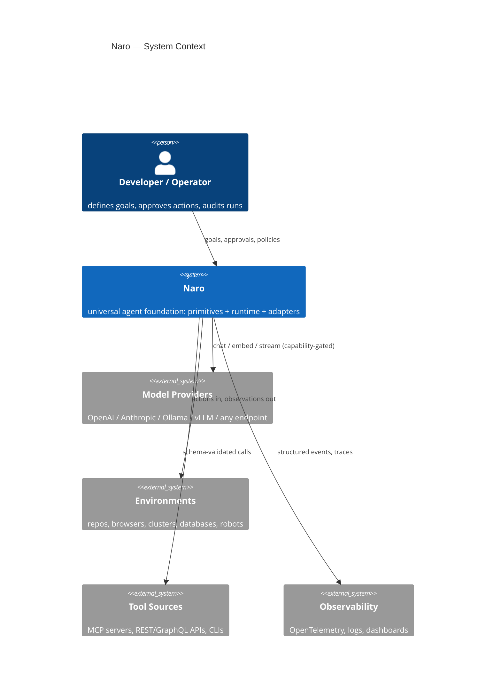
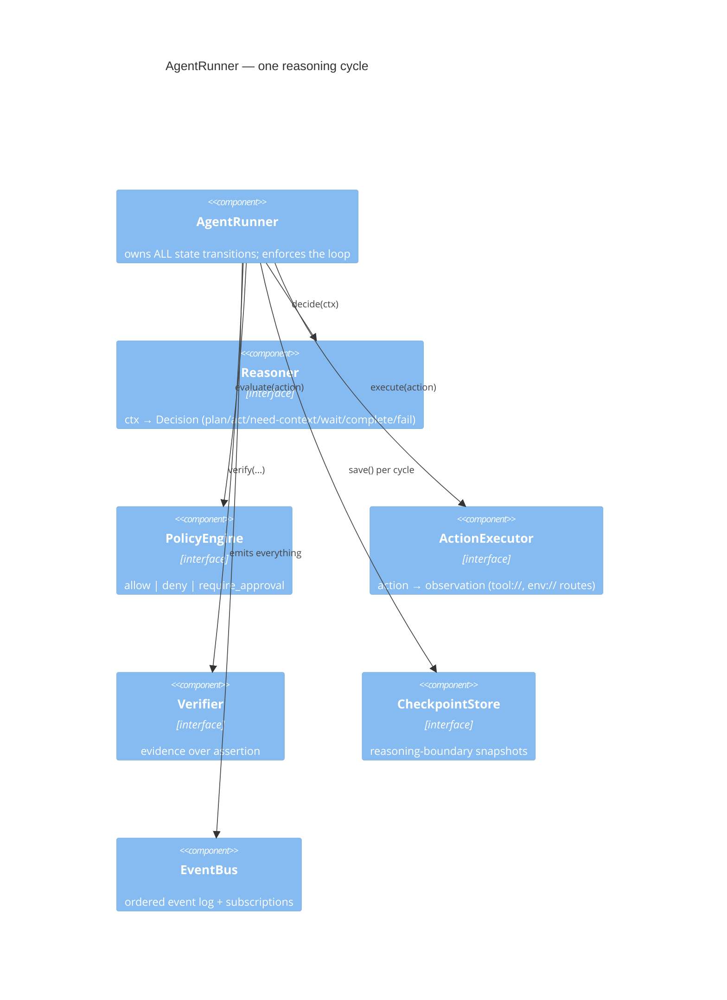
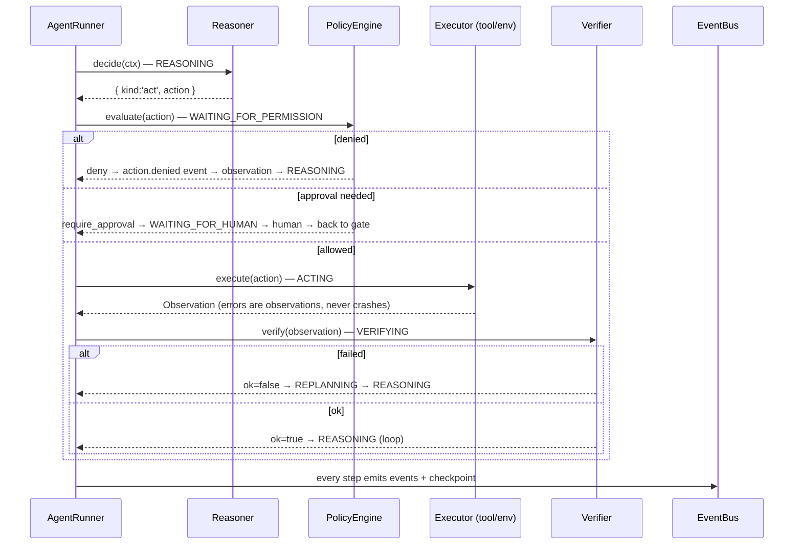

# Naro Architecture

Four C4 views: who Naro serves → what it's made of → how the parts connect →
what happens during one agent step.

## C4 Level 1 — System Context

Naro sits between **people** (who set goals and approve actions), **models**
(who supply intelligence), and **the world** (environments, tools, data):



## C4 Level 2 — Containers (packages)

Each box is a separately testable, separately replaceable package.
Arrows only ever point *toward* `core` — nothing upstream depends on anything.

```mermaid
C4Container
    title Naro — Package View
    Container(core, "@naro/core", "types", "Goal · Task · Action · Observation · Events · 18-state machine · Reasoner/Policy/Verifier/Context/Executor seams")
    Container(runtime, "@naro/runtime", "engine", "AgentRunner · EventBus · retry/timeout · checkpoint+recovery")
    Container(model, "@naro/model", "interface", "Model · ModelProvider · MockModel")
    Container(tools, "@naro/tools", "interface", "Tool · Registry · schema validation · executor pipeline")
    Container(env, "@naro/environment", "interface", "Environment · InMemoryEnvironment")
    Container(memory, "@naro/memory", "store", "Tiered MemoryStore · in-memory + JSONL")
    Container(context, "@naro/context", "pipeline", "retrieve → rank → select → budget")
    Container(reasoning, "@naro/reasoning", "strategies", "ReAct · PlanExecute · Reflection over Model")
    Container(policy, "@naro/policy", "governance", "PolicyEngine · rules-as-data · rate limiting")
    Container(obs, "@naro/observability", "telemetry", "Event exporters · metrics() · JSONL audit")
    Container(evaluation, "@naro/evaluation", "scoring", "Benchmark harness · event-stream scorers")
    Container_Boundary(adapters, "Adapters") {
      Container(mcp, "@naro/adapter-mcp", "", "MCP ToolSource")
      Container(oa, "@naro/adapter-openai", "", "OpenAI-compatible Model/Provider")
    }
    Rel(runtime, core, "drives")
    Rel(model, core, "contracts")
    Rel(tools, core, "contracts")
    Rel(env, core, "contracts")
    Rel(adapters, core, "implements")
```

## C4 Level 3 — Components (the runtime's inner loop)



## C4 Dynamic — one act→observe→verify step



## The rules that keep it universal

1. **Core knows no domains.** If a concept wouldn't make sense to a robot *and*
   a researcher *and* a coder, it doesn't belong in `core/`.
2. **Every decision path is observable.** No silent fallbacks — missing
   capabilities throw, denied actions produce observations, everything emits.
3. **Checkpoints happen only at reasoning boundaries** — an action is never
   half-restored.
4. **Policy is structural.** `REASONING → ACTING` is not a legal transition;
   the only path runs through `WAITING_FOR_PERMISSION`.
