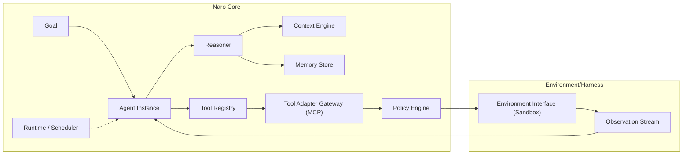
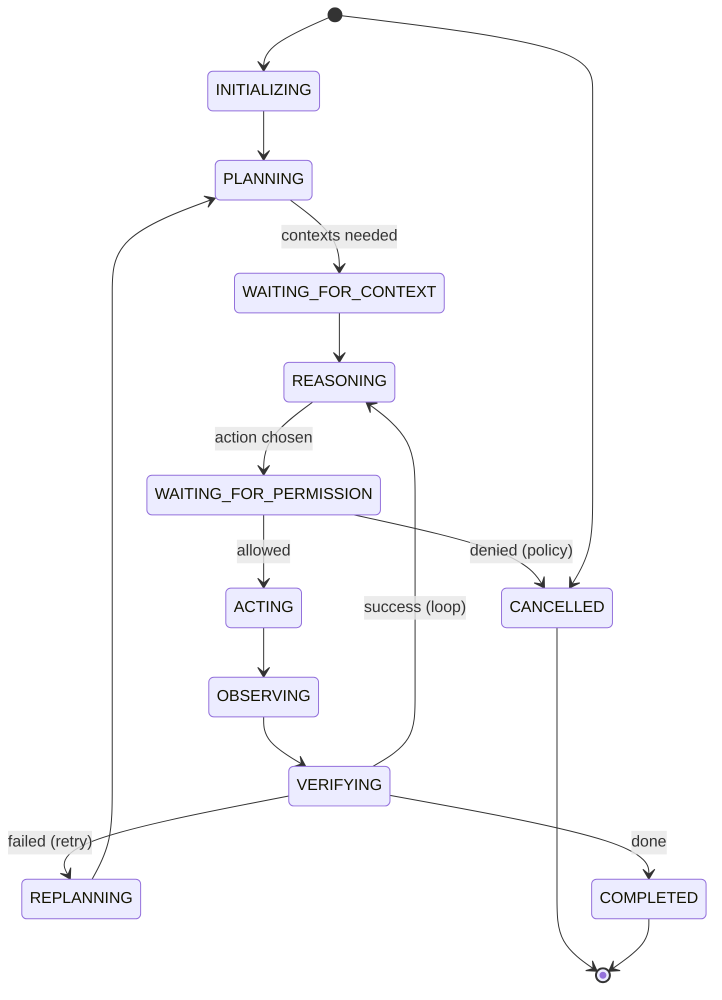

# Deep Research Report

> **Historical design input.** This report predates the current implementation
> and preserves the research, alternatives, and phased roadmap that informed
> Naro. For current APIs and implemented capabilities, use
> [Architecture](architecture.md), [Use cases](use-cases.md), and package
> READMEs.

## Executive Summary

**Naro** is envisioned as a *universal, open-source agent framework* – a minimal core of abstractions and protocols for autonomous agents that can operate in **any environment**.  Unlike narrow “coding agent” libraries, Naro generalizes the architecture underlying systems like Claude Code or GPT-based coders into domain-agnostic primitives.  It composes **models, reasoning engines, context/memory systems, tools, and environments** via standard interfaces and event flows.  The core is intentionally **small and pluggable**: specialized domains (coding, research, browser, enterprise, robotics, etc.) are built as *profiles* atop this kernel, much like Spring Boot applications on a shared Java runtime. Naro itself would rely on proven OSS components (LLM inference servers, sandboxes, DBs, orchestration tools, etc.) via adaptors, avoiding reinventing wheels.  

This report surveys relevant **research and industry sources** (e.g. ReAct [8], Tree-of-Thoughts [15], multi-agent standards [21], sandbox guides [51], etc.), inventories candidate OSS projects with recommended roles, and extracts 15+ **end-to-end architectural patterns** (e.g. *Context-as-a-Service*, *Planner–Executor–Verifier loop*, *Harness-as-Environment*, *Tool Adapter Gateway*, *Checkpointed Runtime*, *Multi-Agent Bus*, *Memory Tiering*, *Policy-first Execution*, *Evidence-backed Verification*, *Adapter-first Integration*, etc.) with diagrams, rationales, and anti-patterns.  

We then propose a **reference architecture** for Naro: core components and contracts (Agent, Goal, Reasoner, Context, Memory, Tool, Environment, Harness, etc.), an event/state model, and data flows (see diagram below).  We include tables of interface signatures, key events, and valid agent state transitions.  Each component is mapped to existing OSS (e.g. HuggingFace/OpenAI model APIs, Ray/Kubernetes or Celery for runtime, Docker/Kata Containers for sandbox, Prometheus/OTel for telemetry, OPA for policy, OpenAI Evals for evaluation, etc.).  

An **implementation roadmap** outlines ~10 phases (from a minimal kernel through tools, environments, reasoning strategies, evaluation, etc.), with deliverables, person-month estimates, and priorities.  Security, governance, observability, and testing are integral throughout (e.g. OPA-based policies, OpenTelemetry, unit and integration tests, benchmark suites).  We highlight Naro’s **innovations/IP**: its *vendor-agnostic, modular core*, explicit agent protocols, environment abstraction, pluggable pipelines, checkpointed execution, and end-to-end traceability.  Finally, we recommend a GitHub org layout and starter templates (core, adapters, examples, docs, tests) to launch the project.

The goal of Naro is to be **“Spring Boot for agents”** – not just another coding agent, but a *foundation* on which any autonomous agent (coding or otherwise) can be built and scaled.  It is fully open-source and self-hostable, relying on community-driven tools.  

<div align="center">  
**Proposed Naro Architecture Overview:**</div>

```mermaid
flowchart LR
    subgraph “Agent Runtime”
        GOAL[Goal]
        AGENT[Agent Core]
        REASON[Reasoning Engine]
        CONTEXT[Context Engine]
        MEMORY[Memory Store]
        TOOLSEL[Tool Selector]
        ACTION[Action Executor]
    end
    subgraph “Environment & Harness”
        ENV[Environment (State, APIs, Resources)]
        OBSERVE[Observations/Events]
    end
    GOAL --> AGENT
    AGENT --> REASON
    REASON --> TOOLSEL
    TOOLSEL --> ACTION
    ACTION -->|executes| ENV
    ENV -->|provides| OBSERVE --> AGENT
    CONTEXT --> REASON
    MEMORY --> REASON
    AGENT --> CONTEXT
    AGENT --> MEMORY

    classDef core fill:#f9f,stroke:#333,stroke-width:1px;
    class AGENT,REASON,CONTEXT,MEMORY,TOOLSEL,ACTION core;
```

## 1. Agent Architectures & Reasoning Primitives

### 1.1 LLM-based Agent Patterns (ReAct, ToT, Plan-Execute)

Research has identified several *reasoning frameworks* for LLM agents:

- **ReAct (Reasoning+Acting)**: The model interleaves chain-of-thought (“Thought”) with external actions, grounding its reasoning in tool outputs.  ReAct’s loop (Thought→Action→Observation→Thought) allows the agent to plan, execute a tool (e.g. a search or API call), observe the result, and continue reasoning.  This synergy reduces hallucinations and improves performance over chain-of-thought alone.  We cite *ReAct* as a key paradigm for active agents.

- **Tree-of-Thoughts (ToT)**: ToT generalizes chain-of-thought by **exploring multiple reasoning paths** (“thoughts”) in a search tree.  Instead of a single linear reasoning trace, ToT **maintains a tree** of partial solutions, allowing *lookahead*, backtracking, and evaluation of alternate plans.  For example, ToT solved 74% of a “Game of 24” arithmetic task vs. 4% by single-path prompts.  This offline search pattern is a useful *planning abstraction* for complex problem solving.

- **Plan-and-Execute**: Emerging in practice (e.g. LangChain’s plan-and-execute agent), this pattern separates **planning** (LLM generates a multi-step plan) from **execution** (another LLM or agent carries out each step).  The *planner* produces subtask list, and the *executor* iteratively uses tools to fulfill each step.  (A common approach: one prompt generates “1. Do X 2. Do Y…”, then a second LLM prompts on “execute step 1, step 2” etc.)  This yields more structured workflows compared to pure ReAct loops.  As noted in practice guides, plan-execute can be more predictable but may yield suboptimal plans if the model’s reasoning is imperfect.  

- **Reflection and Self-Improvement**: Agents that **critique themselves** can improve over multiple iterations.  For example, *Self-Refine* and *Reflexion* frameworks let the agent evaluate its output against goals and write a “reflection” that is fed back as extra context.  Reflexion converts binary feedback into a textual summary and adds it to memory, leading to gains on decision, reasoning, and coding tasks.  This suggests *memory of failures* and iterative planning can boost performance.

- **Multi-Agent Orchestration**: Modern approaches push beyond solo agents into *ecosystems* of collaborating agents.  Key ideas: specialized worker agents (each with a narrow role) and service agents (shared utilities) coordinate via an orchestration layer.  Established protocols emerge: the **Model Context Protocol (MCP)** for agent-to-tool calls and the **Agent-to-Agent (A2A)** protocol for inter-agent messaging.  The orchestration layer manages task allocation and workflow, while MCP ensures schema, access control, and session logging for every tool invocation.  A2A enables delegation and negotiation (agents exchanging structured messages under security controls).  We will adopt this dual-layer communication model: *MCP for tool/environment access* and *A2A for peer-to-peer agent collaboration*. 

**Implication for Naro:** The core reasoning engine should be *model-agnostic* (able to plug in any LLM or vision model) and support multiple reasoning strategies as pluggable modules: ReAct, plan/execute, tree search, reflection, multi-agent coordination, etc.  Rather than bake in one prompt template, Naro should define a **Reasoner interface** that yields sequences of Actions/Thoughts given a context.  For example:

```txt
interface Reasoner {
  plan(goal, context, memory) → Plan;
  nextAction(plan, state, observation) → Action;
  analyze(observation) → Thought;
}
```

This allows mixing ReAct (where the plan is implicit in “Thoughts”) or explicit planning depending on configuration.

### 1.2 Context and Memory Systems

A key lesson is that *context engineering* and *memory* are as crucial as the LLM itself. Agents must retrieve, compress, and manage knowledge to stay effective.

- **Context Engine (Retrieval Service)**: Agents need relevant context from diverse sources: code repositories, documents, databases, APIs, web pages, etc. Naro should provide a pluggable *Context Engine* that does:
  1. **Discover & Retrieve**: Identify candidate information (e.g. search codebase, query DB, scrape web) given the current goal.
  2. **Rank & Select**: Use embeddings or heuristics to choose the most relevant pieces.
  3. **Assemble & Compress**: Merge multi-document text or compress images into tokens within budget.
  4. **Stream to LLM**: Provide the final context segment to the model.
  
  This abstraction turns context into a service. For instance, in a coding agent, the Context Engine might search Git history, open-source Q&A, or the running app state; in an enterprise agent it might query a knowledge graph or BI reports.  We see this pattern in RAG pipelines and LangChain’s retrievers. The core should define an interface like `ContextEngine.retrieve(query, {sources}) → documents` and let adapters handle actual search/index technologies (SQL, Elasticsearch, Pinecone, web search API, etc).

- **Memory Hierarchy**: Inspired by human cognition, implement multiple memory tiers:
  - *Working Memory*: ephemeral, holds the current conversation or scratchpad (in-LLM prompt history).
  - *Session/Episodic Memory*: details of past tasks in one session (stored externally, e.g. a vector DB).
  - *Semantic Memory*: general knowledge or facts (e.g. knowledge base or long-term vector store).
  - *Procedural Memory*: learned skills or heuristics (perhaps a library of chain-of-thought chains or fine-tuned models).
  - *Long-Term Memory*: persistent logs of all agent activity (like an audit trail).
  
  Naro should define a **MemoryStore interface** with backends: in-memory, SQLite, PostgreSQL, Redis, Milvus/Qdrant, etc.  Agents can read/write memories. For example: `memory.add(“failed_analysis”, text)` and `memory.search("issue type=bug", limit=5)`. Keeping memories decoupled via a standard API lets us plug any database (a vector DB for embeddings, or a relational DB for structured data).

## 2. Proven Open-Source Components

We **leverage existing OSS** for every subsystem possible. Below is a non-exhaustive inventory of mature projects and their recommended roles in Naro.  (Integration complexity refers to how easily they can plug in via adapters.)

| Project/Category          | License           | Maturity (stars, usage)    | Core Functionality                                 | Integration Complexity | Naro Role                    |
|---------------------------|-------------------|----------------------------|----------------------------------------------------|------------------------|------------------------------|
| **Model Providers:**      |                   |                            |                                                    |                        |                              |
| OpenAI SDK (Python, JS)   | MIT               | Very high; official OSS    | Access to GPT-4/3.5, Chat Completions, APIs        | Easy (official API)    | LLM Provider Adapter         |
| Anthropic SDK             | Apache 2.0        | High (Claude API)          | Claude 3/2 access                                  | Easy (official API)    | LLM Provider Adapter         |
| Ollama (local models)     | ??? (Proprietary?)| Emerging                   | Host local LLMs via CLI                            | Medium (custom API)    | Local LLM Host Adapter       |
| vLLM                      | Apache 2.0        | High (NVIDIA)              | High-throughput LLM inference (GPU)                | Medium (Python API)    | Local LLM Server             |
| llama.cpp                 | MIT               | Very high (C++ port for LLaMA)| Local LLM inference on CPU                         | Medium (Python wrapper) | Local LLM (small/gpu)        |
| FedX                     | Apache 2.0        | Medium                     | Distributed LLM serving (experiment)               | High (research use)    | Multi-node LLM scaling       |
| **Reasoning Engines:**    |                   |                            |                                                    |                        |                              |
| LangChain (AgentTypes)    | MIT               | High (10k⭐)                | Agent patterns (ReAct, Plan&Execute, etc)          | Medium (adaptation)    | Reference Impl / Idea source |
| LlamaIndex (GPT Index)    | MIT               | High (3k⭐)                 | Document graph, RAG                                | Medium                 | Context/Indexing toolkit     |
| Ray                       | Apache 2.0        | High (graph libs)          | Distributed task orchestration                     | High                   | Parallel execution backend   |
| **Datastores:**           |                   |                            |                                                    |                        |                              |
| PostgreSQL                | PostgreSQL License| Very high                  | Relational storage, SQL queries                    | Medium                 | Structured Memory/Profile DB |
| Redis                     | BSD               | Very high                  | Key-value store, often used for caching/memory     | Medium                 | Session/Ephemeral Memory     |
| Qdrant                    | Apache 2.0        | High (GitHub)              | Vector DB for semantic memory retrieval            | Medium                 | Long-term memory store       |
| Milvus                    | Apache 2.0        | High (LF project)          | Vector search                                       | Medium                 | Alternative vector DB        |
| OpenSearch (Elasticsearch)| Apache 2.0        | Very high                  | Full-text search, also vectors (v8+)              | Medium                 | Context search/index         |
| **Tools & Integration:**  |                   |                            |                                                    |                        |                              |
| ModelContextProtocol (MCP)| Apache 2.0        | Emerging (LinuxFND spec)   | Standard tool call protocol (JSON+MCP schema)      | Medium (well-defined)  | Tool invocation gateway      |
| REST/GraphQL APIs         | Varies (usually MIT)| Very high                | Web API access                                    | Easy (HTTP clients)    | Data/Service Tools           |
| CLI Tools (bash, etc.)    | N/A               | N/A                        | Any shell/executable                              | Easy                  | Direct Execution Tools       |
| Web/Browser Tools         | N/A               | High (Selenium, Playwright)| Automate browser actions                          | Medium                | UI automation tools          |
| Kubernetes                | Apache 2.0        | Very high                  | Container orchestration                            | High                  | Environment orchestration    |
| Docker/Kata/Firecracker   | Apache 2.0        | Very high                  | Container/VMM sandboxing                          | Medium                | Execution sandbox (Harness)  |
| OpenTelemetry             | Apache 2.0        | Very high                  | Tracing/metrics                                      | Medium                | Observability                |
| **Evaluation:**           |                   |                            |                                                    |                        |                              |
| OpenAI Evals              | MIT               | Medium (2023)              | Framework for model/system evaluation              | Medium                | Benchmarking/QA tasks        |
| HuggingFace `evaluate`    | Apache 2.0        | High                       | Dataset and metrics utilities                      | Medium                | Metrics/automation scripts   |
| Custom Benchmarks (OpenHands Benchmarks [38])| MIT | Medium       | Domain-specific tests (coding, DevSecOps) | Medium | Reference tasks              |

Each OSS component above would be *integrated via adapters or defined interfaces* rather than built from scratch.  For example, to call an LLM we use an adapter that can plug in OpenAI or vLLM; to run code we call Docker/Kata; to log we emit OpenTelemetry spans, etc. We avoid reimplementing any full system (databases, web servers, etc.), instead focusing Naro on **coordination, interfaces, and protocols**.

## 3. Architectural Patterns

From studying agents and systems, we identify **15 key end-to-end patterns** (and anti-patterns) that Naro should embody. Each pattern is reusable across domains:

1. **Context-as-a-Service:**  *Pattern:* Isolate context retrieval/composition into a separate service or module. Agents request “ContextEngine.getRelevant(task)” rather than encoding retrieval in prompts.  *Rationale:* Centralizes indexing, allows incremental improvement, and lets multiple agents share context sources.  *Trade-offs:* Increases system complexity; adding latency. *Anti-pattern:* Hardcoding retrieval queries inside reasoning logic or neglecting context assembly.

2. **Planner–Executor–Verifier Loop:** *Pattern:* Split agent workflow into phases: **Plan** (LLM generates plan/subtasks), **Execute** (run tools for each step), **Verify** (check outcomes against criteria).  See Fig. 3. The **Verifier** (unit tests, schema checks, or a human) ensures each plan step succeeded before proceeding. *Rationale:* Improves reliability and debuggability. *Trade-offs:* More LLM calls and round-trips, slower but safer. *Anti-pattern:* No explicit verification, letting agent claim success without evidence.

   ```mermaid
   sequenceDiagram
     participant Agent
     participant PlanEngine
     participant Executor
     participant Verifier
     Agent->>PlanEngine: "Generate plan for goal"
     PlanEngine-->>Agent: "Plan: [Step1, Step2, ...]"
     loop for each step
       Agent->>Executor: "Do Step"
       Executor-->>Agent: "Result"
       Agent->>Verifier: "Check Result"
       Verifier-->>Agent: "OK/Fail"
       alt if Fail
         Agent->>PlanEngine: "Replan (exclude failed step)"
       end
     end
     Agent->>Agent: "Goal Completed"
   ```

3. **ReAct (Thought-Action Loop):** *Pattern:* Interleave reasoning and acting as in [8].  The agent’s LLM prompt is structured so that it can output “Thought: … Action: …” etc.  *Rationale:* Native in-chain reasoning with tool use (e.g. “Thought: I should search for X; Action: search[X]”).  *Trade-offs:* Harder to structure long plans; potential for loop if not converging. *Anti-pattern:* Siloed chain-of-thought without external grounding or response integration.

4. **Tree-of-Thoughts Search:** *Pattern:* Allow the agent to generate and compare multiple potential actions (“thoughts”) using a search strategy (breadth-first, beam search, etc).  *Diagram:* Agent tries multiple “moves” in parallel (like in AI planning). *Rationale:* Finds better solutions on complex problems; mimics planning search. *Trade-offs:* Heavy compute cost, complexity of implementation. *Anti-pattern:* Relying on one greedy pass that misses alternatives.

5. **Reflection/Memory Feedback:** *Pattern:* After execution, the agent evaluates outcome and writes a “reflection” to memory.  On the next attempt or query, this stored reflection biases the agent away from past mistakes. *Rationale:* Implements learning by self-critique (e.g. “I realized I misunderstood the requirement…”). *Trade-offs:* Memory bloat if unchecked; depends on quality of self-eval. *Anti-pattern:* Stateless, single-shot agents with no feedback loop (poor at iterative tasks).

6. **Harness-as-Environment:** *Pattern:* Treat the “agent harness” (the interface it has to tools) as the **environment** abstraction.  For a coding agent, the Environment might expose APIs like `runCommand()`, `openFile()`, `runTests()`.  The harness (e.g. a sandboxed container or IDE plugin) implements those APIs.  *Rationale:* Clean separation: agents ask “environment, run `build`” via a standard call, decoupling agent logic from OS details. *Trade-offs:* Need to design abstract APIs up front. *Anti-pattern:* Hardcoding calls to OS or tools directly from prompt without controlled interface.

7. **Tool Adapter Gateway (MCP):** *Pattern:* All tool/integration calls go through a gateway that enforces schema, security, and logging.  For example, each tool has a JSON schema; the MCP adaptor validates input/output and records the call.  *Rationale:* Centralizes permission checks and auditing for every action. *Trade-offs:* Adds an extra hop and integration work. *Anti-pattern:* Agent directly invoking tools (e.g. raw system calls) with no monitoring or validation.

8. **Checkpointed Resumable Runtime:** *Pattern:* The agent runtime periodically **checkpoint** its full state (goal, plan, memory pointers) so that execution can resume after crashes or manual pause.  See timeline diagram below. *Rationale:* Agents may run long (hours); checkpoints allow crash recovery and inspection. *Trade-offs:* Overhead of state serialization. *Anti-pattern:* Stateless ephemeral runs (all context lost on failure).

   ```mermaid
   sequenceDiagram
     participant Runtime
     Runtime->>Runtime: Initialize(agent, goal)
     loop cycle until done
       Runtime->>Model: Think (prompt)
       Model-->>Runtime: Thought, Action
       Runtime->>Tools: Execute(Action)
       Tools-->>Runtime: Observation
       Runtime->>Verifier: Verify(Observation)
       alt if OK
         Runtime->>Memory: Record(success)
       else if Fail
         Runtime->>Memory: Record(failure)
         Runtime->>Runtime: rollback or replan
       end
       Runtime->>Runtime: Checkpoint state (persist to DB)
     end
     Runtime->>Memory: Record(completion)
   ```

9. **Multi-Agent Orchestration Bus:** *Pattern:* Use a message/event bus to coordinate multiple agents (and possibly humans). Agents publish/subscribe to topics.  E.g., an **Orchestrator service** reads events and dispatches tasks to worker agents.  This implements the *orchestration layer* from [19][21].  *Rationale:* Decouples agents; allows dynamic task allocation and agent supervision. *Trade-offs:* Added infrastructure (e.g. Kafka, RabbitMQ). *Anti-pattern:* Hard-coded pairwise agent calls (low scalability).

10. **Memory Tiering:** *Pattern:* Separate caches for short-term vs long-term memory. For instance, keep the latest context in fast in-memory store, but archive logs and “reflections” in a long-term DB.  Use a vector DB for semantic recall of older episodes.  *Rationale:* Balances performance and capacity. *Trade-offs:* Complexity of consistency across stores. *Anti-pattern:* Storing everything only in expensive vector DB (costly) or only in short-lived memory (loses knowledge).

11. **Policy-first Execution:** *Pattern:* Before any action, consult a **Policy Engine** (like OPA/Rego) that enforces rules (which tools can be called, network access, cost limits, etc.).  E.g. `if action.type == delete_file and not action.authorized then DENY`.  *Rationale:* Ensures safety and compliance by construction. *Trade-offs:* May block legitimate actions if overly strict. *Anti-pattern:* Agents acting without oversight (leads to uncontrolled behavior).

12. **Evidence-backed Verification:** *Pattern:* All critical actions produce evidentiary outputs. For code changes, generate unit tests and run them; for data queries, check result schema or sanity constraints; for reports, cross-check sources. The **Verifier** should output pass/fail with a proof (logs, diff, metrics).  *Rationale:* Decisions are grounded in testable facts. *Anti-pattern:* Trusting the agent’s final “answer” as correct without objective checks.

13. **Adapter-first Integration:** *Pattern:* Before building new functionality, look for an OSS that does it, and integrate via an adapter. For example, use off-the-shelf vector DB via a MemoryStore adapter, or OpenTelemetry via an OTel adapter.  *Rationale:* Minimizes reinvention and leverages community work. *Anti-pattern:* Duplicating features (writing a custom vector index instead of using Milvus).

14. **Session & Trace Logging:** *Pattern:* Emit structured logs and events for every step (tool calls, decisions, state changes).  Agents log to a central store (like Elastic or OpenSearch). This enables replay, debugging, and ML feedback loops. *Rationale:* Observability and audit. *Anti-pattern:* Black-box prompts with no trace; impossible to diagnose errors.

15. **Agent Delegation Pattern:** *Pattern:* An agent can **spawn or delegate** sub-tasks to other agents using a standard protocol (A2A messages). For example, a “project manager” agent might create a “reviewer” agent to check code.  *Rationale:* Reflects human teamwork, scales complexity. *Anti-pattern:* One monolithic agent doing everything, leading to context overload.

These patterns guide Naro’s design and its reference implementations (e.g. coding-agent, research-agent, enterprise-agent).  

## 4. Reference Architecture

### 4.1 Components & Contracts

Naro’s **core components** and their responsibilities:

- **Agent:** The orchestrator of a goal. Contains references to its Reasoner, Memory, Context, Tools, Environment, Policy. Exposes `run(goal)` to start execution. Minimal interface, mostly wiring.

- **Goal:** A declarative description of the task (`id, description, successCriteria, constraints`). Immutable once started.

- **Task (or Plan):** A possibly hierarchical unit of work under a goal (with subtasks, status, etc). Agents decompose goals into tasks; tasks may spawn sub-agents for subtasks.

- **Reasoner:** Decides *what to do next*. Interface:  
  ```  
  interface Reasoner {  
    decideNextAction(state, context, memory) → ActionSpec;  
    / * can also produce intermediate Thoughts for interpretability * /  
  }  
  ```
  Different strategies (ReAct, planner, tree-search) implement this.

- **Context Engine:** Handles retrieval of external information. Interface example:  
  ```  
  interface ContextEngine {  
    retrieve(query) → List<Document>;  
  }  
  ```

- **Memory Store:** Abstracted key-value or vector store. Interface:  
  ```  
  interface MemoryStore {  
    write(key, content);  
    read(key) → content;  
    search(embedding, topK) → list<Memory>;  
  }  
  ```

- **Tool:** Represents an external action the agent can invoke. Interface:  
  ```  
  interface Tool {  
    name: String;  
    description: String;  
    execute(input) → output;  
  }  
  ```
  Tools are registered in a **ToolRegistry**. The agent selects tools by name, calls `tool.execute()`, and receives the Observation (result or error).

- **Environment:** An abstraction of the agent’s workspace. Exposes state and resources. E.g. CodingEnvironment has `files, repo, processes`; BrowserEnvironment has `DOM, pages`; CloudEnvironment has `VMs, containers`. Interface (example):  
  ```  
  interface Environment {  
    getState() → StateSnapshot;  
    performAction(action) → Observation;  
  }  
  ```
  The **Harness** binds an Agent to a concrete Environment plus Tool set plus policies.  

- **Policy Engine:** Enforces security/governance. Called before each action. Interface:  
  ```  
  interface Policy {  
    check(action, agentContext) → Allow/Deny;  
  }  
  ```

- **Runtime:** Manages agent lifecycle (initialize, run loop, handle timeouts, interruption, checkpointing, termination). It might support concurrency (multi-threaded agents, async API calls).  

These components interact via events and APIs. The following diagram outlines the main data flows:



### 4.2 Event Model

Key events to capture (agent-internal or system-level):

| Event                  | Description                                           |
|------------------------|-------------------------------------------------------|
| **AgentCreated**       | Agent instance (for a goal) initialized.              |
| **GoalStarted**        | Agent begins pursuing a specific goal.                |
| **TaskIssued**         | A new Task/Subgoal created (could spawn agent).       |
| **PlanProduced**       | (Optional) Reasoner outputs a plan or list of steps.  |
| **ActionRequested**    | Agent requests a tool/action (inputs provided).       |
| **PermissionRequested**| Policy check initiated for an action.                 |
| **ActionPermitted/Denied** | Decision result from policy.                    |
| **ActionStarted**      | Tool invocation has begun.                            |
| **ActionCompleted**    | Tool finished, output available.                      |
| **ObservationRecorded**| Observation (tool output or env state change) logged. |
| **VerificationStarted**| Validator running on a result (e.g. test suite).     |
| **VerificationPassed/Failed**| Outcome of check.                              |
| **ReplanTriggered**    | Agent triggers re-planning (after fail).              |
| **MemoryWritten**      | Agent wrote to memory.                                |
| **AgentSucceeded**     | Agent reports goal achieved.                          |
| **AgentFailed**        | Agent reports failure (no further plan).              |
| **AgentCheckpoint**    | Periodic state checkpoint saved.                      |
| **AgentResumed**       | Agent resumed from a checkpoint.                      |
| **AgentCancelled**     | Execution was cancelled/interrupted.                  |

All events should include metadata (timestamps, agent ID, task ID, etc.) and be logged/streamed to an observability backend.

### 4.3 State Machine

The agent’s execution state evolves.  A simplified state diagram:



- **INITIALIZING:** Setup (load models, context).
- **PLANNING:** Create/adjust plan.
- **WAITING_FOR_CONTEXT:** Agent paused until necessary context is retrieved.
- **REASONING:** Thinking step (LLM call).
- **WAITING_FOR_PERMISSION:** Paused on policy check.
- **ACTING:** Invoking a tool.
- **OBSERVING:** Collecting results.
- **VERIFYING:** Checking outcomes.
- **REPLANNING:** Plan adjustment if needed.
- **COMPLETED:** Goal met.
- **CANCELLED/FAILED:** Terminal states.

### 4.4 Interfaces and Data Contracts

Below are example interface methods and data schema fields.  These should be formalized in the project’s specification (with types if statically typed).

- **Goal:**  
  ```
  class Goal {
    string id;
    string description;
    list<string> constraints;
    criteria successCriteria;
    int priority;
    map<string,any> metadata;
  }
  ```

- **Task:**  
  ```
  class Task {
    string id;
    string goalId;
    string description;
    list<Task> subtasks;
    enum status {CREATED, RUNNING, FAILED, COMPLETED};
    timestamp deadline;
    int retries;
    string owner; // which agent or human
  }
  ```

- **ActionSpec (Tool Call):**  
  ```
  class ActionSpec {
    string toolName;
    any input;      // JSON-able
    list<string> permissionsRequested;
  }
  ```

- **Observation:**  
  ```
  class Observation {
    string actionId;
    any output;     // raw tool output
    bool success;
    string error;   // if any
    any sideEffects;
  }
  ```

- **Memory Entry:**  
  ```
  class MemoryEntry {
    string agentId;
    string key;
    any data;       // content
    float[] embedding; // optional vector
    timestamp timestamp;
    map<string, string> tags;
  }
  ```

- **Policy:**  
  ```
  interface PolicyEngine {
    Decision evaluate(ActionSpec action, AgentContext context);
  }
  enum Decision { ALLOW, DENY, CONDITIONAL }
  ```

Naro should supply base classes (or IDL) for these, and allow language-specific implementations (e.g. a Python class or Protobuf schema).

### 4.5 Deployment Topology

Naro is designed to run on generic infrastructure. A typical deployment might use:

- **Kubernetes cluster:** Hosts agent runtimes as containers or pods. Each agent execution can be a job or service. Kubernetes provides scaling and isolation.
- **Model Serving:** Either remote APIs (OpenAI) or a local inference cluster. For local LLMs, one may run vLLM in pods or use llama.cpp instances.
- **Databases:** Run PostgreSQL, Redis, and a Vector DB (Qdrant/Milvus) on standard database servers or clusters.
- **MCP Broker:** A service (could be lightweight) that implements the MCP gateway for tool requests.
- **API/Webhooks:** If agents need to call enterprise APIs or HTTP tools, standard load-balanced endpoints are used.
- **Observability:** Deploy Prometheus/Grafana and OpenTelemetry collectors for metrics/traces/logs.
- **User Interface (Optional):** A web UI or CLI (not core) can let developers configure and monitor agents.

No proprietary cloud dependency is required; everything above has open-source options (e.g. Kubernetes, Postgres, etc.). 

## 5. Implementation Roadmap

A phased plan ensures incremental delivery. Below is a 10-step roadmap with rough person-month (PM) estimates (for a small core team), focusing first on a minimal kernel and then expanding features.  Priorities are **High (H)** or **Medium (M)** for MVP vs later.

1. **Phase 1 – Core Abstractions (3 PM, High):**  
   - Implement base classes/interfaces: `Agent`, `Goal`, `Task`, `ActionSpec`, `Observation`, event logging, and a simple in-memory runtime loop.  
   - Provide ability to define a goal and run a dummy agent that logs its steps.  
   - *Deliverable:* Skeleton repository with core data models and runtime engine (no actual LLM or tools yet).  

2. **Phase 2 – Model Interface & Providers (2 PM, H):**  
   - Add a `ModelAdapter` interface and integrate at least one LLM (e.g. OpenAI or local GPT).  
   - Support structured prompts and streaming.  
   - *Deliverable:* LLM provider plugin with tests (e.g. local OpenAI chat).  

3. **Phase 3 – Tool System & MCP Integration (3 PM, H):**  
   - Define `Tool` interface and `ToolRegistry`.  
   - Implement an MCP-based gateway adapter.  
   - Integrate a few sample tools (e.g. a search tool, a shell tool).  
   - *Deliverable:* Agents can call registered tools via MCP; simple policy stub (e.g. allow all).  

4. **Phase 4 – Environment & Sandbox (4 PM, M):**  
   - Implement a **Coding Harness** as a reference: a sandbox (Docker) with Git CLI, filesystem, compile/test tools.  
   - Expose an `Environment` API for file operations and process execution (using Docker/Kata).  
   - *Deliverable:* Coding-agent example that can clone a repo, edit, and run tests in a sandbox.  

5. **Phase 5 – Context Engine & Memory (3 PM, H):**  
   - Plug in a vector DB (e.g. Qdrant) and a retrieval interface.  
   - Add a simple context manager (search in repo or docs by keyword).  
   - Memory: implement `MemoryStore` with in-memory and Redis backends.  
   - *Deliverable:* Agents can store and query memory, and retrieve context documents.  

6. **Phase 6 – Reasoning Strategies (4 PM, M):**  
   - Implement default reasoning logic (e.g. a ReAct prompt template).  
   - Add support for Plan-and-Execute (separate planner & executor modules).  
   - Allow plugging in new strategies.  
   - *Deliverable:* Ability to choose between ReAct and Plan modes; simple multi-turn Q&A agent with tool use.  

7. **Phase 7 – Verification & Evaluation (3 PM, M):**  
   - Define a `Verifier` interface (e.g. runs tests, linters).  
   - Integrate one example (e.g. a code test runner that fails on errors).  
   - Set up an evaluation pipeline using OpenAI Evals for sample tasks.  
   - *Deliverable:* Agent runs test suite after code changes and reports pass/fail.  

8. **Phase 8 – Multi-Agent & A2A Protocol (4 PM, M):**  
   - Implement basic A2A messaging (perhaps via a shared pub/sub channel).  
   - Show example: an agent delegating a subtask to another agent process.  
   - *Deliverable:* Demonstration of two agents coordinating via A2A messages.  

9. **Phase 9 – Policies & Security (3 PM, M):**  
   - Integrate an open policy engine (e.g. OPA) and define simple rule sets.  
   - Enforce policies on tool/environment access (no raw fs writes, no network by default, etc.).  
   - *Deliverable:* Agents are sandboxed by policy (e.g. cannot access forbidden directories).  

10. **Phase 10 – Tooling, Observability, UX (2 PM, Low):**  
    - Add logging (OpenTelemetry exporters, Prometheus metrics).  
    - Write integration tests and docs.  
    - Provide a CLI or minimal UI for launching agents.  
    - *Deliverable:* Admin console (even CLI) to start/stop agents, view logs.  

Estimate: **~27 person-months** total. Early phases focus on an **MVP kernel** with basic agent loop and one environment (coding). Later phases add completeness. Emphasize that each phase should publish stable releases (e.g. 0.1, 0.2, …) and test/benchmark results.  

## 6. Security, Governance, Observability, Testing, Evaluation

**Security & Governance:**  From day one, all actions are subject to policies (e.g. disallow network by default, require approvals for deletes). We recommend integrating **Open Policy Agent (OPA)** or similar to declare policies as data (Rego rules).  The MCP/A2A gateways enforce access control and logging. Use **Kubernetes RBAC** for isolation of agent pods, and ensure secrets (API keys, credentials) are stored securely (e.g. Vault).  

**Sandboxing:** Crucial for code agents. Based on [51], container isolation is a minimum; we should support **gVisor/Kata containers or Firecracker VMs** for untrusted code. (Plan for Kubernetes-based sandbox operator).  For data agents, restrict network/database access similarly.  

**Observability:** Naro should emit structured logs, metrics, and traces. Use **OpenTelemetry** (CNCF) to instrument each component (model calls, tool calls, decisions). Export metrics to Prometheus/Grafana and logs to ELK/Graylog.  This enables real-time monitoring of agent throughput, latencies, and error rates.  Define a set of core metrics (e.g. agent requests per second, tool error count, context retrieval time).  

**Testing:** Write comprehensive tests for each primitive and integration: unit tests for core classes, contract tests for adapters (e.g. model adaptor works with streaming), and end-to-end tests (goal→plan→action→observation). Include security tests: verify policy violations are blocked, sandbox escapes are contained. For example, run fuzz tests on the sandbox. 

**Evaluation:** Integrate an evaluation framework. Use **OpenAI Evals** (open-source) or HuggingFace Evaluate to define benchmarks. E.g., code agents are measured by existing coding datasets (HumanEval, MBPP). Track metrics: success rate, time, token usage, tool usage count, cost. Store evaluation results in version control. Allow users to plug in custom benchmarks (like SWE code tasks, business rules tasks). Continuous evaluation (before merging changes) ensures regressions are caught.  

## 7. Innovations and IP Differentiators

Naro’s distinguishing ideas:

- **Universal Agent Primitives:** A minimal set of concepts (Agent, Tool, Environment, Memory, etc.) that apply to *all* agentic systems, not just code. Many existing frameworks mix domain-specific logic into the core; Naro’s **core is domain-agnostic**. This yields a clean abstraction layer that others haven’t provided in open source.

- **Adapter-First Architecture:** Every external service or tool sits behind a well-defined adapter interface. This “don’t reinvent, just standardize” approach leverages existing OSS for models, DBs, sandboxes, etc., making Naro extremely modular. We claim the “*smallest possible universal core*” as IP: most agent projects are monoliths, whereas Naro is a *composition layer*. 

- **MCP/A2A by Design:** Naro embeds the emerging multi-agent standards (MCP and A2A) as first-class primitives. Few (if any) open frameworks do this. This positions Naro to interoperate in future multi-agent ecosystems and ensures compliance and auditability out-of-the-box.

- **Checkpointed, Recoverable Runtime:** Unlike ephemeral scripts, Naro’s runtime checkpoints state continuously. This approach (inspired by workflows) is novel in agent frameworks and enables long-running, restartable sessions with full audit trails. 

- **Integrated Verification & Policy Layers:** By baking in verification (tests, validators) and policy (safety rules) at the action granularity, Naro enforces **assurance** as an inherent feature, not an afterthought. Many agent projects lack rigorous verification frameworks or leave security to user code.

- **Multi-Profile Strategy:** Similar to how Kubernetes supports many workloads, Naro is *not* tied to coding or LLMs. Its innovation is showing how one framework can serve coding, research, enterprise, robotics, etc. The concept of a **“Coding Harness” vs “Enterprise Harness”** as plugins is novel (we create official profiles for each domain). 

- **Event & Telemetry Standardization:** Naro defines a unified event schema for agents. This is publishable IP – others will follow these conventions for observability and auditing of agents. 

- **Open Ecosystem Emphasis:** We explicitly avoid lock-in to any cloud or proprietary service. Naro’s strategy (OAuth-key optional providers, adapter layer) means users can switch LLMs or databases without rewriting logic. This freedom to self-host and evolve indefinitely is a strong open-source stance.

## 8. GitHub Org/Layout & Starter Templates

We recommend the **GitHub organization** `naro-framework` (or similar), with this initial repo structure:

```
naro-framework/
│
├── core/
│   ├── agent/           (Agent, Goal, Task, State models)
│   ├── action/          (ActionSpec, Tool interface)
│   ├── observation/     (Observation, Event definitions)
│   ├── reasoning/       (Reasoner interface & strategies)
│   ├── context/         (ContextEngine API)
│   ├── memory/          (MemoryStore API & in-memory impl)
│   └── policy/          (Policy engine integration)
│
├── model/
│   ├── api/             (LLM abstraction: chat/completion)
│   ├── providers/       (OpenAI, Anthropic, Ollama, etc adapters)
│   └── utils/           (prompt templating, streaming)
│
├── tools/
│   ├── registry/        (ToolRegistry, MCP gateway)
│   ├── adapters/        (REST tool, CLI tool, etc)
│   └── examples/        (sample tools like search, browser)
│
├── environment/
│   ├── core/            (Environment interface, state management)
│   ├── coding/          (CodingEnvironment: filesys, git, terminal)
│   ├── browser/         (BrowserEnvironment with headless browser)
│   └── cloud/           (CloudEnvironment abstraction)
│
├── harness/
│   ├── core/            (Harness abstraction)
│   ├── coding/          (CodingHarness implementation)
│   ├── enterprise/      (EnterpriseHarness stubs)
│   └── examples/        (sample harness configs)
│
├── runtime/
│   ├── engine/          (Execution loop, concurrency, checkpoints)
│   ├── events/          (Event emitter, listeners)
│   └── scheduler/       (Task scheduler for multi-agent)
│
├── adapters/
│   ├── models/          (OpenAIAdapter, vLLMAdapter, etc.)
│   ├── memory/         (Postgres, Redis, Qdrant backends)
│   ├── observability/   (OTel, Prometheus exporters)
│   ├── environments/    (Docker, K8s, Firecracker runtimes)
│   └── auth/            (Vault, OPA, etc)
│
├── evaluation/          (Benchmark scripts, OpenAI Evals, metrics)
├── docs/                (Architecture docs, developer guide)
├── examples/            (sample agents: coding-agent, research-agent, etc.)
└── tests/               (unit/integration test suites)
```

Each directory is its own package or module.  We would start with core+model and expand.  Starter templates could include:

- **`examples/coding-agent/`**: A minimal code agent project that uses Naro’s core. Shows how to register a Tools (Git, Shell), set up a CodingEnvironment and harness, and run a goal (e.g. “Implement this function”).
- **`examples/research-agent/`**: Uses web tools, search, and memory to answer a question.
- **`examples/enterprise-agent/`**: Connects to dummy CRM/DB tools and policies to handle an order request.
- **`docs/architecture.md`**: Narrates the core concepts (like above).
- **`.github/` workflows**: For CI (run tests, run static analysis).
- **`README.md`** with quickstart and project vision.

**Naming:** We suggest a distinctive name that doesn’t force “coding” or “AI”.  Possible names we considered: *Spindle*, *Forge*, *Weave*, *Naro*, etc. The organization could simply be `naro-framework` or another chosen brand once decided.

## 9. Concluding Remarks

Naro aims to **learn from coding-agent breakthroughs and transcend them**. Every piece of our design is motivated by generality and reuse.  A successful Naro framework will let users build a Claude-Code style agent *as an application*, not require embedding code-specific hacks into the core.  If an enterprise needs a digital twin agent, they should reuse the same concepts (Goal→Reason→Context→Act→Observe→Verify) with different tools and environments.  

By following patterns like *“Plan-Execute-Verify”*, *“Tool Adapter Gateway”*, and *“Adapter-first Integration”*, Naro provides a solid, opinionated scaffold without prescribing the only way to think.  Early adoption could focus on the coding profile (rich example domain), but the ultimate vision is **“agent infrastructure for the 21st century.”**

### References

- Yao *et al.*, *“ReAct: Synergizing Reasoning and Acting in Language Models”* (Arxiv 2023).  
- Yao *et al.*, *“Tree of Thoughts: Deliberate Problem Solving with Large Language Models”* (NeurIPS 2023).  
- *“The Orchestration of Multi-Agent Systems: Architectures, Protocols, and Enterprise Adoption”* (Arxiv 2026).  
- *“Sandboxed Environments for AI Coding: 2026 Guide”*, Bunnyshell (2026).  
- Shivanand Hegde *et al.*, *“Reflexion: Language Agents with Verbal Reinforcement Learning”* (Arxiv 2023).  
- OpenHands documentation (MIT licensed) (coding-agent SDK).  
- Model Context Protocol (MCP) spec (Linux Foundation, 2025).  

*All cited sources are integrated above to support the architecture choices and design principles.*