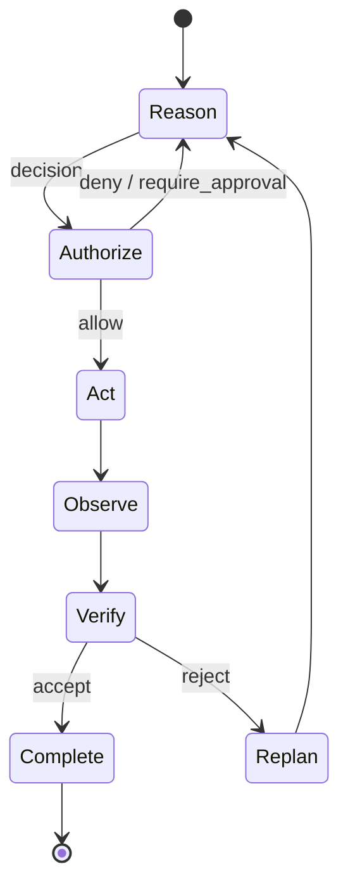
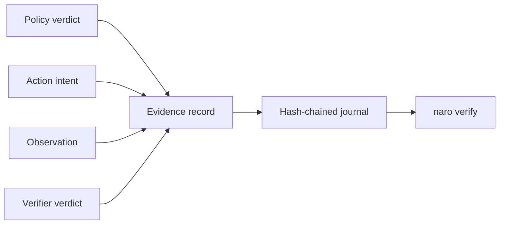
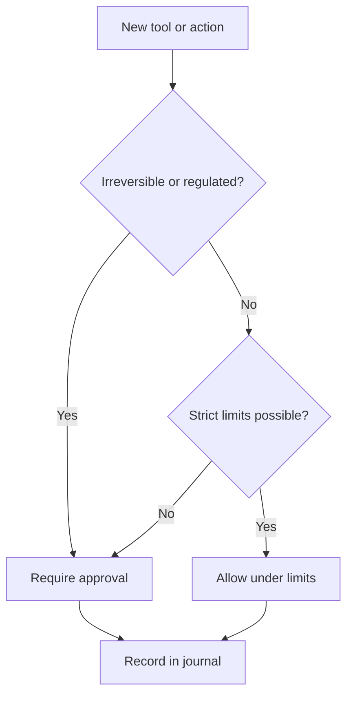

# Diagrams

Visual summaries of the core invariants. These diagrams are intentionally simple so they remain accurate as the implementation evolves.

## Core agent loop

## Evidence flow

## Autonomy decision tree

These diagrams are linked from the Foundations and relevant decision pages.
