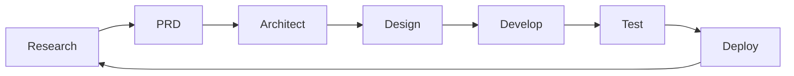

# AI System Development Lifecycle (AI SDLC)

A practical lifecycle for building production AI systems. Each phase has a clear goal, required artifacts, an exit gate, and a mapping to Naro mechanisms and the production gaps this guide addresses.

## Phases

| Phase | Goal | Key artifact | Exit gate |
|-------|------|--------------|-----------|
| [1. Research](01-research.md) | Understand the problem, risks, and constraints | Research brief | Problem and success metrics agreed |
| [2. PRD](02-prd.md) | Define what will be built and why | Product Requirements Document | Scope, autonomy level, and risks signed off |
| [3. Architect](03-architect.md) | Choose the system shape and invariants | Architecture decision record(s) | Major decisions recorded and reviewed |
| [4. Design](04-design.md) | Specify contracts, policy, verification, and evidence | Design spec | Contracts and gates reviewable |
| [5. Develop](05-develop.md) | Implement against the contracts | Working agent + tests | Core loop and gates pass locally |
| [6. Test](06-test.md) | Prove outcomes and prevent regressions | Baseline suite + evidence | `naro bench --baseline` (or equivalent) green |
| [7. Deploy](07-deploy.md) | Run with ownership, audit, and rollback | Runbook + journal retention | Production readiness checklist complete |

## How this maps to production gaps

- Research & PRD close **unclear value & ownership**.
- Architect & Design close **governance, verification, and data-contract** gaps.
- Test closes the **no regression gate** gap.
- Deploy closes **operating discipline and audit** gaps.

Use the phase pages in order for a new system, or jump to the phase you are currently in.
