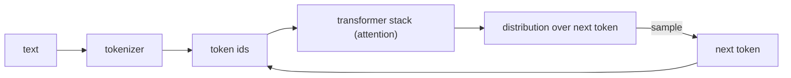

# 00 — How LLMs Work

## The one-sentence version

An LLM is a function that predicts the next token given all previous tokens.
Everything else — reasoning, tool use, agents — is built on top of that.

## Analogy

Think of an LLM as the world's best-read autocomplete. It has read a
significant fraction of public text and learned statistical structure so deep
that "what comes next" often looks like understanding. It doesn't *know*
anything the way a database does — it *predicts*.

## The mechanism (enough to be dangerous, not enough to build one)

1. **Tokens**: text is split into sub-word units (`"unbelievable"` → `un`,
   `believ`, `able`). Models see integers, not strings. Context windows,
   costs, and limits are all measured in tokens.
2. **Transformers**: stacked attention layers let every token "look at" every
   previous token and weigh relevance. That's how the model tracks "it" in
   "the cat sat on the mat because **it** was tired".
3. **Inference**: one forward pass produces a probability distribution over
   the next token. Sample from it (temperature controls sharpness), append,
   repeat. Generation is a loop — one token at a time.
4. **Context window**: the hard limit on how many tokens the model can see.
   Everything the model "knows" this turn must fit inside it — which is why
   context engineering (page 06) is a discipline.

## Key vocabulary

| Term | Meaning | Why you care |
|---|---|---|
| temperature | sampling sharpness (0=deterministic-ish) | reliability vs creativity |
| context window | max tokens in one call | hard budget for prompts |
| hallucination | fluent but wrong output | why verification exists |
| system prompt | highest-priority instruction channel | steerability & injection risk |
| finish reason | why generation stopped | `length` = you got truncated |

## In Naro

`@naro/model` wraps all of this behind `Model.chat(request)`. Your agent
code never touches tokenizers or sampling directly — but `Usage`
(input/output tokens, cost) flows through every response so budgets and
evaluation can measure it.

## Failure modes
- Hallucination: the model asserts falsehoods fluently → verify with evidence.
- Truncation: `finish_reason=length` mid-JSON → check finish reasons.
- Non-determinism: same prompt, different output → temperature, evals.

## Security
- The model will happily follow instructions embedded in *data* it reads
  (prompt injection). Treat model output as untrusted input.
- Never put secrets in prompts you can't fully control.

## Scale
- Inference cost scales with tokens in + tokens out. Long contexts are
  expensive; see page 06 (budgeting) and 12 (scale).
