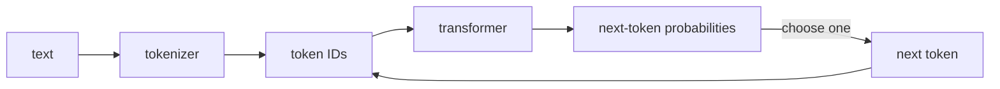

# 00 — How LLMs Work

Start with the least magical description: an LLM predicts the next token.

That sounds small. Repeated thousands of times, it can produce an explanation,
a plan, a tool call, or a convincing mistake. Understanding that loop will save
you from designing around abilities the model does not actually have.

## What happens when you send a prompt

1. **The tokenizer splits text into tokens.** A token may be a word, part of a
   word, punctuation, or whitespace. The model receives token IDs, not strings.
2. **The transformer processes those tokens.** Attention helps each generated
   token use relevant parts of the available context.
3. **The model scores possible next tokens.** It produces a probability
   distribution, not a fact.
4. **The decoder chooses one token.** Temperature and other sampling settings
   influence that choice.
5. **The loop repeats.** The chosen token becomes part of the input for the
   next step.



This explains a lot of model behavior. The output can be fluent because the
model is good at language patterns. It can still be wrong because plausible
continuation and verified truth are different jobs.

## The context window is the model's working view

A model can only use the tokens available in its current context window. That
usually includes instructions, conversation history, retrieved evidence, tool
results, and the output generated so far.

A larger window gives you room. It does not guarantee attention. Important
instructions can still be buried, irrelevant text can distract the model, and
every input token adds cost. We will deal with that directly in
[context engineering](06-context-engineering.md).

## Terms you will keep seeing

| Term | Plain meaning | Why it matters |
|---|---|---|
| token | the unit a model reads and writes | limits and billing use tokens |
| context window | the tokens available for one request | it is a hard capacity limit |
| temperature | how sharply the decoder favors likely tokens | lower is steadier; higher is more varied |
| hallucination | a plausible output unsupported by evidence | fluent is not the same as correct |
| finish reason | why generation stopped | `length` often means incomplete output |
| system message | high-priority instructions sent with the request | useful for behavior, not a security boundary |

Temperature `0` is often more repeatable, but do not treat it as a proof of
determinism. Providers, model versions, routing, and infrastructure can still
change the result.

## Where Naro draws the boundary

Naro does not implement tokenization or inference. `@naro/model` exposes a
provider-neutral `Model` interface and a canonical `ChatRequest`. Provider
adapters translate that request to a hosted API or local runtime.

The useful detail is what comes back: `ChatResponse` includes a `finishReason`
and may include `Usage`. The reasoner can catch truncation, while evaluation
and budget code can account for input tokens, output tokens, and cost.

```ts
const response = await model.chat(request);

if (response.finishReason === 'length') {
  // The answer may be incomplete. Do not parse or execute it blindly.
}
```

## Production instincts

- Verify claims with evidence. The model is generating, not consulting a truth
  table.
- Treat model output as untrusted input before parsing it or turning it into an
  action.
- Check the finish reason before accepting structured output.
- Keep secrets out of prompts unless the complete data path is trusted.
- Measure token use. Long prompts affect cost, latency, and often quality.

## Check your understanding

If the same prompt produces two different answers, that is not automatically a
bug. Ask which part varied: sampling, model version, retrieved context, tool
results, or provider routing. Agent engineering starts when those variables
become explicit.

Next: [Training—and why Naro does not do it](01-training.md).
