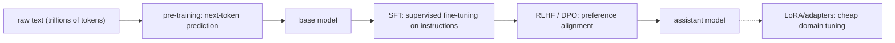

# 01 — Training (and why Naro doesn't do it)

## The one-sentence version

Training adjusts billions of parameters on massive compute so the model's
next-token predictions get better; Naro *consumes* the result through an
inference interface — it will never train anything.

## Analogy

Training is building the engine; Naro is the car. You should understand the
engine to drive well, but you don't manufacture pistons on the way to work.

## The pipeline

| Stage | What happens | Cost |
|---|---|---|
| **Pre-training** | predict next token on web-scale text | millions of $, months |
| **SFT** | imitate curated instruction→answer pairs | thousands of $ |
| **RLHF / DPO** | prefer helpful/harmless outputs via human prefs | high |
| **LoRA / adapters** | tune a small sidecar of weights, freeze the rest | tens of $ |

## What this explains about behavior

- **Why models are sycophantic**: RLHF rewards answers humans rate highly —
  which correlates with confidence and agreement. → Verify with evidence.
- **Why models "know" old facts**: knowledge is frozen at training time. → RAG
  (page 04) supplies fresh facts at inference.
- **Why fine-tuning ≠ memory**: training bakes in patterns, not retrievable
  records. → Memory (page 07) is a different mechanism entirely.

## In Naro

Naro's boundary is the `Model` interface — adapters reach hosted APIs or
self-hosted inference (vLLM, llama.cpp, Ollama). Training stays in their
world; the adapter boundary is the contract.

## Failure modes
- Assuming a fine-tuned model "remembers" your data (it doesn't — retrieve it).
- Assuming alignment training prevents misuse (it reduces it — policy remains).

## Security
- Training data can leak (memorization). Don't train on secrets.
- Fine-tuning can *weaken* safety training; evaluate after tuning.

## Scale
- If you ever do train: LoRA on a small model beats retraining a large one
  by orders of magnitude. But most agent problems are context problems,
  not capability problems — fix retrieval before you fine-tune.
