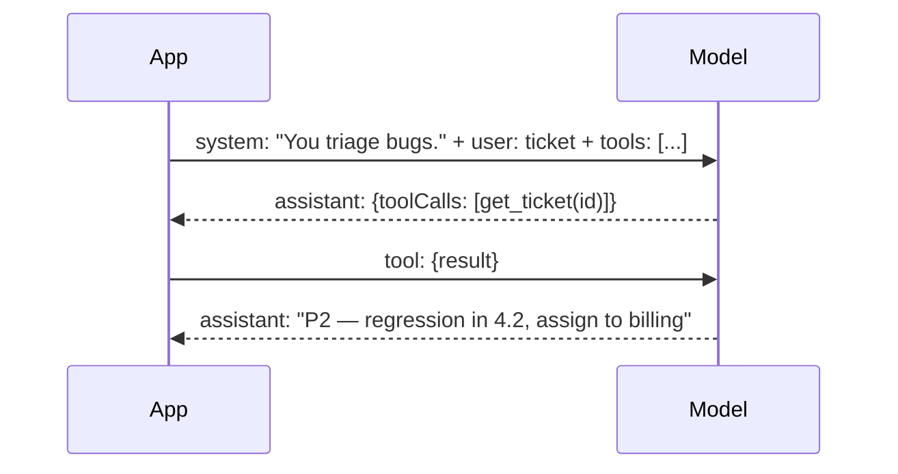

# 02 — Prompting & Structured Output

## The one-sentence version

The prompt is the entire observable universe of the model — everything it
knows this turn, it knows because you put it in the context window.

## Analogy

Prompting is briefing a brilliant consultant with amnesia: every call, they
wake up knowing only what's in the memo you hand them. Quality of memo =
quality of work.

## The mechanics

- **Roles**: `system` (policy/persona), `user` (request), `assistant`
  (model's prior outputs, replayed), `tool` (results fed back).
- **Few-shot**: showing 2–3 input→output examples beats paragraphs of
  instruction for format compliance.
- **Structured output**: constrain generation to a JSON Schema so output is
  machine-checkable — the difference between "please reply as JSON" (a wish)
  and schema-constrained decoding (a guarantee, where supported).

## In Naro

`ChatRequest` in `@naro/model` is the canonical form: `messages` (roles),
`tools` (ToolSpec = name+description+JSON Schema), `responseFormat`
('text' | 'json' | schema-constrained — gated by the `structured-output`
capability). Reasoners assemble prompts; the model only answers.

## Failure modes
- **Vague instructions** → confident wrong formats. Prefer schemas over prose.
- **Prompt drift** across model versions → eval on upgrades (page 10).
- **Context rot**: very long prompts degrade instruction-following → budget
  and compress (page 06).

## Security
- User-controlled text inside a prompt is an injection vector: it can
  override your instructions. Delimit it, mark it untrusted, and never let
  it widen permissions. See page 11.
- System prompts are not secret — assume they leak.

## Scale
- Prompt tokens are billed every call. Shared prefixes enable provider-side
  caching on some APIs — keep the stable part of the prompt first.

## Swap
Different models want different phrasing — adapters translate `ChatRequest`
to provider formats; agent code stays put.
