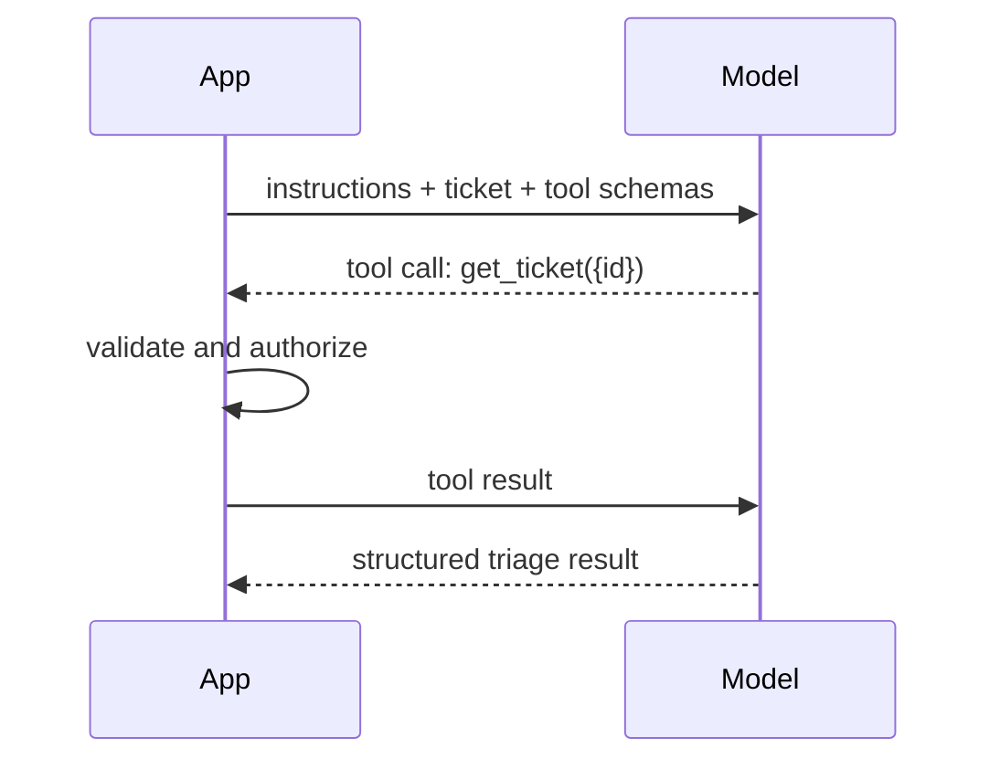

# 02 — Prompting and Structured Output

A prompt is not just the user's last sentence. It is the complete request the
model receives: instructions, messages, examples, tool definitions, retrieved
context, and output constraints.

Think of it as a work brief for a capable colleague who cannot see anything you
did not include. A good brief states the job, supplies the evidence, defines
the boundaries, and makes the expected result testable.

## Build prompts in layers

A reliable prompt usually answers these questions:

1. **What is the task?** State the outcome, not a vague persona.
2. **What evidence is available?** Include only relevant context and identify
   where it came from.
3. **What may the model do?** Offer tools explicitly; do not imply access it
   does not have.
4. **What must the output look like?** Use a schema when code will consume the
   result.
5. **How will success be judged?** Give concrete criteria or examples.

Message roles keep those layers legible:

- `system` carries application instructions;
- `user` carries the request;
- `assistant` replays earlier model turns;
- `tool` carries the result of a tool call.

Provider behavior and instruction hierarchies differ, so roles are not a
security boundary. They help organize intent; policy code still controls what
the agent may do.

## Examples often beat more prose

If a model keeps returning the wrong shape, show it two or three representative
input/output pairs. Examples expose details that long instructions often miss:
field names, edge cases, tone, and acceptable omissions.

Choose examples carefully. The model will copy accidental patterns too. Cover
the common case and at least one awkward case rather than repeating the same
shape three times.

## Structured output is a contract

“Reply with JSON” is an instruction. A JSON Schema is a machine-checkable
contract. When the provider supports schema-constrained generation, use it.
When it does not, validate the returned text and handle failure before the data
reaches the rest of your system.



## In Naro

`@naro/model` represents this request as `ChatRequest`:

```ts
const request = {
  messages,
  tools,
  responseFormat: {
    type: 'schema',
    schema: triageSchema,
  },
};
```

Offering `tools` requires the model's `tool-calling` capability. Passing a
schema object as `responseFormat` requires `structured-output`. Naro checks
those declarations instead of silently degrading to a weaker mode.

Reasoners own prompt construction because prompting is part of the reasoning
strategy. The runtime only receives a closed `Decision`: plan, act, request
context, wait for a human, complete, or fail.

## Where prompts fail

**The instruction is vague.** “Review this” does not say whether to summarize,
find defects, or approve. Name the decision you need.

**The context is noisy.** More text can reduce quality. Retrieve, rank, and
budget it; do not dump the entire knowledge base into the prompt. See
[context engineering](06-context-engineering.md).

**The format is wishful.** Validate structured output. A convincing near-match
is still invalid input.

**A model upgrade changes behavior.** Prompts are code with a probabilistic
runtime. Put important cases in [evaluation](10-evaluation.md).

## Security rules

- Treat user text, retrieved documents, and tool output as untrusted data.
- Delimit untrusted content and preserve its provenance.
- Never let text inside the prompt grant permissions.
- Assume system instructions can be exposed. Do not store secrets there.
- Keep stable instructions first when your provider supports prefix caching,
  but measure before optimizing around provider-specific behavior.

## Try it

Take a prompt from your application and mark each line as instruction,
evidence, example, or output contract. If a line fits none of those,
remove it and compare the result in an eval.

Then look at where Naro actually builds one: open `reasoning/src/react.ts`
and `reasoning/src/transcript.ts` to see a real `ChatRequest` assembled —
messages, tools, and `responseFormat` — from a `ReasoningContext`. Run
`npm run example:react` and watch the events; each `reasoning.started` /
`action.requested` pair is one turn of the layered prompt this page
described, made concrete.

## Check yourself

- Why isn't a `system` message a security boundary, even though it
  carries the application's instructions?
- A tool call keeps returning malformed JSON. Is the fix "add more
  instructions" or "add a schema and validate"? What's the actual
  difference?
- Name one thing that belongs in `responseFormat` and one thing that
  belongs in `tools` — and why mixing them up breaks capability checking.

Next: [Reasoning patterns](03-reasoning-patterns.md).
