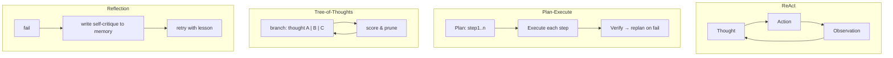

# 03 — Reasoning Patterns

## The one-sentence version

A reasoning pattern is a *strategy for spending* model calls — the model is
the same; how you interleave thinking, acting, and checking is the design.

## Analogy

Same chess engine, different play styles: react move-by-move (ReAct), plan
the whole game first (Plan-Execute), explore many lines (Tree-of-Thoughts),
review your blunders after each game (Reflection).

## The repertoire



| Pattern | Strength | Cost | When |
|---|---|---|---|
| Direct | fast, cheap | brittle | trivial tasks |
| ReAct | grounded, flexible | many calls | exploration, tool use |
| Plan-Execute | structured, legible | plan may be wrong | known-shape tasks |
| ToT / search | finds non-obvious paths | expensive | puzzles, design |
| Reflection | improves over tries | memory bloat | iterative tasks |
| Multi-agent | specialization | coordination overhead | big heterogeneous work |

## In Naro

All of these are the same seam:

```ts
interface Reasoner {
  strategy: string;
  decide(ctx: ReasoningContext): Promise<Decision> | Decision;
}
```

- ReAct: `decide` returns `{kind:'act',…}` until done → `{kind:'complete'}`.
- Plan-Execute: first `decide` returns `{kind:'plan', tasks}`; later calls act.
- ToT: a reasoner that fans out model calls internally, then returns one decision.
- Reflection: on failed observations, writes a critique to context before retrying.

The runtime never learns a new word — `Decision` is the closed union of what
*any* strategy may ask for. That's what "pluggable reasoning" means in
practice.

## Failure modes
- **Loops**: ReAct agents repeat a failing action → `maxIterations` bounds it;
  replanning + verifier evidence break the cycle.
- **Plan rigidity**: executing a stale plan → verify each step, replan on fail.
- **Search blowup**: ToT branching unbounded → beam width + budget caps.

## Security
- A reasoning trace can leak sensitive context or chain-of-thought; policy
  controls what is recorded/exported.

## Scale
- More reasoning = more tokens = more cost and latency. Match strategy cost
  to task value; measure with evals (page 10).
