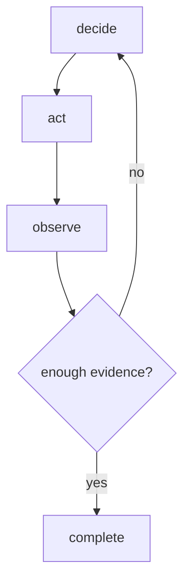

# 03 — Reasoning Patterns

A reasoning pattern decides how to spend model calls. The underlying model may
stay the same while the agent becomes faster, safer, or more reliable because
the control flow changed.

Do not start with the most elaborate pattern. Start with the cheapest one that
can produce evidence of success.

## The useful patterns

| Pattern | How it works | Good fit | Main cost |
|---|---|---|---|
| direct | one decision or scripted rule | simple, well-shaped tasks | brittle when the task changes |
| ReAct | alternate model decisions and observations | tool use and exploration | extra calls and loop risk |
| plan–execute | create tasks, then execute and verify them | work with known stages | the plan can become stale |
| search | explore and score several candidate paths | hard design or puzzle-like work | branching cost |
| reflection | feed a failure lesson into the next attempt | repeated tasks with useful feedback | bad lessons can compound |
| multi-agent | delegate bounded work to specialists | genuinely separable work | coordination and context loss |



ReAct is just this loop made explicit. Plan–execute adds a task graph before
acting. Reflection changes the next prompt after failure. Search runs several
possible next steps before choosing one. The patterns are variations in control
flow, not new kinds of intelligence.

## The Naro seam

Every strategy implements the same interface:

```ts
interface Reasoner {
  readonly strategy: string;
  decide(ctx: ReasoningContext): Promise<Decision> | Decision;
}
```

`Decision` is deliberately closed:

```text
plan | act | need-context | wait-for-human | complete | fail
```

That closed union is the important design choice. A reasoner can be driven by a
model, rules, tree search, or a human. The runtime still knows every possible
request it can make.

`@naro/reasoning` currently includes:

- `ReActReasoner`, which turns model tool calls into actions;
- `PlanExecuteReasoner`, which creates a structured plan and dispatches
  task-bound actions;
- `ReflectionReasoner`, which adds lessons from failed observations;
- `DirectReasoner` in `@naro/runtime`, for scripted decisions without a model.

## Pick a pattern from the failure, not the fashion

Use **direct** when one call or a deterministic rule is enough.

Move to **ReAct** when the model must inspect results before deciding what to do
next. Bound it with `maxIterations`, because a flexible loop is also a loop that
can repeat a bad action.

Use **plan–execute** when progress and dependencies need to be visible. Verify
each step and allow replanning; a plan written before the first observation is
only a hypothesis.

Use **reflection** when failures contain reusable information. Keep the lesson
specific and evidence-backed. “Try harder next time” is not memory.

Use **multiple agents** only when work can be separated cleanly or needs
different privileges. Two model calls pretending to have job titles are not
automatically better than one well-designed loop.

## Failure modes

- **Repeated action:** record the failed observation and cap iterations.
- **Stale plan:** verify steps and replan when the world disagrees.
- **Search explosion:** cap depth, width, tokens, and wall-clock time.
- **Reflection drift:** do not promote an unverified self-critique to fact.
- **Trace leakage:** reasoning inputs may contain sensitive context. Export only
  what your policy allows.

More reasoning raises token cost and latency. Evaluate it against task success,
not against how impressive the trace looks.

## Check your understanding

A deployment task has five known stages and each stage has a machine-checkable
result. Start with plan–execute. An unfamiliar repository investigation where
each finding changes the next question is a better fit for ReAct.

Next: [Retrieval-augmented generation](04-rag.md).
