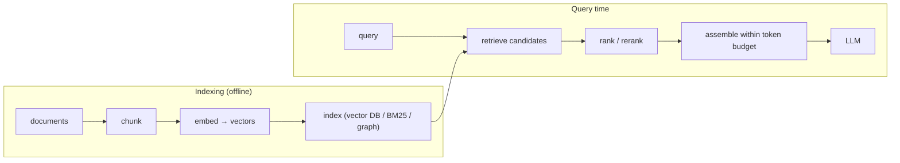

# 04 — RAG: Retrieval-Augmented Generation

## The one-sentence version

Instead of hoping the model memorized the answer, fetch the relevant facts
and put them in the prompt — give the amnesiac consultant a good filing
cabinet.

## Analogy

Closed-book exam vs open-book exam. RAG is open-book: the model doesn't need
to *know*, it needs to *look up well*.

## The pipeline

1. **Chunk**: split documents into retrievable pieces. Chunk size is the
   classic trade-off — too big dilutes relevance, too small loses context.
2. **Embed**: a model maps text → vector; similar meanings land near each
   other in vector space.
3. **Retrieve**: vector similarity, keyword/BM25, SQL filters, graph
   traversal — or hybrid, which usually wins.
4. **Rerank**: a second model re-scores candidates for precision.
5. **Assemble**: fit the best pieces into the token budget (page 06).

## In Naro

- The seam: `ContextProvider.retrieve(query) → ContextItem[]` in `@naro/core`.
- The runner handles `decision.kind === 'need-context'` by calling it —
  reasoning *requests* context, retrieval *serves* it.
- `ContextItem.source` preserves provenance — every piece of context is
  attributable, which is what makes audit and injection defense possible.
- `@naro/context` implements the pipeline (sources → rank → select →
  compress → budget) behind this interface — `KeywordSource` ships as the
  reference; vector/SQL/graph sources plug in unchanged.

## Failure modes
- **Retrieval misses**: the right fact exists but isn't fetched → hybrid
  retrieval, better chunking, query rewriting.
- **Poisoned context**: retrieved text contains instructions ("ignore
  previous directions") → treat retrieved content as untrusted data.
- **Stale index**: doc changed, embedding didn't → index freshness policy.

## Security
- Retrieved content is the #1 indirect prompt-injection vector. Mark
  provenance, strip or fence instructions in retrieved text, never let a
  document grant permissions.
- Per-tenant retrieval filters must be enforced *before* the LLM sees data.

## Scale
- Vector DBs (Qdrant, Milvus, pgvector) scale retrieval; BM25 (OpenSearch)
  complements semantics with exact terms.
- Cache embeddings; embed once, query many.

## Swap
`ContextProvider` is one method — in-memory today, Qdrant+reranker tomorrow,
zero changes to the runner.
