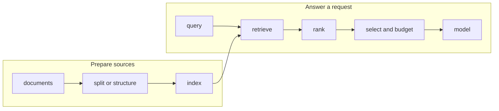

# 04 — Retrieval-Augmented Generation

Retrieval-augmented generation, or RAG, gives the model evidence at request
time. Instead of hoping a fact is encoded in the model's weights, you fetch the
best source material and place it in context.

The hard part is not “use a vector database.” The hard part is retrieving the
right evidence, preserving where it came from, and fitting it into a limited
context window.

## The two halves of RAG



During preparation, you make source material searchable. During the request,
you retrieve candidates and decide which pieces deserve space in the prompt.

A practical pipeline looks like this:

1. **Split or structure the source.** Preserve enough local context for each
   result to make sense.
2. **Index it.** That may mean embeddings, BM25, SQL columns, a graph, or no
   special index at all.
3. **Retrieve candidates.** Use semantic similarity, exact terms, filters, or a
   hybrid.
4. **Rank or rerank them.** Retrieval gets candidates; ranking decides priority.
5. **Select within budget.** The best ten results are useless if only three fit.
6. **Generate with citations or provenance.** The answer should remain tied to
   its evidence.

## Retrieval choices

Vector search is good at semantic similarity. Keyword search is good at exact
names, identifiers, and rare terms. SQL filters are good at hard constraints
such as tenant, date, or status. Graph traversal is good when relationships are
the question.

Hybrid retrieval often performs well because these methods fail differently.
Do not add all of them by default. Build a small eval set from real questions
and measure recall before increasing complexity.

## Chunking is a product decision

Large chunks preserve context but may hide the relevant sentence and consume
more tokens. Small chunks retrieve precisely but can lose headings, qualifiers,
and neighboring definitions.

Start from the structure people already use: sections, functions, records,
tickets, or policy clauses. Fixed token windows are a fallback, not a law.
Always retain source identifiers so the original can be inspected.

## In Naro

A reasoner asks for context with a `need-context` decision. The runtime passes
the query to `ContextProvider.retrieve()` and returns the resulting
`ContextItem[]` to later reasoning cycles.

`@naro/context` now provides a working `ContextEngine`:

```text
sources → merge → rank → select → truncate → budget
```

Each `ContextItem` carries `id`, `source`, `content`, and an optional `score`.
`KeywordSource` is the lexical in-memory reference source; `EmbeddingSource`
is its semantic counterpart, scoring documents by cosine similarity against
a query embedded through any `Model` that declares `'embeddings'`. SQL, a
real vector database, file, or API sources can implement the same
retrieval contract without changing the runner.

The default budget is expressed in items and characters. A token-aware adapter
can be more exact, but a hard character cap is still better than an unbounded
prompt.

## Failure modes

**The answer exists but is never retrieved.** Improve query rewriting,
chunking, filters, or hybrid recall.

**The best result is buried.** Add ranking and inspect whether source scores are
comparable.

**The index is stale.** Define freshness, deletion, and re-indexing behavior as
part of the data pipeline.

**Retrieved text contains instructions.** It is still untrusted data. A document
can provide evidence; it cannot grant the agent permission.

**Tenant filters happen too late.** Enforce access control before retrieval
results reach the model. Prompt instructions are not row-level security.

## Try it

Build twenty questions whose answers you can point to in the source
material. Measure whether the required chunk appears in the top results.
Debug retrieval before judging the final prose—the model cannot cite
evidence it never saw.

Then read the pipeline for real: open `context/src/engine.ts` (the
`sources → merge → rank → select → truncate → budget` stages as code) and
`context/src/keyword-source.ts` (the reference `ContextSource`). Run
`npm run example:research` and check the research agent's citations —
`ResearchEnvironment` refuses a citation whose URL was never actually
fetched, which is provenance enforced structurally, not by convention.

## Check yourself

- Retrieval returns the right document, but the answer still cites the
  wrong fact. Is that a retrieval problem, a ranking problem, or a
  budgeting problem — and how would you tell which?
- Why does "the tenant filter is in the prompt" fail as an access-control
  strategy, even if the prompt says it clearly?
- What's the difference between a document *providing evidence* and a
  document *granting permission* — and which one can retrieved text
  never do?

Next: [Tool calling and MCP](05-tool-calling.md).
