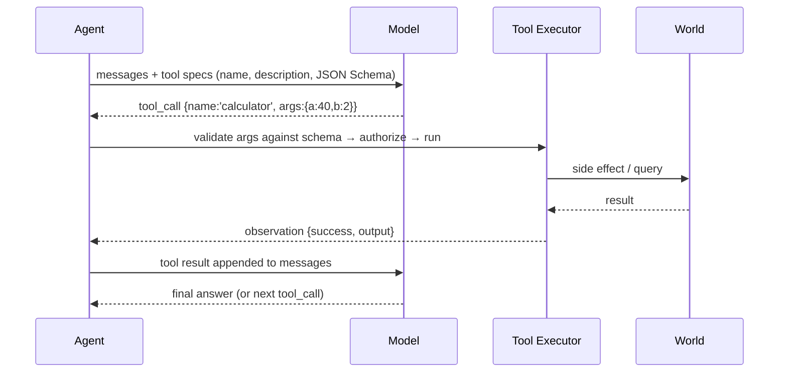

# 05 — Tool Calling (and MCP)

## The one-sentence version

Tool calling lets a model emit a *structured request* to run code instead of
prose — the model describes the call, your system executes it and feeds the
result back.

## Analogy

The model is a manager who can't leave their desk: they write a work order
(tool call), someone else executes it, and the report comes back to their
desk (observation). A good manager is judged on the orders they write.

## The mechanics

- **Schemas are the contract**: the model writes JSON that must validate
  against `inputSchema`; tools promise `outputSchema`. Naro validates both
  directions — a tool that lies about its output breaches the contract.
- **MCP** (Model Context Protocol) is the emerging standard wire format for
  discovering and invoking tools on external servers. In Naro it's a
  `ToolSource` adapter — one way to fill the registry, not the only way.

## In Naro

- `Tool` = metadata + `inputSchema`/`outputSchema` + `permissions` +
  `sideEffects` + `execute()`. Everything declarative except the work.
- `ToolExecutor` runs `resolve → validate → execute → observe`; the runner
  adds `authorize` before it via `PolicyEngine`.
- `createToolPolicy(registry)` turns tool metadata into decisions:
  missing permissions → `deny`, `sideEffects:'destructive'` → `require_approval`.

## Failure modes
- **Bad arguments**: model invents params → schema validation rejects before
  execution (no partial side effects).
- **Tool spam**: loops calling the same tool → iteration bounds + reasoner
  sees failures as observations.
- **Wrong tool**: poor descriptions → mis-selection. Tool descriptions are
  part of your prompt engineering.

## Security
- *Every* call passes the policy gate; `REASONING → ACTING` isn't a legal
  transition — there is no path around it.
- `sideEffects` is declared so governance can reason about blast radius
  *before* execution.
- Tool outputs are untrusted content (injection vector — see pages 04, 11).

## Scale
- Registries can merge many `ToolSource`s (local + MCP + remote catalog);
  `refresh()` re-discovers.
- Long-running tools: executors receive `ctx.signal` — honor it.
