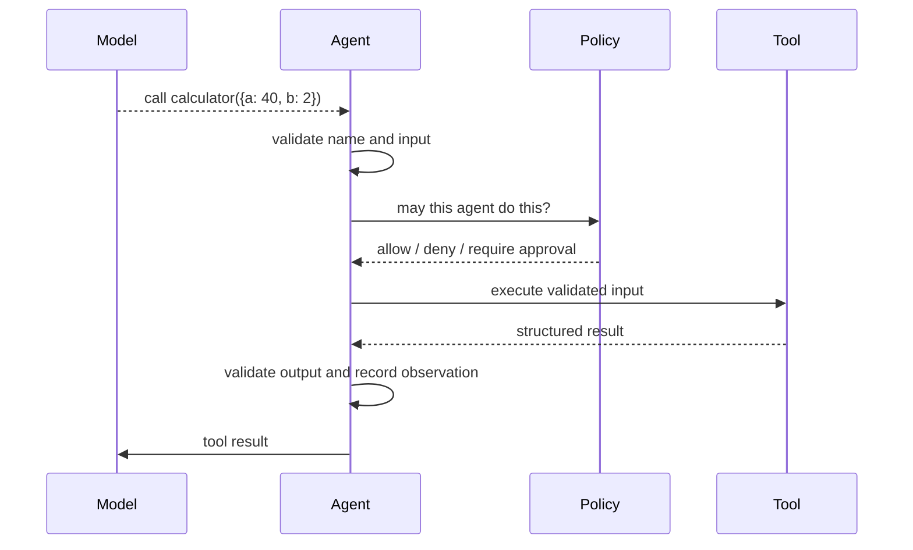

# 05 — Tool Calling and MCP

A language model can describe an action. It cannot perform that action by
itself. Tool calling is the protocol that turns a model's structured request
into code your application may choose to run.

That distinction matters: the model proposes; your runtime validates,
authorizes, executes, and records.

## One tool call, end to end



The model does not call a function directly. It emits a tool name and
arguments. Your application remains responsible for every step with real-world
consequences.

## Schemas are part of the safety model

A tool schema tells the model what to request and gives the executor something
to validate. Good schemas use narrow types, required fields, bounded values,
and descriptions that distinguish similar tools.

Validation must run in both directions:

- validate input before execution so malformed calls have no partial effect;
- validate output before it enters the next prompt or another component.

A schema does not authorize anything. `{ "service": "payments" }` can be valid
JSON and still be forbidden for this agent.

## In Naro

A Naro `Tool` combines declarative metadata with one `execute()` function:

```ts
const deploy: Tool = {
  name: 'deploy',
  description: 'Deploy one service to a named environment',
  inputSchema: deployInputSchema,
  outputSchema: deployOutputSchema,
  permissions: ['deploy.write'],
  sideEffects: 'write',
  execute: async (input, ctx) => deployService(input, ctx.signal),
};
```

The execution path is split across clear boundaries:

```text
resolve → policy gate → validate input → execute → validate output → observe
```

`ToolRegistry` resolves names and can merge multiple `ToolSource`s.
`ToolExecutor` handles validation and execution. `AgentRunner` invokes the
`PolicyEngine` before the executor. `createToolPolicy(registry)` derives a
baseline policy from each tool's permissions and side-effect declaration.

Destructive tools require human approval under that baseline policy. If no
human bridge is configured, approval is denied rather than silently granted.

## Where MCP fits

MCP, the Model Context Protocol, standardizes how clients discover and invoke
capabilities exposed by external servers. In Naro, an MCP integration belongs
behind `ToolSource`: it discovers remote tools and presents them through the
same registry contract as local tools.

`@naro/adapter-mcp` provides `McpToolSource`: it wraps a connected MCP client,
discovers the server's tools, and registers them through the same registry
contract as local tools. Calls then follow the standard validation, policy,
execution, and observation path. MCP does not declare side effects, so unknown
remote tools default to `destructive` until you review and override their
metadata.

## Failure modes

**The model invents an argument.** Reject it at validation. Do not repair a
write request by guessing.

**The wrong tool is selected.** Improve names, descriptions, and examples.
Tools that sound interchangeable will be treated as interchangeable.

**The agent repeats a failed call.** Return the failure as an observation and
bound the reasoning loop.

**A retry duplicates a side effect.** Use idempotency keys for writes and do
not blindly retry destructive work.

**Tool output contains a prompt injection.** Treat output as untrusted content,
just like a retrieved document.

## Design checklist

Before registering a tool, answer:

- What is the narrowest input contract?
- Which permission does it require?
- Is it read-only, a write, or destructive?
- Can it be retried safely?
- Does it honor `AbortSignal`?
- What output can safely return to the model?

Next: [Context engineering](06-context-engineering.md).
