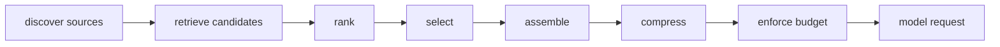

# 06 — Context Engineering

Context engineering is the work of deciding what the model sees for one
decision. Prompt writing is part of it, but so are retrieval, ordering,
compression, tool results, memory recall, and token budgets.

The goal is not to fill the window. The goal is to give the model the smallest
set of information that makes a good decision likely.

## Treat context as a pipeline



Each stage answers a different question:

- **Discover:** which sources are allowed and available?
- **Retrieve:** which items may be relevant?
- **Rank:** which candidates deserve priority?
- **Select:** which items should survive?
- **Assemble:** how should instructions, evidence, and history be arranged?
- **Compress:** what can be shortened without changing the meaning?
- **Budget:** does the final request fit, including room for the answer?

Combining these stages into “build a big string” makes failures hard to locate.
Keep the boundaries visible.

## Budget before you retrieve

A useful budget starts with the model's context limit, then reserves space for:

- the expected output;
- stable application instructions;
- tool definitions;
- recent observations or conversation;
- retrieved evidence.

The remainder is not free space to fill. It is a ceiling. Long contexts can
degrade instruction following even when they fit technically, especially when
relevant evidence is surrounded by repetitive or conflicting text.

## Ordering and provenance

Put instructions where they are easy to distinguish from data. Group related
evidence, label its source, and preserve identifiers that let you inspect the
original.

Position can affect model attention, but avoid cargo-cult rules such as “always
put evidence last.” Measure with your model and task. Clear structure and less
noise are more portable than provider-specific tricks.

Provenance is not decoration. It lets you cite answers, apply trust rules, debug
bad retrieval, and trace an injection back to its source.

## In Naro

`ContextItem` is the unit passed through the system:

```ts
interface ContextItem {
  readonly id: string;
  readonly source: string;
  readonly content: unknown;
  readonly score?: number;
}
```

A reasoner returns `need-context`; the runtime calls the configured
`ContextProvider`; retrieved items become part of later `ReasoningContext`
values.

`@naro/context` implements the pipeline with `ContextEngine`. It can fan out to
several sources, merge and rank their results, cap the item count, and truncate
to a character budget. Its reference `KeywordSource` uses term overlap. More
capable sources can sit behind the same `ContextSource` contract.

The current budget uses `maxItems` and `maxChars`. Character count is an honest,
portable approximation, not exact token accounting.

## Failure modes

- **Context rot:** quality falls as history and evidence accumulate. Remove or
  summarize before adding more.
- **Budget blowout:** retrieval returns more than the request can hold. Enforce
  a hard limit after ranking.
- **Summary distortion:** compression drops a qualifier. Keep links to original
  evidence and evaluate summaries on critical details.
- **Self-reinforcing errors:** an agent retrieves its own unsupported claim.
  Separate observations, model claims, and trusted sources.
- **Authority confusion:** text from a document looks like an instruction.
  Provenance never upgrades data into policy.

## A practical test

Log the final context as structured sections during development. For a failed
run, ask:

1. Was the needed evidence retrieved?
2. Did it survive ranking and budgeting?
3. Could the model distinguish evidence from instructions?
4. Was contradictory or stale material included?

This is faster than rewriting the prompt blindly.

## Try it

Open `context/src/engine.ts` and read `ContextEngine` top to bottom — it's
short enough to read in one pass, and it's the pipeline diagram from
this page turned into ~six method calls. Then open
`context/src/engine.test.ts` to see `maxItems`/`maxChars` budgeting
actually enforced against a fixture, not just described.

## Check yourself

- A context budget is set to 4000 characters and retrieval returns
  12,000 characters of relevant material. What should happen, in what
  order — rank first or truncate first, and why does the order matter?
- Why is "the context window is big enough" not the same claim as "the
  model will use the right part of it"?
- Where does provenance (which source an item came from) actually get
  used later — pick two consumers from earlier pages in this course.

Next: [Memory](07-memory.md).
