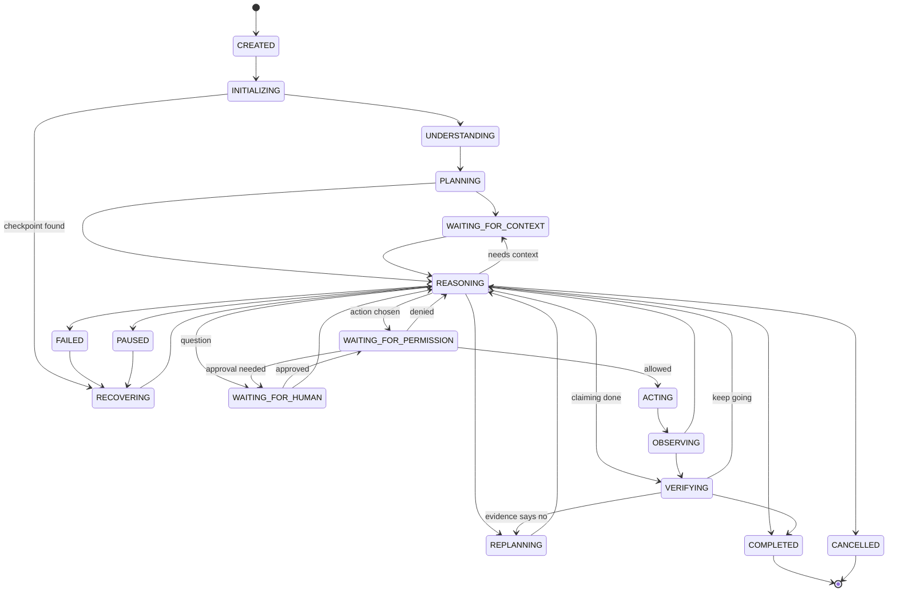

# 08 — Agent Loops & State Machines

## The one-sentence version

An agent is a loop — perceive, decide, act, repeat — and making that loop an
explicit state machine is the difference between a demo and a system.

## Analogy

A while-loop says "keep going until done". A state machine says *where* you
are, *how* you got there, and *where you're allowed to go next* — which is
what lets you pause, resume, audit, and prove the agent can't teleport.

## Why explicit states

The naive loop `while (!done) { llm(); tool(); }` can't answer: Can I pause?
Resume after a crash? Prove an action was authorized? Reconstruct what
happened? Naro's 18 states exist so every answer is yes:

Rules worth memorizing:

- **`REASONING → ACTING` does not exist.** The only road to action runs
  through `WAITING_FOR_PERMISSION`. Policy is a topology, not a check.
- **FAILED is semi-terminal** — it may go to RECOVERING, never silently back.
- **Checkpoints only at reasoning boundaries** — a restore never resumes
  inside a half-finished side effect.

## In Naro

`AgentRunner` is the *only* code that can transition states
(`assertTransition` throws on anything else). `ctx.iteration` +
`maxIterations` bound the loop. `AbortSignal` cancels at boundaries;
`runner.pause()` parks at PAUSED → checkpoint → a fresh process can resume.

## Failure modes
- Runaway loops → `maxIterations` (default 64).
- Mid-action crashes → error observations, not corrupted state.
- Zombie agents → cancellation propagates via `AbortSignal` to executors.

## Security
- Denied and refused-approval actions are *observations* — the reasoner sees
  "no" as evidence and can adapt, instead of the runtime hiding it.

## Scale
- Long-running agents are normal: checkpoint file per agent (`JSONL`), resume
  anywhere. This is what makes hour-long runs and multi-day supervision
  possible without special machinery.
