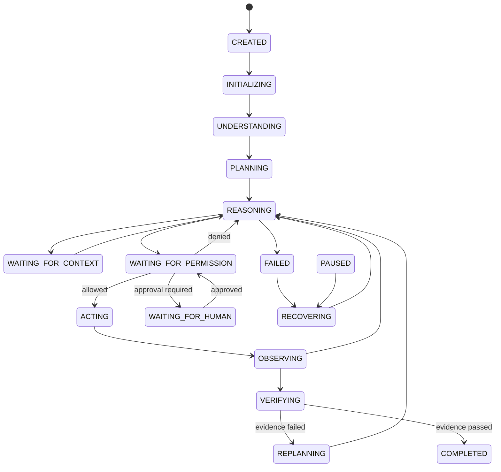

# 08 — Agent Loops and State Machines

An agent is a loop: inspect the current situation, decide, act, observe, and
repeat until the goal is complete or execution must stop.

A plain `while` loop can demonstrate the idea. A state machine makes it
operable. It tells you where the agent is, which transitions are legal, where
policy runs, and what can be resumed after failure.

## Why explicit state pays off

Without explicit states, basic production questions become guesswork:

- Is the agent thinking, waiting for approval, or executing a side effect?
- Can this run be paused safely?
- Did policy authorize the action?
- What should happen after a crash?
- Is “complete” a model claim or a verified outcome?

Naro models those distinctions as 17 states rather than hiding them in log
messages.



The complete transition table lives in `@naro/core`; the diagram focuses on the
main execution path.

## The structural rules

**There is no `REASONING → ACTING` transition.** Every action passes through
`WAITING_FOR_PERMISSION`. `AgentRunner` requires a `PolicyEngine`; authorization
is part of the topology, not an optional line inside a tool.

**`COMPLETED` and `CANCELLED` are terminal.** `FAILED` is recoverable only
through `RECOVERING`, so a failed run cannot silently continue.

**Reasoning is bounded.** `maxIterations` defaults to 64. A flexible loop still
needs a hard stop.

**Failures become evidence where possible.** Tool and environment errors are
recorded as observations so the reasoner can adapt instead of losing the run to
an exception.

## In Naro

`AgentRunner` owns transitions and calls `assertTransition` for every move. A
reasoner can request only one of the known `Decision` variants; it cannot mutate
the state machine directly.

At a high level, each cycle does this:

```text
reason → authorize → act or act-batch → observe → verify → replan or continue
```

An `act-batch` still authorizes each action serially. Only authorized actions
execute concurrently, and every result is observed and verified.

The runner emits typed events throughout the cycle. Those events support audit,
UI updates, debugging, and evaluation without changing the execution logic.

When a `CheckpointStore` is configured, the runner saves tasks, actions,
observations, context, iteration, optional reasoner state, and journal position
after completed cycles. A resumed runner restores the original `runId` and
event sequence, enters `RECOVERING`, and returns to a reasoning boundary. It
does not resume halfway through a side effect.

Cancellation and action deadlines use `AbortSignal`. Executors must honor or
propagate the signal; `SandboxedExecutor` terminates its worker directly.

## Failure modes

- **Runaway loop:** cap iterations, tokens, cost, and time.
- **Zombie action:** enforce deadlines and make executors honor cancellation.
- **Duplicate side effect after retry or recovery:** use idempotency keys and
  record external operation IDs.
- **False completion:** require verifier evidence for important goals.
- **Unrecoverable checkpoint:** version the checkpoint shape and test restore,
  not just save.

## Read a trace like a story

A healthy trace should answer: what did the agent know, what did it decide, who
authorized it, what changed in the world, and what evidence justified the next
step? If one of those is missing, add structure before adding more model calls.

Next: [Multi-agent systems](09-multi-agent.md).
