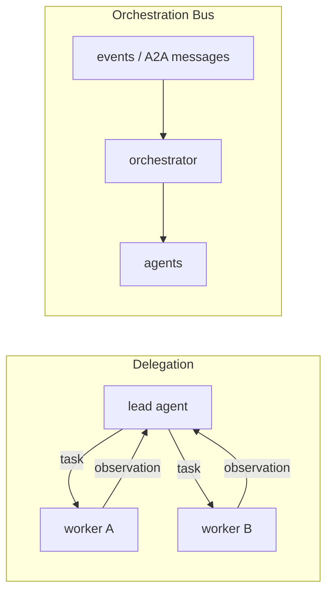

# 09 — Multi-Agent Systems

## The one-sentence version

Multi-agent isn't a different architecture — it's the same primitives with
more than one participant: a task delegated *is* a goal owned by another
agent.

## Analogy

An org chart: a lead decomposes work, delegates tickets to specialists,
reviews outcomes. The org works because roles, handoffs, and review are
explicit — not because everyone shares one brain.

## Patterns

- **Delegation**: `Task.owner` is another agent's id — delegation is already
  expressible; the child agent's completion arrives as an Observation.
- **Shared context**: parents pass *selected* context, not their whole
  transcript — attention and injection control in one move.
- **A2A protocol**: agent-to-agent messaging standard (like MCP for tools).
  In Naro it's an adapter surface, same as MCP — same primitives, new wire.

## In Naro

- `Task.owner`, `parentId`, `dependsOn` — the decomposition graph.
- Child agents emit their own event streams scoped by `agentId`/`goalId` —
  supervision is just subscribing to another agent's bus.
- Approval chains compose: a child's `require_approval` can surface to the
  parent's human bridge.

## Failure modes
- **Infinite delegation**: A delegates to B delegates to A → depth limits +
  budgets per sub-goal.
- **Context telephone**: each hop loses fidelity → pass structured task
  specs, not summaries of summaries.
- **Overlapping writes**: two agents, one environment → environment
  capabilities + policy decide who may write what.

## Security
- Inter-agent messages are *untrusted input* — a compromised agent can
  inject another. Same fencing rules as tool output.
- Least privilege per agent: delegate narrow grants, not your whole policy.

## Scale
- Agents are independent processes — scale horizontally; the event bus
  abstraction tolerates moving from in-process pub/sub to a real broker.
