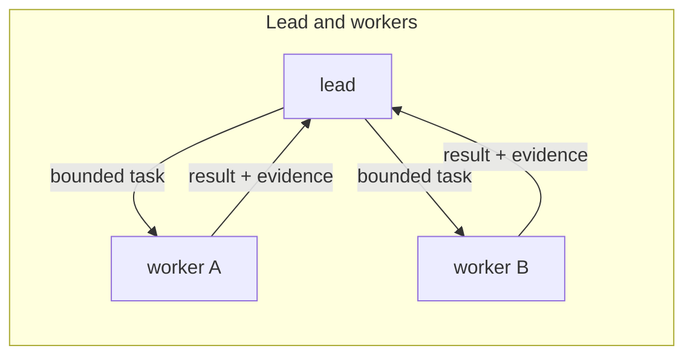

# 09 — Multi-Agent Systems

A multi-agent system is useful when work has real boundaries: different
specialties, privileges, context, ownership, or execution environments. It is
not automatically better because several model calls can talk to one another.

Start with one agent. Split it only when the split makes the system easier to
reason about.

## Common coordination patterns

**Lead and workers:** one agent decomposes a goal and reviews worker results.
This fits tasks that can be divided cleanly.

**Pipeline:** each agent owns one stage and hands structured output to the next.
This fits stable workflows, but one bad handoff can contaminate everything
downstream.

**Peer collaboration:** agents exchange proposals or critiques. Use it when
independent perspectives have measured value, not as a default conversation
pattern.

**Supervisor:** a separate controller monitors budgets, policy, and progress.
The supervisor should rely on events and evidence, not merely another model's
opinion.

## Design the handoff first

A delegated task should state:

- the exact outcome;
- available tools and permissions;
- selected context, not the parent's complete transcript;
- time, token, and iteration budgets;
- the expected result schema;
- evidence required for acceptance.

If the handoff cannot be made explicit, the work is probably not ready to
split.

## What Naro supports today

Naro's core primitives already express part of the design:

- `Task.owner` identifies who owns work;
- `parentId` and `dependsOn` describe decomposition and ordering;
- events are scoped by agent and goal IDs;
- policy and grants can be configured per runner.

These are building blocks, not a complete multi-agent orchestrator. Naro does
not currently provide child-agent spawning, a distributed message bus, or an
A2A adapter. An application can compose multiple runners around the existing
contracts, but it owns their lifecycle and communication.

A2A protocols aim to standardize agent-to-agent discovery and messaging, much
as MCP standardizes tool-facing integration. In Naro, such a protocol should be
an adapter around tasks, observations, and events rather than a second agent
model hidden inside the kernel.

## Why context should not be copied wholesale

Passing a full parent transcript to every child is expensive and risky. It
spreads irrelevant instructions, sensitive data, and prompt injections across
the system.

Send the smallest task packet the worker needs. Return a structured result with
source evidence. This reduces both attention problems and blast radius.

## Failure modes

**Infinite delegation.** Track ancestry and enforce depth and budget limits.

**Context telephone.** Repeated prose summaries lose qualifiers. Pass structured
task specs and original evidence references.

**Conflicting writes.** Give agents narrow environments or use locks,
transactions, and policy to coordinate shared resources.

**Duplicated work.** Assign ownership explicitly and make task status visible.

**Trust by job title.** A “reviewer agent” is still untrusted software output.
Verify its findings and restrict its permissions.

## When not to add another agent

Do not split a workflow just to obtain a second opinion, imitate an org chart,
or make a demo look autonomous. First try a stronger verifier, a clearer plan,
or parallel tool calls. Coordination has a real cost in tokens, latency,
security review, and failure handling.

Next: [Evaluation](10-evaluation.md).
