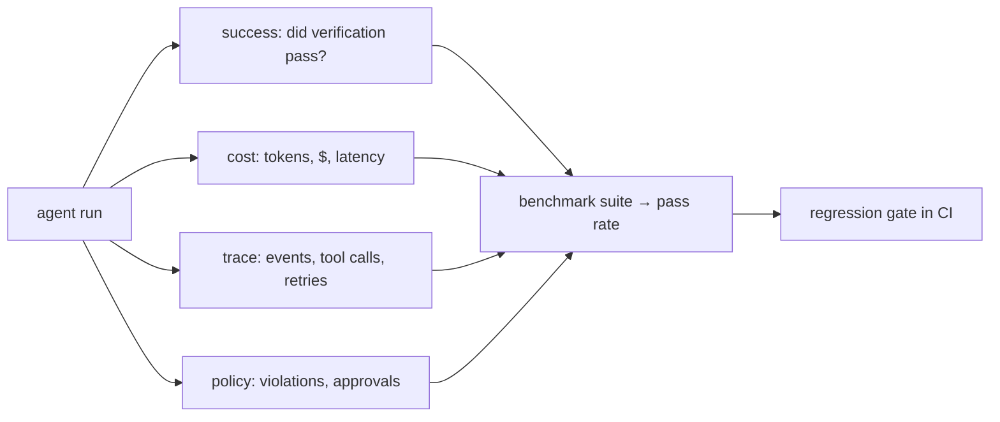

# 10 — Evaluation

## The one-sentence version

If you can't measure whether the agent did well, you can't improve it —
evals turn "seems smart" into regression-tested numbers.

## Analogy

Unit tests for non-deterministic systems: instead of asserting exact output,
you score outcomes across many runs and watch distributions, not single
samples.

## What to measure

- **Task success**: did the verifier say yes — with evidence?
- **Behavioral**: tool-call count, retries, iterations to converge.
- **Economic**: tokens in/out, latency, cost per success.
- **Governance**: policy denials, approval rate, violations.
- **LLM-as-judge**: a model scoring free-text outcomes — useful, but treat
  as a noisy metric, never as ground truth.

## In Naro

- The event log IS the eval data source: `events` carries iterations, tool
  calls, denials, verifications, cost-relevant observations.
- `Verifier` results are structured (`ok`, `evidence`, `reason`) — evaluation
  hooks read the same evidence the agent did.
- Phase 9 adds benchmark harnesses (OpenAI Evals-style tasks as Goals,
  scored by Verifiers) — the primitives already exist.

## Failure modes
- **Evaluating vibes**: "the answer looks right" → verifier evidence or it
  didn't happen.
- **Overfitting evals**: tuning prompts to the benchmark → holdout sets.
- **Single-run judgments**: flaky pass/fail → n runs, report rates.

## Security
- Include adversarial cases in evals: injection attempts, denied-permission
  requests, destructive probes — verify the agent refuses correctly.

## Scale
- Evals run the same runner with a `MockModel` or recorded traces for
  determinism — replay is built in because events are the record.
