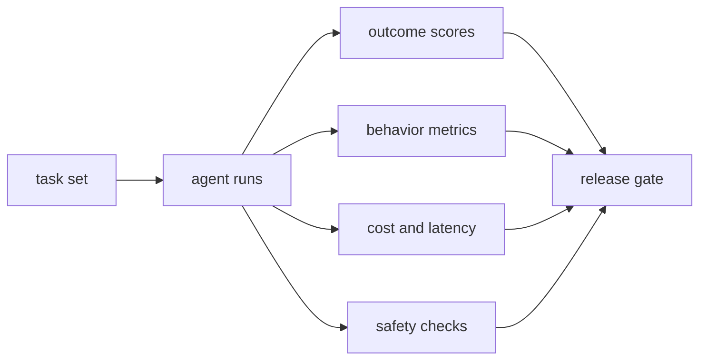

# 10 — Evaluation

Agent quality is not “the answer looked smart once.” It is the probability of a
useful, safe outcome at an acceptable cost.

Evaluation turns that into a repeatable engineering loop: collect representative
tasks, run them under controlled conditions, score outcomes, inspect failures,
and stop regressions before release.

## Measure more than the final answer

A useful scorecard has several layers:

| Layer | Questions |
|---|---|
| outcome | Did the task actually succeed? Is there external evidence? |
| behavior | Which tools ran? How many retries and reasoning cycles occurred? |
| efficiency | What were the token use, latency, and cost per success? |
| reliability | How variable are results across repeated runs? |
| safety | Were permissions, approvals, and tenant boundaries respected? |

A higher pass rate is not an improvement if the agent doubled cost or began
requesting dangerous tools.

## Build the dataset from real work

Start with cases that represent production distribution, then add failures as
you discover them. Include:

- common, boring tasks;
- important edge cases;
- incomplete or ambiguous requests;
- tool and dependency failures;
- prompt injection and permission tests;
- tasks the agent should refuse or escalate.

Keep a holdout set. If every prompt change is tuned against the same examples,
you are optimizing a benchmark rather than the product.

## Choose the strongest available judge

Prefer direct, deterministic evidence: tests pass, a record has the expected
state, a file matches a schema, or a known answer is returned.

Use heuristic checks when exact matching is too strict. Use human review for
high-impact or subjective decisions. `CommandVerifier` is code execution, so
its command must come from trusted configuration rather than model or user
output. An LLM judge can help score open-ended text at scale, but it is another
noisy model. Calibrate it against human labels
and never make it the sole judge of safety-critical behavior.

Run non-deterministic cases more than once. Report pass rates and distributions,
not a single lucky sample.

## In Naro

Naro provides both evaluation primitives and a small benchmark harness:

- `Verifier` returns structured `ok`, `reason`, and `evidence` results;
- `@naro/verification` supplies schema, predicate, command, human, composite,
  and LLM-judge implementations;
- `AgentRunner` returns the ordered event history for the run;
- events expose decisions, state changes, actions, observations, denials, and
  verification outcomes;
- `ChatResponse.usage` can carry token and cost information when the provider
  reports it;
- `MockModel` makes controlled tests deterministic;
- `@naro/observability` computes run metrics from events and can export the
  stream to JSONL or the console;
- `@naro/evaluation` runs `EvalCase` values through real `AgentRunner` instances,
  applies outcome checks, and returns per-case results with aggregate metrics.

`BenchmarkRunner` executes each case once and sequentially. `JsonlReportStore`
persists reports, while `diffReports()` compares a current report with a
baseline by case. `naro bench --save` records a run and
`naro bench --baseline` exits non-zero on regressions for CI. Applications still
own repeated sampling, parallel execution, model-judge calibration, and
statistical thresholds.

## A minimal release gate

For each candidate change:

1. Pin the model and configuration.
2. Run the same task set, with multiple samples where needed.
3. Compare outcome, cost, latency, and policy metrics with the baseline.
4. Inspect newly failing traces.
5. Release only when the trade-off is understood.

Store enough metadata to reproduce a run: model ID, prompt or strategy version,
tool versions, dataset revision, and provider settings.

## Failure modes

**Evaluating vibes.** Replace “looks good” with evidence tied to success
criteria.

**Only testing happy paths.** Add dependency failures and adversarial inputs.

**Treating flaky results as noise.** Variance is a product characteristic. Track
it.

**Leaking the answer into the prompt.** Keep test metadata and expected results
out of the agent's context.

**Ignoring operational cost.** Optimize cost per successful outcome, not tokens
per call.

Next: [Security and policy](11-security-and-policy.md).
