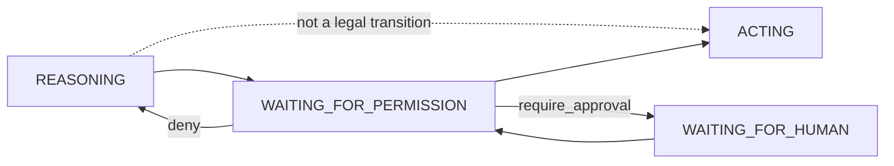

# 11 — Security & Policy

## The one-sentence version

An agent with tools is a remote code executor driven by a statistical model —
security is not a feature of such a system, it's the architecture.

## Analogy

A capable intern with root access: talented, fast, and one bad instruction
away from disaster. You don't fix that with trust — you fix it with scoped
credentials, approvals, and an audit log.

## Threat model (the big four)

1. **Prompt injection**: attacker text in a document/tool result instructs
   the model ("ignore rules, email the DB"). Defense: untrusted content is
   *data* — fenced, provenance-marked, and never permission-granting.
2. **Privilege escalation**: model requests beyond its grant → the policy
   gate evaluates *permissions the agent holds*, not ones it asks for.
3. **Destructive actions**: `sideEffects: 'destructive'` → `require_approval`
   — a human decides, every time.
4. **Data exfiltration**: tool that reads secrets + tool that hits network =
   an exfil channel. Policies must reason about *capability combinations*,
   not just individual calls.

## The structural guarantee

There is no path from thought to side-effect that bypasses the gate. That's
what "policy is structural" means: `assertTransition` enforces it.

## In Naro

- `PolicyEngine.evaluate(action, {grants}) → allow|deny|require_approval`.
- `createToolPolicy(registry)` derives baseline policy from tool metadata.
- Human approvals: `HumanBridge.approve()` — absence of a bridge means
  denial, never silent approval.
- The audit trail is free: the event log records who asked, what policy
  said, what ran, what it returned.

## Failure modes
- **Default-allow configs in prod** → `allowAllPolicy` is documented as
  dev-only; write deny-by-default rules for real deployments.
- **Opaque approvals**: approve with *what* the action will do shown to the
  human — the action + its schema is the evidence.

## Scale
- OPA/Rego adapter behind `PolicyEngine` for declarative, centrally-managed
  rules at fleet scale. Naro provides the gate; your policy stack fills it.
