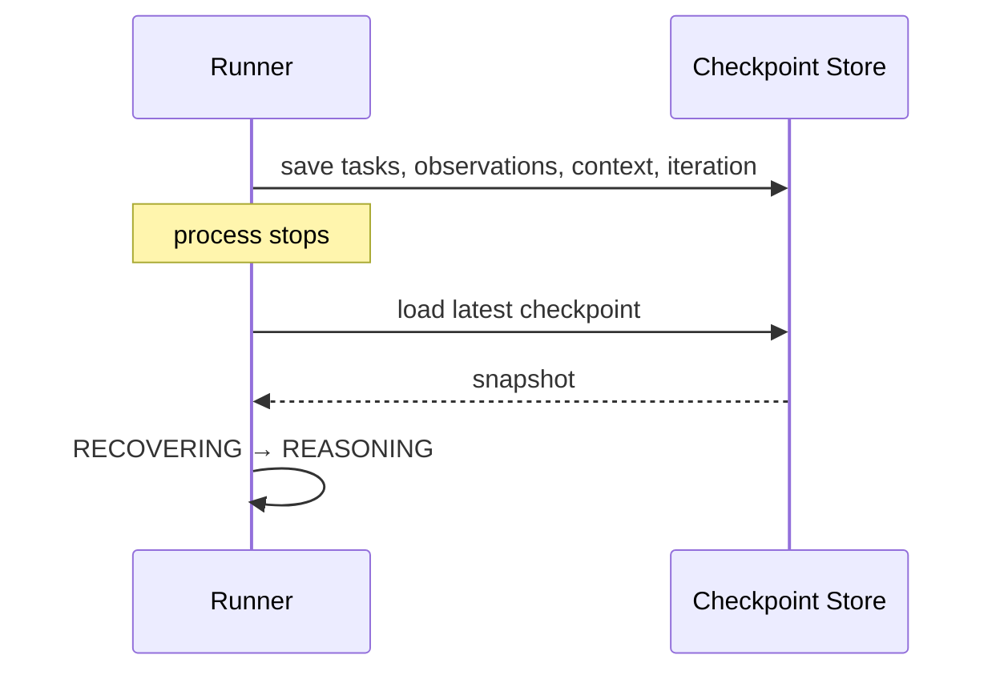

# 12 — Scale and Reliability

Agent systems combine slow model calls, flaky dependencies, side effects, and
loops whose length is not known in advance. Reliability starts by treating
timeouts, retries, cancellation, and recovery as normal control flow.

Scale is not only requests per second. You also scale context size, run
duration, tool concurrency, event volume, cost, and the number of failures that
can happen at once.

## The reliability layers

| Risk | Control |
|---|---|
| transient dependency failure | selective retry with backoff and jitter |
| hung operation | deadline plus cancellation |
| runaway reasoning | iteration, time, token, and cost budgets |
| process restart | checkpoints at safe boundaries |
| duplicate write | idempotency key and external operation record |
| provider outage | queueing, circuit breaking, or an evaluated fallback |
| silent wrong result | verification with external evidence |
| lost diagnosis | structured events and correlation IDs |

No single retry helper makes a system reliable. These controls work together.

## Retry only repeatable work

A retry policy should answer two questions: was the failure transient, and is
the operation safe to repeat?

Reads are often retryable. Writes may be retryable when they carry an
idempotency key. Destructive actions should not be repeated merely because a
client timed out—the server may have completed the first request.

Use exponential backoff and jitter to avoid a fleet retrying in lockstep. Put a
hard cap on attempts and total elapsed time.

## Timeouts and cancellation are different

A timeout decides that the caller will stop waiting. Cancellation asks the
underlying operation to stop. If a tool ignores `AbortSignal`, the agent may
move on while the side effect continues in the background.

Propagate cancellation through every adapter that can honor it. For external
systems that cannot be cancelled, record operation IDs and reconcile their
final state.

## Recovery needs a safe boundary

Naro checkpoints after completed reasoning cycles, never in the middle of tool
execution. On resume, the runner restores the latest snapshot and returns to a
reasoning boundary.

This avoids pretending that an in-flight side effect can be resumed from local
memory. It does not remove the need for idempotency: an external action may have
completed just before the process failed to record its observation.

## What Naro provides today

- `retry()` with attempt limits, exponential backoff, optional jitter, and a
  `shouldRetry` predicate;
- `withTimeout()` and `AbortSignal` propagation for action execution;
- `maxIterations`, defaulting to 64;
- `InMemoryCheckpointStore` and append-only `FileCheckpointStore`;
- ordered runtime events;
- `@naro/observability` metrics plus JSONL and console event exporters;
- optional token and cost fields in model `Usage`.

`AgentRunner.retry` applies to action execution. Model-call retry behavior
belongs in the reasoner or model adapter today. Naro does not yet include a
distributed queue, circuit breaker, OpenTelemetry exporter, hosted metrics
backend, or provider failover policy.

## Scaling dimensions

**Concurrency:** isolate per-run state. Bound global model and tool concurrency
so a traffic spike does not become a provider outage.

**Rate limits:** queue work and respect retry hints. Backpressure is better than
thousands of sleeping retries.

**Context and memory:** enforce budgets and retention. Storage growth and prompt
growth are separate problems.

**Events:** preserve ordering per run and choose a retention policy. Exporters
can subscribe to Naro's event bus without changing the runner.

**Provider fallback:** test it as a behavior change. A cheaper or available
model may support different capabilities and produce different decisions.

## Before production

- Define service-level objectives for successful tasks, not only API uptime.
- Test crash recovery and duplicate-action scenarios.
- Load-test the external bottlenecks: model quotas, tools, stores, and approval
  queues.
- Alert on iteration growth, denial spikes, retry storms, and cost per success.
- Version prompts, models, tools, policies, and checkpoint formats.
- Run failure drills with real cancellation and degraded dependencies.

The mature version of an agent is not the one that never fails. It is the one
that fails visibly, limits damage, and resumes from a state you can explain.

Return to [How LLMs work](00-how-llms-work.md), or move from concepts to the
repository's runnable examples.
