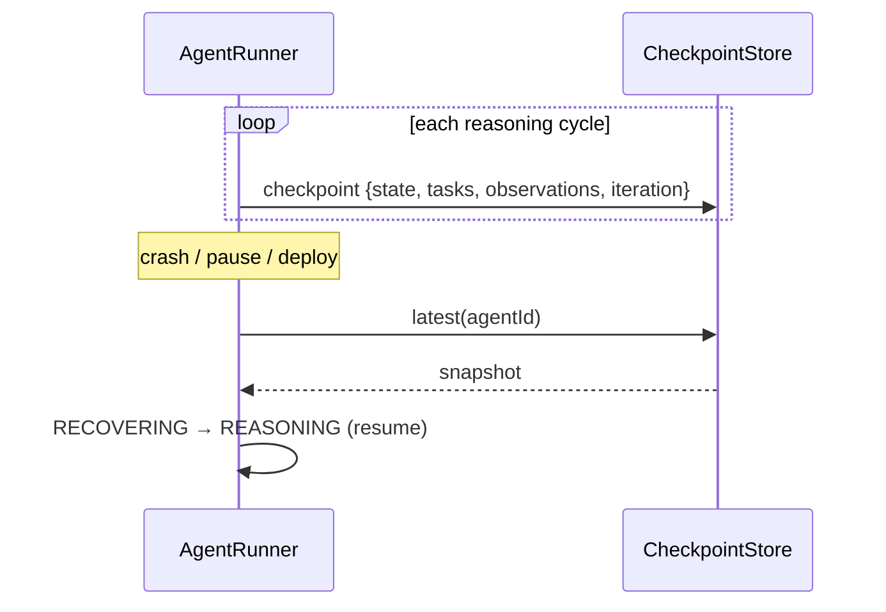

# 12 — Scale & Reliability

## The one-sentence version

Agents are long-running, flaky-dependency, expensive processes — reliability
means assuming failure and designing recovery into the loop itself.

## Analogy

Air travel: delays (timeouts), reroutes (retries), cancellations (aborts)
are normal operations, not exceptions — the system is built around them.

## The reliability stack

| Problem | Naro mechanism |
|---|---|
| transient tool/model failure | `retry(fn, policy)` — backoff + jitter + `shouldRetry` |
| hung call | `withTimeout` + `AbortSignal` into executors |
| process crash mid-run | `CheckpointStore` at reasoning boundaries → `resume` |
| runaway reasoning | `maxIterations` bounds every loop |
| cost blowout | `Usage` tokens on every response → budget policies |
| silent corruption | every action is an event; every result an observation |

## Scaling dimensions

- **Concurrency**: many agents = many runners; they're independent by design.
  Share `EventBus` history, not in-process state.
- **Model throughput**: providers rate-limit → retry with jitter, queue,
  fall back to a second provider behind `ModelProvider`.
- **Context/memory growth**: tiered stores (page 07) + budgets (page 06).
- **Fleet operations**: OTel adapters (Phase 9) export the same event stream
  to Prometheus/Grafana — the events are already structured.

## Failure modes worth engineering for
- Executor hangs → timeout converts it to a failed observation; the run
  survives and the reasoner sees the failure.
- Duplicate side effects on retry → prefer idempotent tools; declare
  `sideEffects` so policy knows which actions are unsafe to retry blindly.
- Checkpoint write failure → surface it; a run that can't checkpoint can't
  promise recovery.

## Honesty rule
Retry only what you can safely repeat. A `sideEffects:'write'` tool retried
blindly can double-write — policy + idempotency keys are the fix, and both
have seams already.
