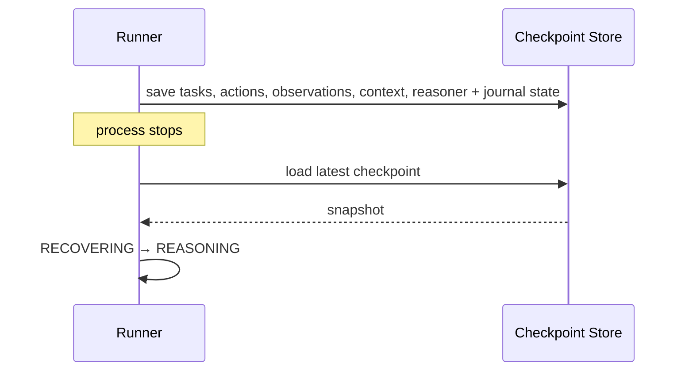

# 12 — Scale and Reliability

Agent systems combine slow model calls, flaky dependencies, side effects, and
loops whose length is not known in advance. Reliability starts by treating
timeouts, retries, cancellation, and recovery as normal control flow.

Scale is not only requests per second. You also scale context size, run
duration, tool concurrency, event volume, cost, and the number of failures that
can happen at once.

## The reliability layers

| Risk | Control |
|---|---|
| transient dependency failure | selective retry with backoff and jitter |
| hung operation | deadline plus cancellation |
| runaway reasoning | iteration, time, token, and cost budgets |
| process restart | checkpoints at safe boundaries |
| duplicate write | idempotency key and external operation record |
| provider outage | queueing, circuit breaking, or an evaluated fallback |
| silent wrong result | verification with external evidence |
| lost diagnosis | structured events and correlation IDs |

No single retry helper makes a system reliable. These controls work together.

## Retry only repeatable work

A retry policy should answer two questions: was the failure transient, and is
the operation safe to repeat?

Reads are often retryable. Writes may be retryable when they carry an
idempotency key. Destructive actions should not be repeated merely because a
client timed out—the server may have completed the first request.

Use exponential backoff and jitter to avoid a fleet retrying in lockstep. Put a
hard cap on attempts and total elapsed time.

## Timeouts and cancellation are different

A deadline aborts the action's child `AbortSignal`. Cancellation is cooperative:
if an executor ignores the signal, the operation may remain pending and the run
may not make progress. `SandboxedExecutor` has a stronger local mechanism—it
terminates the worker on timeout or abort.

Propagate cancellation through every adapter that can honor it. For external
systems that may commit before cancellation, record operation IDs and reconcile
authoritative state.

## Recovery needs a safe boundary

Naro checkpoints after completed reasoning cycles, never in the middle of tool
execution. On resume, the runner restores the latest snapshot and returns to a
reasoning boundary.

This avoids pretending that an in-flight side effect can be resumed from local
memory. It does not remove the need for idempotency: an external action may have
completed just before the process failed to record its observation.

The deeper point: the journal itself is sufficient. `AgentRunner.wake()`
rebuilds the session by replaying events — checkpoints only make hydrate
faster. That is the property that lets the session outlive any single
process: store the journal durably (SQLite, Postgres) and a new runner on a
new host can continue the run, hash chain intact.

## What Naro provides today

- `retry()` with attempt limits, exponential backoff, optional jitter, and a
  `shouldRetry` predicate;
- per-action deadlines that ABORT the executor through a child
  `AbortSignal` (a timed-out action is cancelled, not abandoned);
  timed-out actions are not auto-retried — their result is indeterminate;
- `maxIterations`, defaulting to 64;
- in-memory, JSONL, and transactional SQLite checkpoint stores;
- journal-native resume via `wake()` plus kernel-level `session.compacted`
  events for long-running sessions;
- `serveEnvironment`/`HttpEnvironment` for environments in a separate
  process or host;
- in-memory and SQLite runner leases for single-agent mutual exclusion;
- ordered runtime events through callbacks and `runner.events()` async
  iteration;
- `@naro/observability` metrics plus JSONL and console event exporters;
- `@naro/adapter-otel` for ordered OTLP/HTTP log export with `flush()`;
- optional token and cost fields in model `Usage`.

`AgentRunner.retry` applies to action execution. Model-call retry behavior
belongs in the reasoner or model adapter today. Durable storage arrived with
`SqliteCheckpointStore`, `SqliteEventStore`, and `SqliteMemoryStore` (FTS5
recall), plus `DurableAgentBus` — an at-least-once SQLite task queue where
pending work survives crashes and stale claims are reclaimed. What remains
in-process: circuit breakers and failover are `failover()`/`retrying()` model wrappers; hosted metrics and dashboards remain external.

## Distribution primitives

- **Shared quotas** — `RulePolicyEngine` accepts a `LimitStore`:
  `InMemoryLimitStore` per process, `SqliteLimitStore` shares caps across
  processes on one host (`BEGIN IMMEDIATE` serializes increments).
  Redis/Postgres implementations plug the same port for multi-host.
- **Runner leases** — `deps.lease: { store, ttlMs }` on `AgentRunner`:
  acquire on start, heartbeat through the loop, release on exit. A second
  runner for the same agent fails fast. A lost heartbeat emits a replan warning;
  the current runner is not forcibly stopped, so external fencing still matters.
  `InMemoryLeaseStore` and `SqliteLeaseStore` are provided.
- **Sharding** — `ShardedExecutor` routes by stable FNV-1a hash of the
  shard key (default `action.target`), so `env://tenant-x/...` always
  lands on the same executor instance; `routedBy` for explicit layouts.
- **A2A depth** — `message/stream` serves lifecycle SSE events
  (submitted → working → completed) and `tasks/cancel` marks stored
  tasks canceled; `requestStream` consumes them client-side.
- **OIDC** — `jwksVerifier` fetches an issuer's JWKS (discovery or direct
  URL), verifies RS256/ES256 JWTs with native crypto, pins iss/aud/exp,
  and refreshes keys on rotation. Wire it into `HttpAgentBus`'s
  `authenticate` hook.
- **Budgets** — `deps.budgets: { maxTotalTokens, maxCostUsd }` fails the
  run fast when accumulated `model.usage` crosses the cap.
- **Provider resilience** — `failover([m1, m2])` tries lanes in order with
  per-lane circuit breaking (`tripAfter`/`resetMs`, half-open probe);
  capabilities are the intersection, so a weaker fallback narrows — never
  inflates — the surface. `retrying(model)` adds transient-failure retry.
- **Releases** — changesets manage versioning (`npm run changeset`),
  `npm run release` gates publish on the full check + pack-check.

## Scaling dimensions

**Concurrency:** isolate per-run state. Bound global model and tool concurrency
so a traffic spike does not become a provider outage.

**Rate limits:** queue work and respect retry hints. Backpressure is better than
thousands of sleeping retries.

**Context and memory:** enforce budgets and retention. Storage growth and prompt
growth are separate problems.

**Events:** preserve ordering per run and choose a retention policy. Exporters
can subscribe without changing the runner; application code can consume the
same history-plus-live stream with `for await (const event of runner.events())`.

**Provider fallback:** test it as a behavior change. A cheaper or available
model may support different capabilities and produce different decisions.

## Before production

- Define service-level objectives for successful tasks, not only API uptime.
- Test crash recovery and duplicate-action scenarios.
- Load-test the external bottlenecks: model quotas, tools, stores, and approval
  queues.
- Alert on iteration growth, denial spikes, retry storms, and cost per success.
- Version prompts, models, tools, policies, and checkpoint formats.
- Run failure drills with real cancellation and degraded dependencies.

The mature version of an agent is not the one that never fails. It is the one
that fails visibly, limits damage, and resumes from a state you can explain.

Return to [How LLMs work](00-how-llms-work.md), or move from concepts to the
repository's runnable examples.
