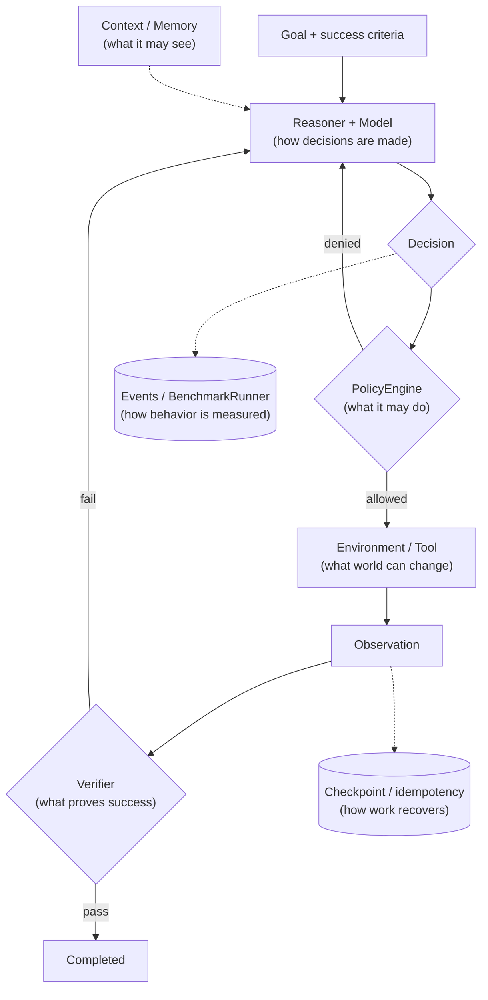

# End-to-End Use Cases

Naro keeps the runtime universal and puts domain behavior in profiles. Every
use case below follows the same control loop:

```text
Goal → Reasoner → Decision → Policy → Environment/Tool → Observation → Verifier
```

What changes is the world the agent can see, the capabilities it may request,
and the evidence required before completion.

## Composition checklist

Before choosing a profile, define these eight parts:

| Question | Naro boundary |
|---|---|
| What outcome is required? | `Goal` and success criteria |
| How are decisions made? | `Reasoner` and `Model` |
| What world can change? | `Environment` and `ToolRegistry` |
| What may the agent do? | grants and `PolicyEngine` |
| What information may it see? | `ContextProvider` and `MemoryReader` |
| What proves success? | `Verifier` |
| How does work recover? | `CheckpointStore`, idempotency, external operation IDs |
| How is behavior measured? | events, exporters, `BenchmarkRunner` |

Do not start by giving an agent every profile. Start with the smallest world and
narrowest grants that can achieve the goal.

The same eight parts, as the loop they actually run in:



Solid arrows are the control path every example below runs; dotted arrows
are the two boundaries (context in, measurement out) that sit beside the
loop rather than inside it.

---

## 1. Learn the loop: offline arithmetic

**Goal:** use a calculator and return `42`.

**Use:** `@naro/core`, `@naro/runtime`, `@naro/tools`, `MockModel`, and the
minimal example.

```bash
npm run example
```

This example is intentionally small. It demonstrates that a model proposes a
tool call, policy runs before execution, the tool produces an observation, and
a verifier—not the model—decides whether the result is acceptable.

**Production lesson:** understand this trace before adding a real provider or a
large tool catalog.

---

## 2. Coding agent: inspect and change a workspace

**Goal:** read project files, run a bounded command, make a change, and verify it.

**Profile:** `@naro/profile-coding`.

**World:** `WorkspaceEnvironment` provides jailed filesystem capabilities and
bounded shell execution. `codingTools(env)` exposes the same operations as
schema-validated tools for model-driven reasoning.

```ts
const env = new WorkspaceEnvironment({ root: repository }, 'workspace');
const registry = new ToolRegistry();
for (const tool of codingTools(env)) registry.register(tool);

const runner = new AgentRunner({
  spec,
  reasoner,
  executor: new CompositeExecutor({
    'env://': env,
    'tool://': new ToolExecutor(registry),
  }),
  policy,
  verifier: new CommandVerifier('npm test', { cwd: repository }),
  checkpoints,
});
```

Run the offline reference:

```bash
npm run example:coding
```

The snippet above is the shape of it; for every control below actually
wired together — a real model, approval gating, a real verifier, durable
stores, evidence export — see the
[production agent](../examples/production-agent/README.md), runnable
against a real repository with `npm run example:production`.

**Required controls**

- keep the workspace root jailed;
- deny or require approval for `shell.exec` and destructive file operations;
- source `CommandVerifier` commands from trusted configuration only;
- use a disposable checkout or OS sandbox for untrusted repositories;
- verify with tests, lint, build, or a domain predicate.

**Evidence:** changed files, command exit status, bounded stdout/stderr, and test
results.

---

## 3. Research agent: fetch, reason, and cite

**Goal:** answer a question using approved web sources with inspectable
citations.

**Profile:** `@naro/profile-research`.

```ts
const env = new ResearchEnvironment({
  allowedDomains: ['docs.example.com', 'standards.example.org'],
  maxBytes: 250_000,
});
const registry = new ToolRegistry();
for (const tool of researchTools(env)) registry.register(tool);
const policy = createToolPolicy(registry, { denyExternalTriggered: ['destructive'] });
```

The profile separates three operations: fetch a page, add a citation, and list
citations. A citation is refused when its URL was never fetched.

Run the offline reference:

```bash
npm run example:research
```

**Required controls**

- enforce domain allowlists in policy and in the environment;
- fetched text is enforced as untrusted: `web_fetch` observations carry
  `trust: 'external'`, the transcript delimits them, and
  `denyExternalTriggered` denies side effects the content triggered;
- reject or re-check redirects according to the threat model;
- cap bytes, pages, tool calls, and run duration;
- verify that important claims map to fetched evidence.

**Evidence:** fetched-page provenance and a citation trail tied to claims.

---

## 4. Browser agent: interact with an approved site

**Goal:** navigate, enter data, extract a result, and capture evidence.

**Profile:** `@naro/profile-browser` over `BrowserDriver`. The included
`PlaywrightDriver` is optional; test doubles can implement the same port.

```ts
const driver = await PlaywrightDriver.launch({ headless: true });
const env = new BrowserEnvironment({
  driver,
  allowedDomains: ['portal.example.com'],
});
```

**Required controls**

- allowlist navigation destinations inside the environment;
- distinguish read operations from clicks and form submissions in policy;
- require approval before purchases, messages, deletion, or irreversible forms;
- treat page text as untrusted;
- retain screenshots or extracted state as verification evidence.

**Evidence:** final URL/title, extracted values, and screenshots where needed.

---

## 5. Data agent: query without granting accidental writes

**Goal:** inspect schema, run parameterized reads, and optionally perform a
reviewed write.

**Profile:** `@naro/profile-data` with `SqlDriver`; `NodeSqliteDriver` is the
included local implementation.

```ts
const driver = new NodeSqliteDriver(databasePath);
const env = new DataEnvironment({ driver, maxRows: 500 });
```

The profile makes the read/write split structural:

- `sql.schema` inventories tables and columns;
- `sql.query` accepts read statements;
- `sql.exec` accepts writes and DDL.

**Required controls**

- grant `sql.query` independently from `sql.exec`;
- require bound parameters rather than interpolated values;
- enforce tenant filters outside the model;
- cap rows and execution time;
- verify writes by reading authoritative state back.

**Evidence:** normalized result rows, truncation metadata, affected-row counts,
and post-write checks.

---

## 6. DevOps agent: operate through runbooks, not a shell

**Goal:** diagnose a service and invoke an approved operational procedure.

**Profile:** `@naro/profile-devops`.

```ts
const env = new DevOpsEnvironment({
  tasks: [{
    name: 'deploy',
    description: 'deploy one service',
    argv: ['deploy.sh', '{service}', '{environment}'],
    params: {
      service: '^[a-z-]+$',
      environment: '^(staging|prod)$',
    },
    sideEffects: 'destructive',
  }],
  probeAllowlist: ['status.example.com'],
});
```

The model selects a named runbook and validated arguments. It never invents an
arbitrary production shell command.

**Required controls**

- keep runbooks in reviewed configuration;
- validate each substituted argument;
- require approval for production or destructive runbooks;
- use idempotency keys and deployment IDs;
- export events through OTLP and verify service health after execution.

**Evidence:** runbook exit result, deployment ID, health probe, and approval
event.

---

## 7. Deterministic workflow with agentic steps

**Goal:** execute a known DAG while reserving model judgment for selected steps.

**Profile:** `@naro/profile-workflow`.

```ts
const env = new WorkflowEnvironment({ executor, policy });
```

`workflow.validate` checks duplicate IDs, unknown dependencies, and cycles.
`workflow.run` executes topologically, substitutes `$step` outputs, retries
configured steps, and fails fast. The nested policy is required: every step is
evaluated before its executor runs, so a workflow cannot hide actions behind
one outer `workflow.run` permission. Nested `require_approval` resolves as deny
because the workflow has no human interaction channel.

Use a workflow when ordering is known and should be deterministic. Use a
reasoner when the next step depends on evidence discovered at runtime. A real
system can combine them: an agent chooses or prepares a workflow, then the
workflow engine executes it predictably.

**Evidence:** completed step IDs, failed step, and each nested observation.

---

## 8. Robotics agent: sense, plan, act, and stop safely

**Goal:** move toward a target while respecting obstacles, battery, and an
emergency-stop latch.

**Profile:** `@naro/profile-robotics` over `RobotDriver`. `GridSimDriver`
provides a deterministic world model suitable for tests and tree search.

**Reasoning:** `TreeSearchReasoner` can explore simulated transitions before
returning one runtime decision.

**Required controls**

- keep `robot.estop` available even when normal actions are denied;
- gate `robot.reset` and movement separately;
- enforce physical limits below the model and runtime;
- bound search depth, branch width, time, and energy;
- verify sensed state after every physical action.

**Evidence:** sensor observations, selected path, actuator result, estop state,
and final pose.

---

## 9. Multi-agent delegation

**Goal:** let a lead agent delegate a narrow goal to a specialist without
bypassing policy.

**Packages:** `@naro/multiagent` plus either an in-process, HTTP, or A2A
transport.

```ts
const directory = new AgentDirectory();
directory.register({
  id: 'researcher',
  name: 'Researcher',
  capabilities: ['research'],
});

const bus = new HttpAgentBus({ resolve: (id) => endpoints.get(id) });
registry.register(delegationTool(bus, 'lead-agent', directory));
```

For protocol-level discovery and JSON-RPC task exchange, use
`@naro/adapter-a2a`. It implements agent cards and the synchronous
`tasks/send` subset.

**Required controls**

- require `agent.delegate`;
- send a bounded goal and selected context, not the full parent transcript;
- authenticate and encrypt cross-process transport;
- apply budgets and delegation-depth limits;
- verify child output before the parent trusts it;
- pass the parent's `traceId` (`delegationConstraints(goal).traceId`) into
  the child's `AgentRunner.run({ traceId })` so both journals correlate —
  each keeps its own independent hash chain, but an auditor can still walk
  a whole delegation tree by trace.

**Evidence:** delegation action, target agent identity, child result or error,
parent-side verification, and — across the delegation chain — a shared
`traceId` linking every participant's independently verifiable journal.

---

## 10. Governing a foreign coding harness: Naro governing its own development

**Goal:** get an audit trail out of a coding agent you didn't build — here,
Claude Code sessions working on Naro's own source.

**Package:** [`dogfood/`](../dogfood/README.md), built on
`@naro/adapter-harness` (see [ADR 0009](adr/0009-governance-beneath-foreign-harnesses.md)).

Unlike every other use case on this page, there is no `AgentRunner` here —
Claude Code owns the loop entirely. `HarnessKernel` sits beneath it via
`PreToolUse`/`PostToolUse` hooks: every `Bash` call is evaluated against a
policy before it runs, and the verdict plus the result are journaled,
hash-chained, exactly like an in-kernel run.

```ts
const kernel = harnessKernel({ agentId: 'claude-code-session', goal, policy });
const hooks = claudeHooks(kernel);
// PreToolUse  → hooks.preToolUse  → {} (allow) or a deny/ask decision
// PostToolUse → hooks.postToolUse → journals the result, joined by call id
```

Because each hook invocation is a fresh OS process, the kernel lives behind
a small loopback HTTP server (`dogfood/src/server.ts`) for the session's
lifetime — the same shape as `serveEnvironment`/`HttpEnvironment` (ADR
0008), applied to a harness adapter instead of an `Environment`.

**Required controls**

- gate only what's actually dangerous — here, `Bash`, matching
  `profiles/coding`'s own "shell.exec is the dangerous one";
- deny irreversible/security-bypassing patterns structurally (force-push,
  hard reset, hook-bypass flags), not as a prompt instruction to remember;
- require approval, not silent allow, for anything touching shared or
  published state (push to the default branch, publish, merge a PR);
- **fail open** on gate-server errors — a governance bug must never be able
  to lock out the very session it's supposed to be observing; this makes
  it an audit-and-advise layer today, not yet a hard security boundary;
- keep the correlation honest: without a stable per-call id from the
  harness, `PostToolUse` joins to the oldest pending gated action (FIFO) —
  correct for sequential tool calls, and documented as approximate for
  parallel ones.

**Evidence:** a hash-chained `.naro/dogfood-journal.jsonl` —
`naro verify` prints policy verdict → action → observation per Bash call,
the same evidence record a fully in-kernel run would produce.

---

## 11. Provider, policy, and operations choices

These choices are independent from the domain profile:

| Need | Implementation |
|---|---|
| OpenAI-compatible endpoint | `@naro/adapter-openai` |
| Anthropic Messages API | `@naro/adapter-anthropic` |
| Gemini `generateContent` | `@naro/adapter-gemini` |
| MCP tool server | `@naro/adapter-mcp` |
| local policy rules | `@naro/policy` |
| centrally managed Rego | `@naro/adapter-opa` |
| JSONL or console events | `@naro/observability` |
| OTLP/HTTP logs | `@naro/adapter-otel` |
| benchmark and baseline diff | `@naro/evaluation` + `naro bench` |
| replacement adapter confidence | `@naro/contract-tests` |

Model adapters and profiles compose through contracts; choosing Anthropic does
not require an Anthropic-specific coding profile, and choosing OPA does not
change the runtime.

## Production readiness review

Before shipping any use case, confirm:

- an explicit policy covers every target scheme;
- credentials are secret references resolved only at execution;
- hostile code runs in container-level isolation, not only worker threads;
- external writes enforce idempotency keys or are reconcilable;
- a runner lease prevents concurrent execution of the same agent;
- every network and filesystem destination is bounded;
- model, tool, context, iteration, time, and cost budgets exist;
- verification checks authoritative evidence;
- events are redacted, exported, flushed, and retained appropriately;
- checkpoints use a durable store when recovery matters;
- a benchmark covers normal, failure, adversarial, and refusal cases;
- the chosen adapters pass their shared contract suites.
