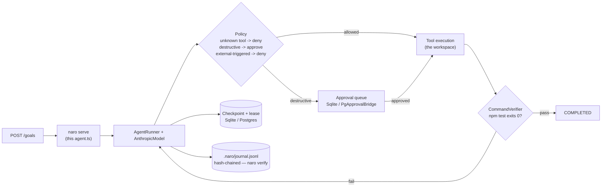

# production-agent

The reference deployment: a coding agent wired with everything the other
examples show in isolation, put together as one thing you could actually
run against a real repository.

```bash
ANTHROPIC_API_KEY=sk-... npm run example:production
```

That starts `naro serve` on port 8080. Everything else in this README is
about what's different from `examples/coding-agent` and why.



Every box above is a row in the claims table below — this isn't a
simplified picture drawn separately from the code, it's the same nine
claims laid out as a path instead of a list.

## What this example claims, and where the code proves it

| Claim | Where | Verified by |
|---|---|---|
| A real model, not MockModel | `agent.ts` → `AnthropicModel` | reading `ANTHROPIC_API_KEY`; fails loudly, not silently, without it |
| Destructive actions require approval | `createToolPolicy(registry, { approvalFor: ['destructive'] })` | `agent.test.ts`: a `run_command` call blocks on `HumanBridge.approve` before completing |
| Evidence triggered by external input is denied, not just gated | `denyExternalTriggered: ['destructive', 'write']` | ADR 0010 — the shape of a prompt-injection defense, kernel-enforced |
| Unknown tools deny outright | `unknownTool: 'deny'` | `agent.test.ts`: a hallucinated tool name is denied; the reasoner recovers and retries |
| Completion is verified, not claimed | `atCompletion(new CommandVerifier(...))` | `NARO_VERIFY_COMMAND` (default `npm test --silent`) must exit 0 before the run can complete |
| Durable across a process restart | `stores.ts` → `SqliteCheckpointStore` / `PgCheckpointStore` | same contract either way — see `docs/architecture.md` §12 |
| One driver per agent, even with N replicas | `lease: { store: opts.stores.lease }` | `PgLeaseStore.acquire` — a lost lease surfaces as a replan, not a double-run |
| The approval queue is shared across replicas | `stores.ts` → `PgApprovalBridge` when `NARO_PG_URL` is set | `naro approvals --db` / `GET /approvals` answers the same pending set on any replica |
| The run is auditable evidence, not a debug log | `pipeTo(runner, new JsonlExporter(...))`, optionally `OtlpExporter` | `.naro/journal.jsonl` — hash-chained; `naro verify` checks it |

## Running it

**Locally, against a real workspace:**

```bash
export ANTHROPIC_API_KEY=sk-...
export WORKSPACE_ROOT=/path/to/a/real/checkout   # defaults to cwd — set this
node cli/src/bin.ts serve examples/production-agent/src/agent.ts
```

Then:

```bash
curl -X POST localhost:8080/goals -H 'content-type: application/json' \
  -d '{"description": "add a .gitignore entry for *.log"}'
```

`run_command` (and `delete_file`) will pause the run waiting for approval —
answer it with `naro approvals --db .naro/approvals.db` (SQLite) or
`GET /approvals` / `POST /approvals/:id` (either tier).

**Multi-host, with Postgres** — this is [`deploy/compose.yml`](../../deploy/compose.yml)'s
topology, pointed at this module instead of a mounted one. The
`Dockerfile` already `COPY . .`s the whole repo, so this file is in the
image at build time — no mount needed, just override the command:

```bash
docker compose -f deploy/compose.yml run --rm -p 8080:8080 \
  -e ANTHROPIC_API_KEY \
  naro serve examples/production-agent/src/agent.ts --host 0.0.0.0 --port 8080
```

`NARO_PG_URL` is already set by the compose file for the `naro` service —
every store in the table above (checkpoints, lease, limits, approvals)
switches to its Postgres implementation automatically; nothing in
`agent.ts` changes.

**With OTLP observability:**

```bash
export OTLP_ENDPOINT=http://localhost:4318
```

Every event streams to your collector as a log record (`@naro/adapter-otel`)
in addition to the always-on `.naro/journal.jsonl` export.

## What's still your job

This is a reference, not a managed platform — see
[`docs/production-readiness.md`](../../docs/production-readiness.md) for
the full list. The two that matter most for this specific example:

- **Workspace isolation.** `WORKSPACE_ROOT` points every run at the same
  directory. Fine for one operator running sequential goals against their
  own checkout; wrong for concurrent or untrusted goals, which need a
  disposable checkout or container per run.
- **Secrets beyond the model key.** `ANTHROPIC_API_KEY` comes from the
  environment here. A real deployment should pull it from a secrets
  manager and never let the agent observe it — `AgentDeps.secrets`
  resolves references at exec time precisely so tool code never sees the
  raw value.

## Tests

`agent.test.ts` proves the composition — not the network call. It injects
a `MockModel` (same substitution every example in this repo makes) and
asserts on real runtime behavior: the approval gate actually blocks until
answered, an unknown tool is denied rather than silently skipped, and the
reasoner recovers from that denial instead of failing the run.

```bash
node --test examples/production-agent/src/agent.test.ts
```

## Next exercises

- Swap `CommandVerifier('npm test')` for a verifier suited to your stack —
  a lint command, a type-check, a smoke test against a staging deploy.
- Add `limitCalls('tool://run_command', 20, 60_000)` (via `allOf` with the
  existing policy) to cap shell invocations per minute.
- Point `context` at a real `RepoContextSource` so the agent starts every
  run knowing the repo's own `AGENTS.md` and git state
  (`@naro/profile-coding`).
- Read [`docs/deploy.md`](../../docs/deploy.md) for the full topology
  writeup this example is topology 2 of.
