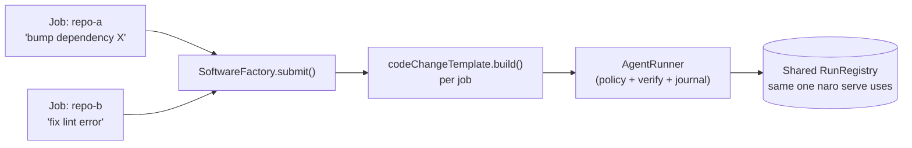

# @naro/factory

A queue of policy-gated, verified code-change jobs across one or more
workspaces — the piece that turns `@naro/templates`' `code-change` template
from "one agent, one task" into "many tasks, one shared record of what
happened and why."



## What this is

An application of the kernel, in the same spirit as `dogfood/` — it owns no
state transition `AgentRunner` doesn't already own. All it adds is fanning a
batch of jobs out to independent runners and giving each a shared name
(`factory:<repo>:<job id>`) so the registry groups them.

```ts
import { SoftwareFactory } from '@naro/factory';
import { InMemoryRunRegistry } from '@naro/runtime'; // or Pg/SqliteRunRegistry
import { ollamaCheapTier } from '@naro/adapter-openai';

const factory = new SoftwareFactory({
  cheap: ollamaCheapTier({ model: 'qwen2.5:3b' }).model,
  registry: new InMemoryRunRegistry(),
});

const { runId } = factory.submit({
  id: 'bump-lodash', repo: 'lifekeel',
  task: 'Bump lodash to the latest patch release and fix any resulting type errors.',
  workspaceRoot: '/disposable/checkout/of/lifekeel',
  verifyCommand: 'pnpm check',
});

factory.status('bump-lodash'); // { status: 'running' | 'completed' | 'failed', ... }
```

Every job is policy-gated (`approvalFor: ['destructive']`,
`denyExternalTriggered`) and verified by actually running the command you
give it — not a model's claim that it's done. Every job's evidence record
(`buildEvidence()`, `naro verify`) is identical in shape to any other Naro
run, because it IS one.

## What this is not

- **Not a scheduler.** No retry policy, no priority queue, no concurrency
  limit. Submit as many jobs as your process and `AgentDeps.budgets` can
  actually run — that ceiling is yours to set, not this class's to manage.
- **Not a dispatcher to an external harness session.** This runs Naro's own
  reasoner loop against `codeChangeTemplate`. Governing an *existing*
  Claude Code or Devin CLI session (a human or that harness's own planner
  driving, not Naro) is `HarnessKernel` + `@naro/adapter-harness`'s shape
  mappers — a different composition for a different case. A real "software
  factory" across contributors on different harnesses uses both: this
  package for the autonomous slice of work, `HarnessKernel` under whichever
  harness a human is actually driving.
- **Not a UI.** Point `naro serve`'s `/runs` and `/runs/:id/evidence` (or
  the chat-ui console) at the same `RunRegistry` this factory writes to,
  and every job shows up there for free — no separate dashboard to build.

## Honest scope

Verifier quality is still the whole product, same caveat PRD-002 makes for
the finance templates: a `pnpm check` that passes on an unchanged workspace
proves nothing. Pick a `verifyCommand` that actually exercises the task, and
treat a job whose only check is "the build didn't break" as weaker evidence
than one with a command built for that specific change.
