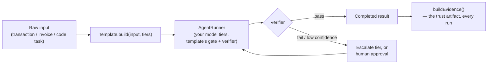

# @naro/templates

Pre-built, pre-verified outcome bundles — PRD-002's answer to "a small
business can't assemble a kernel." Each template packages the composition
`docs/use-cases.md` asks every Naro application to define:

> goal shape + tool set + policy + verifier + budget + tier config

The template supplies all of that *except the models* — the caller owns
the reasoner tiers, so the same template runs on a laptop or a fleet.



Nothing above is template-specific plumbing you have to write — `build()`
returns a ready `AgentRunner` config; the verifier, policy, and evidence
path are the same kernel machinery every Naro agent uses, just pre-wired to
a real business outcome instead of assembled by hand. See the root
[README's worked example](../README.md#from-ai-call-to-provable-outcome)
for `invoice-extractor` run end to end.

## Usage

```ts
import { AgentRunner } from '@naro/runtime';
import { transactionCategorizer } from '@naro/templates';
import { ollamaCheapTier } from '@naro/adapter-openai';

const cheap = ollamaCheapTier({ model: 'qwen2.5:3b', capabilities: verified.capabilities });

const runner = new AgentRunner(transactionCategorizer.build(
  {
    transaction: { description: 'UBER *TRIP 8832', amount: 24.50 },
    categories: ['Meals & Entertainment', 'Office Supplies', 'Travel'],
    history: [{ description: 'UBER *TRIP 1021', category: 'Travel' }],
  },
  { cheap: cheap.model, strong: frontierModel /* optional escalation */ },
));
const result = await runner.run();   // → { status: 'completed', result: 'Travel' }
```

Every run produces the kernel's evidence record (`buildEvidence`) — the
trust mechanism, not a nice-to-have.

## What a template guarantees

- **The verifier is the template.** A completion claim only completes if
  the verifier passes — a category outside the allowed set fails and
  triggers replanning/escalation, not a wrong-but-confident finish.
- **Least privilege by construction.** `transaction-categorizer` and
  `invoice-extractor`'s tools are read-only and gated on a template-scoped
  grant (`finance.categorize`); the composed policy denies every other
  target, so a hallucinated `tool://` call can never execute. `code-change`
  has real write/delete/shell capability — for that template, least
  privilege instead means a jailed `WorkspaceEnvironment` plus
  `approvalFor: ['destructive']` and `denyExternalTriggered`, the same
  defense `examples/production-agent` uses, not read-only tools.
- **Cost is declared before running.** `template.outcome` states the
  expected spend and success threshold; `build()` enforces the budget via
  `AgentDeps.budgets` (the run fails fast past the cap).
- **Escalation is built in.** Pass `strong` and verification failures
  (including low self-reported confidence below the floor) push the run
  up a tier via `EscalatingReasoner`.

## Templates

| id | version | outcome | verifier |
|---|---|---|---|
| `transaction-categorizer` | 0.1.0 | bank/card transaction → chart of accounts | category ∈ allowed set + confidence floor |
| `invoice-extractor` | 0.1.0 | document text → {vendor, date, lineItems, total} | schema-valid **and** arithmetically reconciled |
| `code-change` | 0.1.0 | a coding task against a real, jailed workspace → a change on disk | the project's own check command exits 0 — a real `CommandVerifier`, not a model claim |

`code-change` is the odd one out, deliberately: it's the only template whose
tools have real write/delete/shell side effects, and its verifier runs an
actual shell command against the actual workspace rather than checking the
model's text output. It packages the exact composition
`examples/production-agent` wires by hand
(`@naro/profile-coding` + policy's `approvalFor`/`denyExternalTriggered` +
`CommandVerifier`) so a caller states a task and a disposable workspace
instead of assembling that composition from scratch. See
`templates/src/code-change.test.ts` for the three behaviors that make it
trustworthy: a real file change the verify command actually depends on, a
destructive action (`run_command`) blocked on approval, and a verification
failure that blocks completion even when the model claims success.

Templates version independently — improving one never forces re-testing
the others (PRD-002 req 4).
